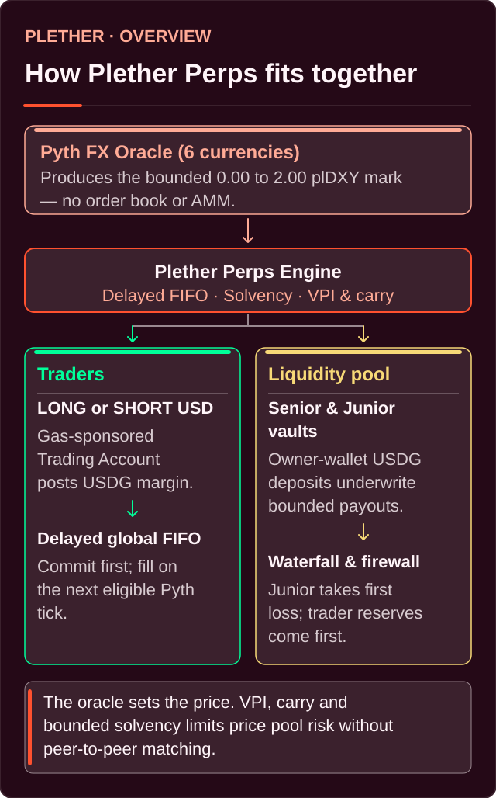

# What is Plether Perps DEX?

> **Trade and hedge U.S. dollar strength onchain.**
>
> Margined and settled in USDG. Bounded payouts. Solvency-checked entry. Delayed oracle execution.

Holding dollars feels neutral. It isn’t.

Most of onchain finance is denominated in dollars. If you hold USDG while earning, spending, or reporting in another currency, moves in the dollar change your purchasing power. That exposure is a position whether you chose it or not.

Plether makes that position explicit.

**Plether Perps DEX** is an onchain perpetual market for trading the strength of the U.S. dollar against a transparent basket of six major currencies (EUR, JPY, GBP, CAD, SEK, CHF).

| Position | Your view | Profits when |
| --- | --- | --- |
| **LONG USD** | The dollar will strengthen | The dollar gains against the six-currency basket |
| **SHORT USD** | The dollar will weaken | The dollar loses against the six-currency basket |

Positions have no scheduled expiry. They stay open until you close them or a keeper liquidates them if the account drops below its maintenance requirement.

> **Active testnet deployment**
>
> Plether Perps DEX and LP Vaults are live on **Arbitrum Sepolia** (`chainId: 421614`) at [app.sepolia.plether.com](https://app.sepolia.plether.com) using **MockUSDG** (a test token with no real-world value). The primary domain [app.plether.com](https://app.plether.com) currently serves the legacy Ethereum `/spot` interface (`plDXY-BULL` / `plDXY-BEAR` in USDC).

### The big picture

Plether does not match traders on an order book or price trades on an AMM curve. Instead, three parts work together:

1. **Pyth FX feeds** supply the underlying exchange rates for the Plether Dollar Index.
2. **Traders** post USDG margin and commit delayed LONG USD or SHORT USD orders. Eligible trading actions are **gas-sponsored** through a derived Plether Trading Account—no Arbitrum Sepolia ETH required for trading or test funding.
3. **A shared USDG liquidity pool**—funded by **Senior** and **Junior** LP vaults—takes the economic other side of every position.

### Why Plether is built this way

* **Solvency before volume:** The index settles inside a fixed **`0.00–2.00`** range, so the protocol calculates every position's worst-case payout before accepting it. If pool backing cannot cover aggregate worst-case payouts plus a buffer, new risk is rejected.
* **No counterparty auto-deleveraging (ADL):** Plether never forcibly trims your profitable position to cover another trader's loss.
* **Carry instead of peer-to-peer funding:** Rather than unpredictable trader-to-trader funding swings, positions pay continuous **carry** for using LP-backed payout capacity.
* **Two LP risk layers:** **Junior** LPs absorb losses first in exchange for residual trading revenue; **Senior** LPs target a coupon funded from Junior value and take losses only after Junior is exhausted. **Liability is the product. Return is what LPs receive for underwriting it.**
* **FX market hours:** Global FX closes over weekends. New risk is blocked during scheduled close-only windows, while closes and liquidations remain available under explicit rules.

### Where to go next

* **New here?** Read [How Plether works in 5 minutes](welcome/how-plether-works-in-5-minutes.md), then skim [Key risks at a glance](welcome/key-risks-at-a-glance.md).
* **Ready to trade?** Follow the [Trader quickstart](trader-quickstart.md) (takes under 5 minutes with free test USDG) and check [Plether Divisions](get-started/plether-divisions.md).
* **Providing liquidity?** Start with the [Liquidity provider quickstart](liquidity-provider-quickstart.md).
* **Building bots or verifying contracts?** Jump to [AI trading agents](welcome/ai-trading-agents.md) or [Deployments, contracts and live parameters](reference/deployments-and-parameters.md).
