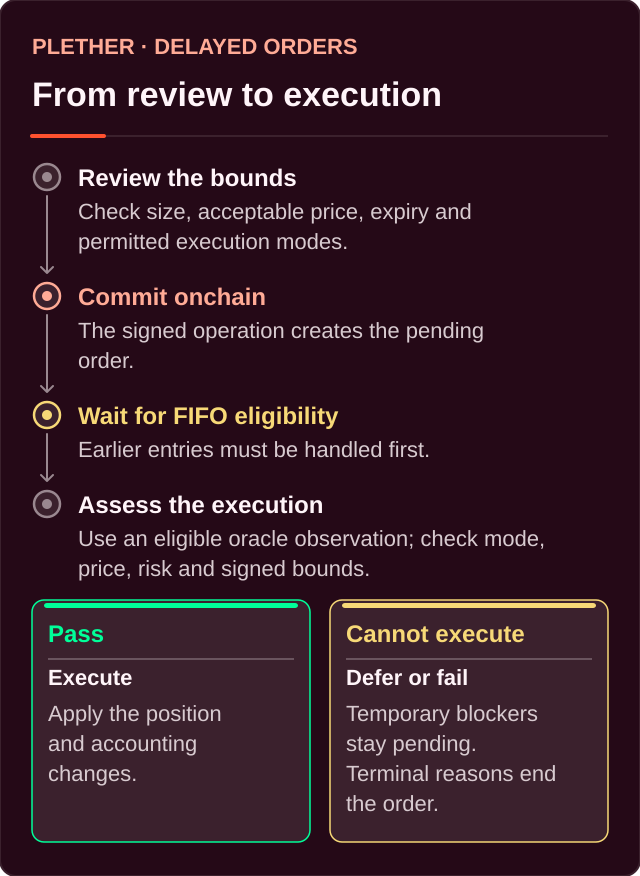
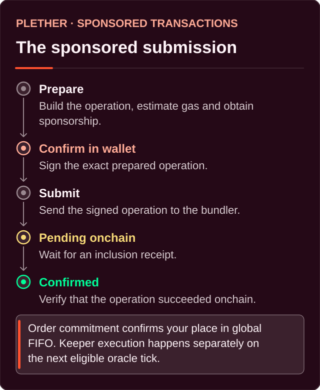
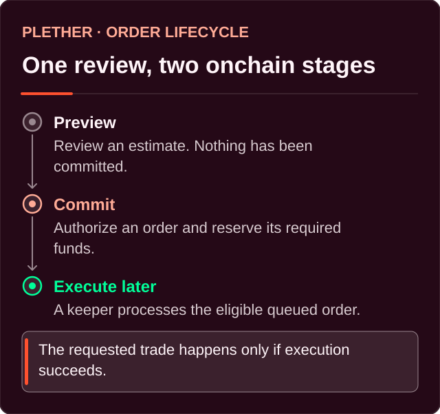
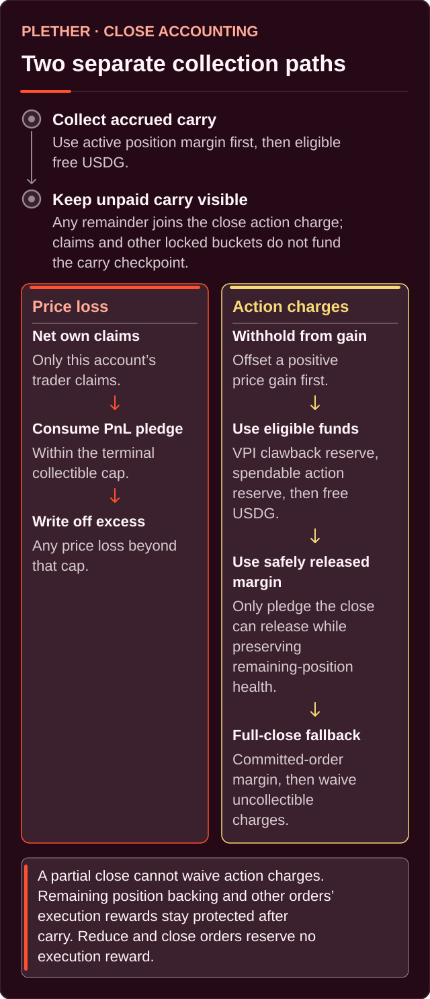

# How orders execute

Plether executes trades through **delayed, oracle-settled[^oracle] global FIFO[^fifo] execution** — never an order book or AMM[^amm].

**Commit first. Price second.** You commit direction, whole-lot quantity, margin and an acceptable-price limit before the fill price is known. After the commitment lands onchain, the order settles under the oracle regime active at execution:

* **Live & FAD-only:**[^fad] First eligible Pyth basket observation strictly after commitment, shifted adversely by `0.25×` basket confidence.
* **`oracleFrozen` voluntary close:** Latest validated frozen basket (up to `3-day` staleness), unshifted plus the separate `50 bps`[^bps] frozen-close spread.



For oracle confidence and staleness rules, see [Oracle & execution model](oracle-and-execution-model.md). For automated exits that add a trigger stage before queuing a close, see [Take profit and stop loss](../trading-on-plether-perps/take-profit-and-stop-loss.md).

## Two separate lifecycles: sponsorship vs delayed execution

1. **Sponsored commitment:** Your owner wallet signs a prepared Trading Account operation and Plether's bundler submits it onchain. **Confirmed** here means only that the order was committed — not that the trade filled.



2. **Delayed keeper execution:** A separate permissionless keeper[^keeper] transaction supplies Pyth data and executes the order (or cleans it up after expiry).



## 1. Preview the order

Before commitment, **Commit Preview** snapshots the estimated result from current state, including direction, **Order exposure**, **Order quantity**, margin, leverage, **Execution limit**, adverse oracle confidence spread, **Estimated fee** (`0.04%`), **VPI: Pay / Receive**[^vpi], opening execution reward (`0.01–0.20 USDG` on opens/increases; `0` on closes), **Liquidation price** and **Execution protections** (including `submitBy` validity and the `60-second` execution deadline).

On voluntary reductions and closes, the close preview also projects **Commitment carry**, **USDG after execution**, **Trader claim after execution**, **Position VPI balance**, and — if `oracleFrozen` is active — **Assessed / Paid / Waived spread** (`assessed = paid + waived`).

### Order quantity

**Order quantity** is the `plDXY` quantity committed onchain. Opens, increases and partial reductions require whole **`100 plDXY` lots** (minimum open notional `1,000 USDG`[^usdg]); the interface rejects non-lot quantities instead of silently rounding them.

```text
Order exposure = Order quantity × current displayed plDXY price
```

An explicit full close with no earlier pending orders uses your exact live position quantity directly (selecting **Current Position**, **Max** or the Position close button leaves zero rounding dust). If earlier orders are still pending, **Max** targets only the projected remainder and is treated as a conditional reduction rather than a guaranteed full close until earlier orders finish.

**Previews are estimates, not locked quotes:**

| Fixed at commitment | Determined at execution |
| --- | --- |
| Direction, open vs reduce/close | Eligible Pyth observation & active market state |
| Exact `plDXY` quantity (100-lot increments) | Final execution price & USDG notional[^notional] |
| Margin to assign & acceptable-price limit | Execution fee (`0.04%`), signed VPI, carry[^carry] & frozen spread |
| `submitBy` (`+120s`) & `executionWindowSeconds` (`60s`) | Resulting account health, payout destination or trader claim |
| Opening execution reward (opens/increases only) | Whether the order executes, fails or stays Pending |

## 2. Commit the order (binding & non-cancellable)

Confirming **Confirm Commit** submits your signed sponsored operation. Order V3 pins `submitBy = confirmationBlock + 120s` (with `45s` sign and `30s` relay client guards) and `executionWindowSeconds = 60s` (`executionDeadline = commitTimestamp + 60s`).

* **Opens & increases:** Immediately reserve submitted opening margin plus the opening execution reward (`1 bp`, clamped `0.01–0.20 USDG`).
* **Reductions & closes (including TP/SL closes):** Reserve **zero** execution reward and no new margin; they reserve only the requested position quantity against overlapping closes and checkpoint accrued carry (from active position margin first, then eligible free USDG).

**Committed orders cannot be cancelled or repriced.** Allowing cancellation after seeing the next oracle tick would create a free option against the liquidity pool. A committed order leaves the queue only through execution, terminal failure, expiry cleanup or account liquidation.

## 3. Global FIFO queue and oracle observation

Every committed order enters one global first-in, first-out queue (`nextExecuteId`). Keepers must process the head first — they cannot skip ahead to cherry-pick profitable fills, higher rewards or specific directions.

During live and FAD-only sessions, execution requires:

* `executionBlock > commitBlock` and `publishTime > commitTimestamp`
* The **unique first eligible Pyth basket observation** inside the onchain settlement window (all 6 feeds valid, aligned within `5s`, confidence `<= 0.10%`).

**Finalization time ≠ pricing time:** A keeper may finalize later while the order is unexpired (`chainNow <= executionDeadline`), still proving that exact post-commit historical tick.

## Who finalizes the order?

At the contract level, `executeOrder`, `executeOrderBatch` and `expireOrder` are permissionless — any address with ETH for gas and Pyth fees can call them. In the sponsored web application, Plether's keeper handles all execution and expired-order cleanup so your owner wallet never pays ETH or manually finalizes trades.

* **Opens and increases:** The reserved opening execution reward (`0.01–0.20 USDG`) is credited to the keeper's Margin Account on execution, terminal failure or expiry cleanup (or forfeited to the protocol treasury if liquidation clears the order first).
* **Reductions and full closes:** Pay **zero** USDG execution reward in every outcome.

## Acceptable-price protection

The **Execution limit** sets the worst policy-adjusted oracle price you will accept (displayed in dollar-oriented `plDXY` terms):

| Action | Limit meaning | Passes when |
| --- | --- | --- |
| **Open / increase LONG USD** | Max acceptable price | `Execution price <= Limit` |
| **Reduce / close LONG USD** | Min acceptable price | `Execution price >= Limit` |
| **Open / increase SHORT USD** | Min acceptable price | `Execution price >= Limit` |
| **Reduce / close SHORT USD** | Max acceptable price | `Execution price <= Limit` |

This is **slippage protection, not a resting limit order** — if the eligible observation crosses your limit, the order terminally fails (`Slippage exceeded`). Choosing **Market** (**Infinity**) removes the price check but never bypasses delayed execution, the `0.25×` confidence shift, fees, VPI, carry, frozen spread or solvency checks.

**What Execution limit does not cap:** Execution fees (`0.04%`), signed VPI, accrued carry, the `50 bps` frozen-close spread or opening execution rewards are settled separately and are not bounded by the price limit.

## Final settlement, collection priority and frozen-close spread

At finalization, the engine verifies full post-trade risk and solvency (for opens: initial margin, `1,000 USDG` min size, `40%` net-pool skew[^skew] cap, pool solvency with `0.25%` buffer, active session; for closes: size availability, non-dust residual, payment coverage).



Plether separates **price-loss collection** from **action-charge funding**:

1. **Carry checkpoint:** Collects from active position margin first, then eligible free USDG (never from trader claims).
2. **Realized price loss:** Nets same-account trader claims **first**, then remaining collectible position margin / pledge. Free USDG and committed-order margin never back price losses.
3. **Action charges** (execution fee, unpaid carry, positive VPI / clawback, `50 bps` frozen-close spread): Paid from positive realized PnL, dedicated VPI rebate reserve, safely released margin, free USDG and (full close only) eligible committed-order margin — never draining margin required to keep a residual position healthy.
4. **Shortfall rules:** Partial reductions cannot waive any cost and reject if underfunded. Terminal full closes record uncovered price loss as explicit bad debt, while waiving uncollectible action charges (including frozen-close spread — waived spread is neither bad debt, a trader claim nor an LP[^lp] receivable).

During `oracleFrozen`, voluntary closes assess a fixed **`50 bps` (`0.50%`)** spread on reduced notional (`100%` LP-owned; timelocked with a `72-hour` notice, capped onchain at `10.00%`). Execution-time market state controls whether the spread applies — committing during live hours and filling after freeze activates it, and vice versa.

## Order outcomes and `60-second` expiry

| Outcome | What happens |
| --- | --- |
| **Executed** | Position updates; close/open receipt records final price, quantity, execution exposure, fee, VPI, carry and any assessed/paid/waived frozen spread; opening reward pays to executing keeper (`0` on closes). |
| **Failed** (`Slippage exceeded`, `Engine rejected`, `Expired`, `Account liquidated`) | Terminal; no trade applied, no execution fee/VPI/frozen spread charged. Committed opening margin releases to free USDG; **opening** execution reward pays to processing/cleanup keeper (or treasury on liquidation); closes pay `0`. |
| **Still Pending** | Transient condition (missing historical Pyth tick, confidence `> 0.10%`, timestamp spread `> 5s`, same-block attempt, insufficient keeper gas, unexpected engine/receipt rollback or open blocked by close-only). Reverts cleanly and waits for retry until `executionDeadline`. |

Once `block.timestamp > commitTimestamp + 60s`, an order is eligible for FIFO expiry cleanup. Until a keeper clears it, reservations stay locked and it counts toward the `5`-order account cap.

## A pending close is still an open position

Committing a close does **not** pause PnL[^pnl], carry or liquidation risk. Liquidation runs on a separate path without waiting in FIFO, never assesses the voluntary frozen-close spread, and — if it executes first — fails all of the account's pending orders and forfeits pending opening execution rewards to the protocol treasury.

[^oracle]: A service that supplies external market data to smart contracts; Plether uses Pyth price feeds.
[^fifo]: First in, first out; orders at the front of the queue are processed before later orders.
[^amm]: Automated market maker, an onchain liquidity mechanism that prices trades using a pool and formula.
[^fad]: Friday Afternoon Deleverage, Plether’s wider scheduled close-only window around the weekly FX closure.
[^bps]: Basis points; 100 bps equals 1%.
[^keeper]: A permissionless actor or bot that submits order-finalization or protocol-maintenance transactions.
[^vpi]: Virtual Price Impact, a separate USDG charge or rebate based on how a trade changes pool directional imbalance.
[^usdg]: USDG is used for margin and settlement. The testnet uses MockUSDG, a test token with no real-world value.
[^notional]: The face value of a position’s market exposure, not the amount of collateral posted.
[^carry]: The time-based cost charged on the portion of a position financed by LP capital.
[^skew]: The imbalance between aggregate LONG USD and SHORT USD exposure.
[^lp]: Liquidity provider, a participant that supplies USDG capital to the liquidity pool.
[^pnl]: Profit and loss, the financial result of market-price movement on a position.
