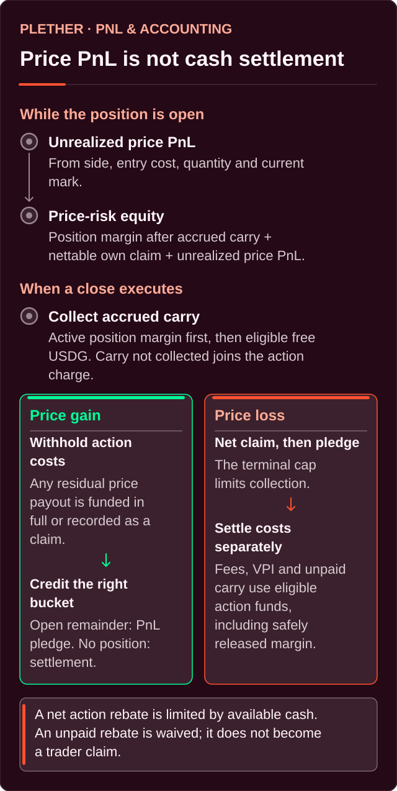
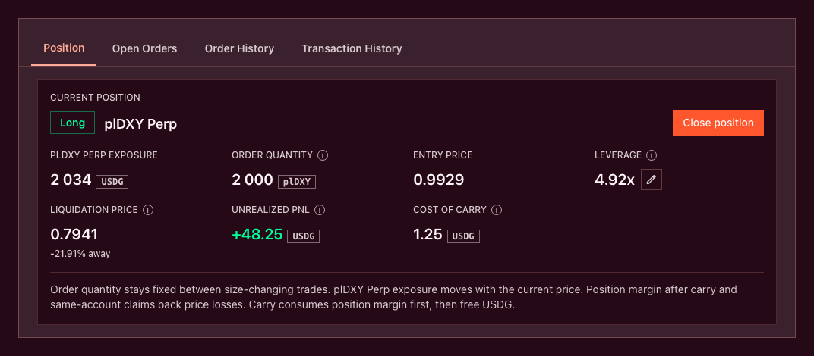
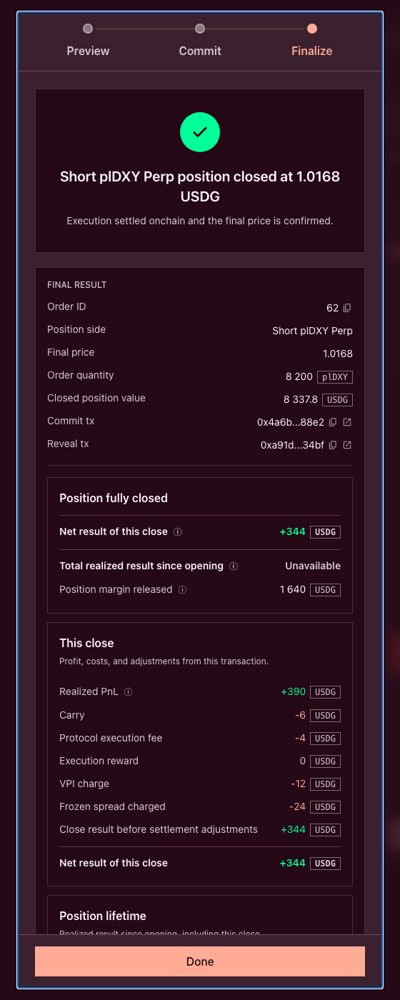

# How PnL is calculated

> **Price PnL[^pnl] measures what the market moved — not how much cash is withdrawable.**

Plether's directional PnL is linear:

* **LONG USD** profits when the displayed `plDXY` price rises.
* **SHORT USD** profits when the displayed `plDXY` price falls.

Gross price PnL, position equity, released margin, net close settlement, trader claims and wallet USDG[^usdg] are separate numbers. **Position equity** equals `position margin (after accrued carry) + same-account trader claim + exact price PnL`. Carry[^carry] collects from active position margin first, then eligible free USDG; execution fees, VPI[^vpi] and frozen-close spread settle separately from gross price PnL. A funded positive close payout credits **position margin** if a position stays open (partial close) or **free Margin Account USDG** if flat (full close); an unfunded payout becomes a **trader claim** in full.



## Displayed price vs raw basket

`PletherOracle` computes the raw foreign-currency basket `B` (`0.00 <= B <= 2.00`), and the interface displays its dollar-oriented complement:

```text
D = 2.00 − B      (0.00 <= D <= 2.00)
```

For example, when `B = 0.92`, displayed `plDXY` is `D = 1.08`. The inversion flips direction without changing magnitude (`|ΔD| = |ΔB|`). All trader formulas below use `D`.

## Exposure, quantity and notional are different

Every position stores a fixed `plDXY` quantity `Q` (in `100 plDXY` lots) that changes only on an increase, reduction or close:

| Field | Formula / meaning |
| --- | --- |
| **plDXY Perp price** | Current displayed price `D` |
| **Order quantity** (`Q`) | Fixed `plDXY` contract quantity |
| **plDXY Perp exposure** | `Q × current D` (dollar-oriented display exposure) |
| **Entry price** | Displayed execution price at entry (or weighted average after increases) |
| **Contract notional** | `Q × current raw basket B` (used by contracts for margin, fees and frozen spread) |
| **Position margin** | USDG collateral assigned to back price risk |
| **Unrealized PnL** | Gross price PnL from entry to current mark (before fees, VPI and carry) |

> Do not compute PnL by subtracting contract notional[^notional] from displayed `plDXY Perp exposure` — they use different price bases (`B` vs `D`). Always use quantity `Q` and `ΔD`.



## Gross price PnL

| Direction | Profits when | Formula |
| --- | --- | --- |
| **LONG USD** | `D_mark > D_entry` | `Q × (D_mark − D_entry)` |
| **SHORT USD** | `D_mark < D_entry` | `Q × (D_entry − D_mark)` |

* **LONG USD example (`Q = 10,000`, `D_entry = 1.00`):** At `D_mark = 1.04`, gross PnL is `+400 USDG`; at `0.97`, gross PnL is `−300 USDG`.
* **SHORT USD example (`Q = 10,000`, `D_entry = 1.00`):** At `D_mark = 0.96`, gross PnL is `+400 USDG`; at `1.03`, gross PnL is `−300 USDG`.

**Leverage does not multiply PnL a second time:** Two positions with the same `Q`, entry and mark produce the exact same gross USDG PnL regardless of margin — leverage only changes your liquidation buffer. The UI displays Unrealized PnL directly in USDG (not ROI%[^roi]).

## Mark price vs execution price

* **Unrealized PnL** uses the neutral central oracle[^oracle] mark `D_mark` — no USDG moves while unrealized. Marked trader gains reduce LP[^lp] NAV immediately as liabilities; marked trader losses never become spendable pool cash until collected.
* **Realized PnL** uses the fill price under the active oracle regime:
  * **Opens & live/FAD[^fad] closes:** Shifted adversely by `0.25×` basket confidence (higher entry / lower exit for LONG USD; lower entry / higher exit for SHORT USD). Because the shift is embedded in the fill price while Unrealized PnL uses the neutral mark, a freshly opened position can start with a small negative unrealized PnL.
  * **Voluntary `oracleFrozen` closes:** Validated unshifted basket price, plus the separate `50 bps` frozen-close spread.

## Increasing and partially reducing a position

* **Increasing (same direction):** Creates a quantity-weighted average entry price:
  ```text
  New entry = (Q_old × D_old + Q_added × D_added) ÷ (Q_old + Q_added)
  ```
  Increasing does not realize existing price PnL, though it does settle the increase's execution fee, VPI, carry checkpoint and opening execution reward.
* **Partial reduction:** Realizes price PnL only on `Q_closed` (`Q_closed × ΔD`), keeps the same entry price on the remainder, releases position margin proportionally (existing collateral, not profit) and checkpoints all accrued carry up to execution.

## From gross realized PnL to net close settlement

```text
Net close result = Gross realized price PnL − Protocol execution fee (0.04%) − Signed close VPI − Accrued carry − Frozen-close spread (if oracleFrozen)
```

Reductions and full closes (including TP/SL closes) have **zero** keeper execution reward. Negative close VPI is a rebate (increasing the result, subject to the lifetime VPI clamp).

### Worked profitable full close (live or FAD)

Suppose a trader holds `1,000 USDG` position margin with `6 USDG` accrued carry due, and fully closes with `+390 USDG` gross PnL, `12 USDG` VPI charge, `4 USDG` execution fee and `0 USDG` close execution reward:

1. **Commitment checkpoints carry from position margin:** `1,000 − 6 = 994 USDG` remaining margin.
2. **Execution calculates fresh payout:** `390 − 12 − 4 = +374 USDG`.
3. **Full close credits free USDG (when pool cash covers it):** `994` released margin `+ 374` funded payout `= 1,368 USDG` credited to free Margin Account USDG (net economic gain across commitment and execution: `+368 USDG`).

On a **partial reduction**, that funded `+374 USDG` profit payout credits **position margin** rather than free USDG (see [Reduce or close a position](../trading-on-plether-perps/reduce-or-close-a-position.md#example-reducing-a-long-usd-position)). If free pool cash cannot cover the entire fresh payout, the complete payout is recorded as a **trader claim** (never split).

## When a close realizes a loss

Plether strictly separates **price-loss backing** from **action-charge funding**:

* **Price loss:** Nets any **same-account trader claim first**, then remaining collectible position margin / pledge. Free Margin Account USDG and committed-order margin never absorb price losses, and Plether can never debit your external wallet.
* **Action charges** (execution fee, unpaid carry, positive VPI / clawback, frozen-close spread): Paid from positive price PnL, dedicated VPI rebate reserve, safely released margin, free USDG and (full close only) eligible committed-order margin.
* **Partial close:** Must pay all price losses and action charges completely without waiver or fails.
* **Full close:** Any uncovered price loss beyond same-account claims and position margin becomes explicit LP bad debt (absorbed through the tranche[^tranche] waterfall). Uncollectible action charges (including frozen-close spread) are waived rather than booked as bad debt.

## Reading the close reconciliation

For an executed reduction or close, **Final Result** (and **Transaction History → View breakdown**) reconciles the onchain receipt in three sections:

* **Execution:** Final price, Order quantity, execution exposure, Order ID and transaction hashes.
* **Close result:** Realized PnL, carry, execution fee (`0.04%`), zero close execution reward, signed VPI, **Frozen spread charged** (plus assessed/waived if nonzero) and **Close result before settlement adjustments**.
* **Account outcome** *(plus **Position margin**)*: Margin Account balance change, trader claim created or consumed, any neutral **Settlement adjustment** (`Close result before settlement adjustments + Settlement adjustment = Actual account change`) and **Actual account change**. Released margin is displayed separately as unlocked collateral, not added to Actual account change.

If a receipt is legacy or malformed, the UI keeps execution details visible and shows **Detailed close accounting unavailable** instead of substituting estimates. Note that **Transaction History → Result** shows gross realized price PnL before fees, VPI and carry — select **View breakdown** for the full net reconciliation.



## Bounded `0.00–2.00` range and contract precision

Because `0.00 <= D <= 2.00`:

| Direction | Max gross profit | Max gross price loss |
| --- | --- | --- |
| **LONG USD** | `Q × (2.00 − D_entry)` (at `D = 2.00`) | `Q × D_entry` (at `D = 0.00`) |
| **SHORT USD** | `Q × D_entry` (at `D = 0.00`) | `Q × (2.00 − D_entry)` (at `D = 2.00`) |

These are price bounds, not liquidation protection (liquidation can occur far earlier, and external FX[^fx] moving outside `[0, 2.00]` creates basis risk[^basis-risk]).

Onchain contracts compute with **18-decimal** position quantities (`100 plDXY` lots), **8-decimal** index prices and **6-decimal** USDG accounting, truncating below supported precision. Treat the confirmed onchain receipt as authoritative.

> **PnL measures price performance. Settlement determines cash flow or claims. Custody determines what is withdrawable.**

[^pnl]: Profit and loss, the financial result of market-price movement on a position.
[^usdg]: USDG is used for margin and settlement. The testnet uses MockUSDG, a test token with no real-world value.
[^carry]: The time-based cost charged on the portion of a position financed by LP capital.
[^vpi]: Virtual Price Impact, a separate USDG charge or rebate based on how a trade changes pool directional imbalance.
[^notional]: The face value of a position’s market exposure, not the amount of collateral posted.
[^roi]: Return on investment, gain or loss expressed relative to the capital invested.
[^oracle]: A service that supplies external market data to smart contracts; Plether uses Pyth price feeds.
[^lp]: Liquidity provider, a participant that supplies USDG capital to the liquidity pool.
[^fad]: Friday Afternoon Deleverage, Plether’s wider scheduled close-only window around the weekly FX closure.
[^tranche]: A pool layer with its own loss priority, withdrawal priority and return profile.
[^fx]: Foreign exchange, the market for trading one currency against another.
[^basis-risk]: The risk that a hedge and the exposure it is intended to offset do not move together.
