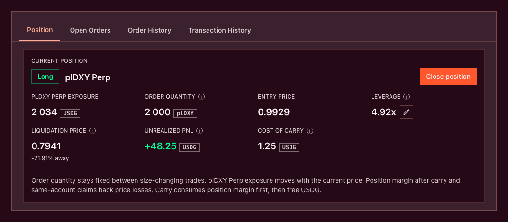
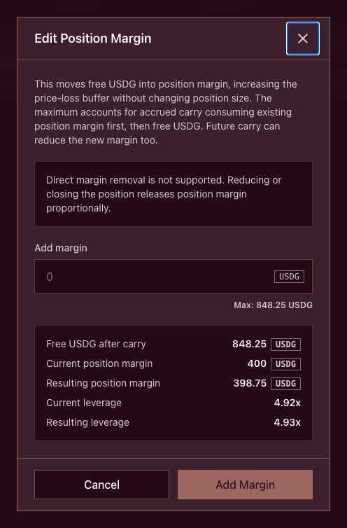

# Margin, leverage and liquidation

Plether uses **isolated position price collateral**: only **position margin (after accrued carry)** and **same-account trader claims** back position price risk. Free Margin Account USDG[^usdg] and committed-order margin do **not** move your price liquidation threshold until explicitly assigned to the position.

* **Position margin** backs price losses on the open position.
* **Position equity** determines price health (while uncovered carry and dedicated VPI[^vpi] rebate reserve backing are checked separately).
* **Maintenance margin** sets the liquidation trigger.

## Where your USDG sits

All trader collateral is held in the **Margin Clearinghouse** across separate accounting buckets:

| Bucket | Role |
| --- | --- |
| **Free USDG** | Buying power for new orders, carry overflow, action charges or withdrawal — **excluded** from price equity |
| **Position margin** | Assigned to the active position; backs price losses and pays carry first |
| **Committed order margin** | Reserved for a pending open/increase — **excluded** from price equity |
| **Execution-reward / TP-SL reserves** | Reserved for opening-order execution or TP/SL triggering — **excluded** from price equity |

> **Carry vs price losses:** Carry[^carry] consumes **active position margin first, then eligible free USDG** (trader claims and reserved funds cannot pay carry). Price losses net **same-account trader claims first, then position margin** (free USDG and committed-order margin never absorb price losses). Plether can never debit assets sitting in your external wallet.

## Contract notional vs displayed exposure

While the interface displays `D = 2.00 − B`, the risk engine computes **contract notional**[^notional] from the raw basket price `B`:

```text
Contract notional N = Q × B = Q × (2.00 − D)
```

Margin requirements and leverage use `N`, whereas directional PnL[^pnl] uses `ΔD`.

## Initial margin

Initial margin governs opening or increasing exposure (`initialMarginBps = 0.20%` on Core v2.0.0; normal UI cap `33x`, Margin Call Simulator cap `416x`):

```text
Initial requirement = max(N × 0.20%, minimum liquidation charge floor)
```

Both assigned position margin and post-trade position equity (after execution fee, VPI and carry) must meet the initial requirement, pass the `1,000 USDG` minimum open notional, stay within the `40%` skew cap and pass pool solvency.

## Maintenance margin

Maintenance margin determines whether an open position stays alive:

```text
Maintenance margin = N × active maintenance margin rate
```

Active Core v2.0.0 rates:

* **Live market:** `0.10%` (`10 bps`)
* **FAD close-only window (market-close regime):** `3.00%` (`300 bps`)

Price liquidation triggers as soon as:

```text
Position equity <= Maintenance margin
```

Equality counts (`<=`, not `<`). Crossing into a FAD window raises maintenance from `0.10%` to `3.00%` immediately — a high-leverage position can become liquidatable without any move in `plDXY`.

## Position leverage and equity leverage

Plether separates nominal position leverage from real-time equity leverage:

```text
Position leverage = Contract notional ÷ Assigned position margin
Equity leverage   = Contract notional ÷ Position equity
```

**Example:** With `10,000 USDG` contract notional, `1,000 USDG` assigned position margin and a `500 USDG` same-account claim (`Position equity = 1,500 USDG`), **Position leverage** is `10.00×` and **Equity leverage** is `6.67×`. If price losses drop position equity to `800 USDG`, **Equity leverage** rises to `12.50×` while Position leverage stays `10.00×`. Adding free USDG alone does not change Equity leverage.

If position equity hits zero or negative, treat the account as critically undercollateralized rather than relying on a finite leverage ratio.



## Depositing USDG vs adding position margin

* **Depositing USDG** adds to **free Margin Account USDG** (and checkpoints carry from active position margin first, then eligible free USDG). It provides carry fallback and buying power, but does **not** raise price equity or move your liquidation price.
* **Adding position margin** (**Edit Position Margin → Add margin**) checkpoints carry first, then moves free USDG into **Position margin** — immediately raising price equity, lowering Position leverage and shrinking your LP[^lp]-financed borrow base (reducing future carry). Future carry can still draw down the added margin first.
* **Direct margin removal is not supported:** Releasing assigned position margin requires reducing or closing the position.



**Available to Trade vs Withdrawable:** Withdrawable can be lower than Available to Trade (or zero) because open-position withdrawals must preserve the higher of initial margin and active maintenance/FAD margin, require a fresh live mark and are blocked during degraded mode.

## Three independent liquidation triggers

An account is liquidatable whenever **any one** of these three conditions holds:

1. **Price liquidation:** `Position equity <= Active maintenance margin`, where `Position equity = position margin (after accrued carry) + same-account trader claim + exact price PnL`.
2. **Uncovered carry:** Pending carry exceeds `position margin + eligible free USDG`.
3. **Underfunded VPI rebate reserve:** Accumulated VPI is negative (provisional rebate) and dedicated `vpiRebateReserve` is smaller than the clawback owed.

**Example:** With `1,000 USDG` position margin, `500 USDG` same-account claim, `50 USDG` carry due and `1,150 USDG` unrealized price loss, carry lowers position margin to `950 USDG` (even if free USDG sits in the account), leaving `Position equity = 950 + 500 − 1,150 = 300 USDG`. Against `250 USDG` maintenance margin, only `50 USDG` of further price loss triggers liquidation.

## Liquidation price

The displayed **Liquidation price** estimates where price equity reaches active maintenance margin:

* **LONG USD:** Vulnerable at or below its liquidation price.
* **SHORT USD:** Vulnerable at or above its liquidation price.

Actual liquidation evaluates against a **side-adverse confidence-adjusted oracle[^oracle] price** (lower for LONG USD, higher for SHORT USD), so a position near its threshold can be liquidated slightly before the neutral chart mark reaches the displayed estimate. Live/FAD liquidations use the live freshness limit; `oracleFrozen` liquidations use the extended `3-day` (`259,200s`) staleness ceiling.

* **Not in range:** No price liquidation threshold exists inside Plether's bounded `[0.00, 2.00]` range under the current snapshot (uncovered carry or VPI reserve shortfalls can still liquidate the account independently).
* **Unavailable:** A required onchain read is missing or refreshing — never assume safety. Watch the **Liquidatable** status banner separately.

## How liquidation works (always full, permissionless)

There is no onchain margin call or grace period. Once liquidatable, any permissionless keeper[^keeper] can trigger liquidation on a dedicated path that does **not** wait behind the FIFO order queue:

1. Validates an oracle update under the active liquidation policy and applies the side-adverse confidence shift.
2. Deletes the **entire position** (Plether never partially liquidates) without trading through an AMM[^amm] or order book.
3. Settles price loss against same-account trader claim first, then position margin (any excess price loss becomes LP bad debt).
4. Collects non-price terminal charges in order (**VPI clawback → remaining carry → liquidation charge**) from dedicated VPI reserve, remaining margin and free USDG.
   * **Liquidation charge (Core v2.0.0):** **`0.10%`** of notional (minimum **`1.00 USDG`**), split **`50%` to the keeper** (min `0.50 USDG`), **`50%` to the liquidity pool LPs** and **`0%` to the protocol treasury**.
   * Liquidation charges **no** voluntary execution fee, **no** new closing VPI and **no** frozen-close spread (even during `oracleFrozen`).
5. Preserves any remaining positive residual for the trader (or records an unfunded fresh payout as a trader claim).
6. Fails and clears all pending orders for the account: **reserved opening execution rewards are forfeited to the protocol treasury**, while committed opening margin is released to free USDG (never backing price losses, though free USDG can cover separate non-price liquidation charges if needed).

**A pending close never protects against liquidation:** Until a close executes, the full position stays live and liquidatable.

| Dimension | Voluntary close | Liquidation |
| --- | --- | --- |
| **Initiator & path** | Trader (or TP/SL) via global FIFO queue | Any keeper via separate direct path |
| **Size** | Partial or full | Full only |
| **Costs** | `0.04%` execution fee, signed VPI, carry, `50 bps` frozen spread (if frozen); `0` close reward | Carry, VPI clawback (if negative), `0.10%` liquidation charge (`50%` keeper / `50%` LPs; min `1.00 USDG`) |
| **Pending orders** | Unaffected | All failed; opening rewards forfeited to treasury |

## Margin Call Simulator

**Margin Call Simulator** removes the normal `33x` UI leverage cap so advanced users can test closer to onchain bounds. Its entry cap equals `floor(10,000 / max(activeMaintenanceBps, initialMarginBps + executionFeeBps))` — **`416x`** under current `20 bps` initial margin and `4 bps` execution fee (and lower whenever FAD `300 bps` applies).

Despite the name, there is still **no margin call or grace period** — liquidation remains full and immediate, and tiny price ticks, VPI, carry or fees can liquidate an extreme-leverage position almost instantly. Treat it strictly as a testing control.

[^usdg]: USDG is used for margin and settlement. The testnet uses MockUSDG, a test token with no real-world value.
[^vpi]: Virtual Price Impact, a separate USDG charge or rebate based on how a trade changes pool directional imbalance.
[^carry]: The time-based cost charged on the portion of a position financed by LP capital.
[^notional]: The face value of a position’s market exposure, not the amount of collateral posted.
[^pnl]: Profit and loss, the financial result of market-price movement on a position.
[^lp]: Liquidity provider, a participant that supplies USDG capital to the liquidity pool.
[^oracle]: A service that supplies external market data to smart contracts; Plether uses Pyth price feeds.
[^keeper]: A permissionless actor or bot that submits order-finalization or protocol-maintenance transactions.
[^amm]: Automated market maker, an onchain liquidity mechanism that prices trades using a pool and formula.
