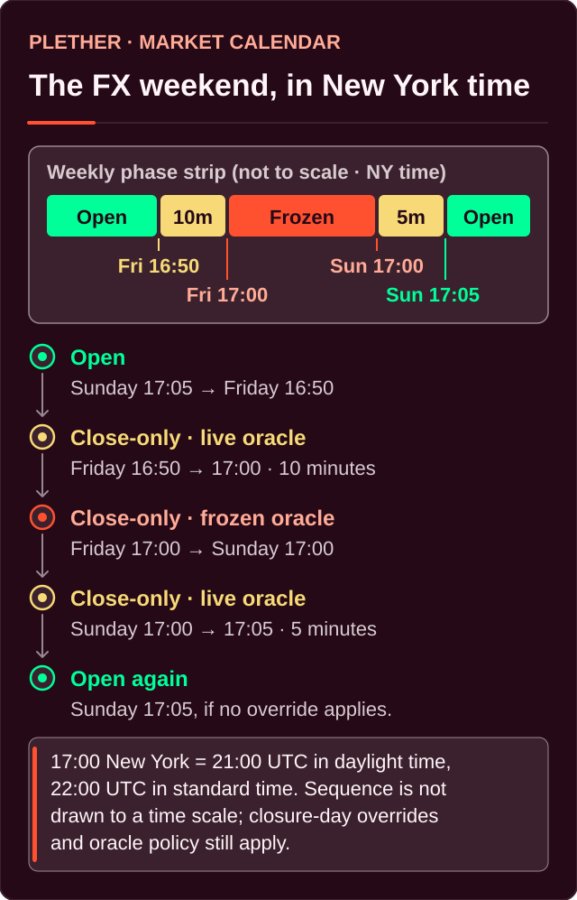
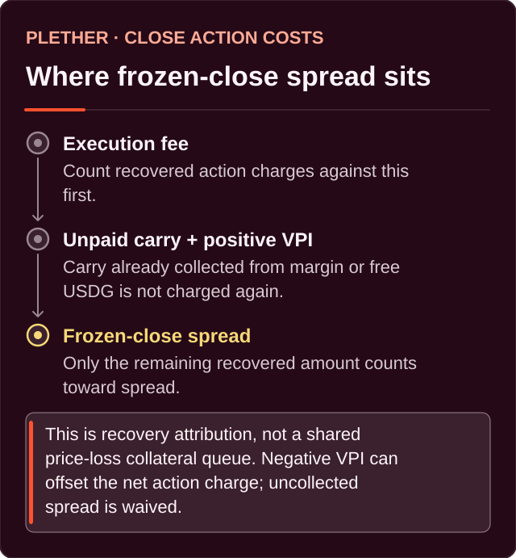
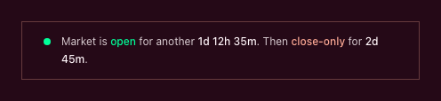

# Market states and oracle closures

Plether runs on a 24/7 blockchain, while the global FX[^fx] market underlying `plDXY` closes on weekends and holidays. Rather than inventing weekend prices, Plether changes which actions are allowed and how recent oracle[^oracle] data must be:

* **Scheduled close-only (FAD[^fad] live shoulders):** New risk is blocked, closure margin (`2.00%`) applies, and live post-commit oracle rules stay in force.
* **Oracle frozen (`oracleFrozen`):** New FX updates are not expected; voluntary closes and liquidations use a bounded stale-data policy (up to `3 days`).
* **Oracle data unavailable / over-stale:** Available data fails validation or exceeds the active age cap, halting price-dependent actions.

> **`oracleFrozen` is a calendar state, not an outage detector.** An unexpected Pyth outage during open FX hours never automatically activates frozen pricing.

See [Oracle & execution model](oracle-and-execution-model.md) for confidence checks and pending-order pricing rules.

## Weekly FX schedule

Plether's regular calendar follows **America/New_York** (with US daylight saving time evaluated independently at each boundary — `17:00 NY = 21:00 UTC`[^utc] in EDT / `22:00 UTC` in EST):

| Time in America/New_York | Public UI state | Oracle policy | Maintenance margin | New risk |
| --- | --- | --- | --- | --- |
| **Sunday 17:05 – Friday 16:50** | Open | Live | `0.10%` | Allowed |
| **Friday 16:50 – 17:00** *(10m pre-close runway)* | Close-only | Live | `2.00%` | Blocked |
| **Friday 17:00 – Sunday 17:00** | Close-only | Frozen (`oracleFrozen`) | `2.00%` | Blocked |
| **Sunday 17:00 – 17:05** *(5m reopen lag)* | Close-only | Live | `2.00%` | Blocked |

The contracts call the wider Friday 16:50 – Sunday 17:05 window the **FAD window** (Friday Afternoon Deleverage); the UI labels the entire window **Close-only**. Starting close-only 10 minutes before FX stops publishing gives traders a live-priced runway to add margin or reduce leverage before weekend gaps and closure margin take full effect.

## Action matrix

Assuming the protocol is active and all account, capacity and acceptable-price checks pass:

| Action | Open (live) | Close-only (live) | `oracleFrozen` (within `3d` limit) | Over-stale / unavailable |
| --- | --- | --- | --- | --- |
| **Open or increase** | Allowed | Blocked | Blocked | Blocked |
| **Execute queued open** | Allowed | Blocked (stays Pending → expires) | Blocked (stays Pending → expires) | Blocked |
| **Commit reduce / close** | Allowed | Allowed | Allowed | May commit with stored mark; cannot execute |
| **Execute reduce / close** | Live post-commit + `0.25×` confidence shift | Live post-commit + `0.25×` confidence shift | Validated frozen price (unshifted) + `50 bps`[^bps] spread | Blocked |
| **Liquidate** | Live policy (`0.10%` maint.) | Live policy (`2.00%` maint.) | Frozen policy (`2.00%` maint.); **no** frozen spread | Blocked |
| **Add position margin** | Allowed | Allowed | Allowed | Allowed |
| **Withdraw USDG[^usdg] (open position)** | Fresh mark + headroom | Live mark + `2.00%` headroom | Frozen mark within limit + `2.00%` headroom | Blocked |
| **Withdraw USDG (flat account)** | Free unreserved USDG | Same | Same | Same |

## Scheduled close-only (live oracle) vs `oracleFrozen`

* **Live-oracle shoulders (Fri 16:50–17:00 & Sun 17:00–17:05 NY):** Opens and increases are blocked and maintenance margin jumps immediately to **`2.00%`**, but closes still require live post-commit Pyth observations, pay **no** frozen-close spread and trigger **no** LP[^lp] frozen withdrawal fee. If FX feeds have not yet resumed during the Sunday 17:00–17:05 window, closes and liquidations wait until live updates arrive.
* **`oracleFrozen` (Fri 17:00 – Sun 17:00 NY and configured holidays):** Voluntary closes waive the post-commit ordering requirement, same-block check and `0.25×` adverse confidence price shift, settling against the latest validated Pyth basket (within the `3-day` staleness ceiling, `0.25%` max confidence ratio, `5s` alignment and `[0.00, 2.00]` bounds) while assessing the fixed **`50 bps` (`0.50%`)** frozen-close spread on reduced contract notional[^notional] (`100,000 USDG` reduced notional → `500 USDG` spread).
  * Normal signed VPI[^vpi] and its lifetime clamp still apply alongside the spread.
  * The spread belongs **100% to LPs** (never the treasury), applies strictly by **execution-time** market state (not commit time) and never applies to liquidations.

* **Collection & waiver:** Carry[^carry] collects first (active position margin → free USDG), then realized price loss consumes same-account trader claims → position margin. Action charges (execution fee, unpaid carry, positive VPI, frozen spread) settle separately from positive PnL, VPI reserve, free USDG and safely released margin. Partial reductions must pay the full spread or fail; terminal full closes waive uncollectible action charges (`assessed = paid + waived`, and waived spread is neither bad debt, a claim nor LP revenue).

## Margin jump, continuous carry and FIFO queue behavior

* **Immediate `2.00%` maintenance jump:** Takes effect at Friday 16:50 NY (not 17:00). An over-leveraged position can become liquidatable without any price move. Liquidations remain full and permissionless during both live close-only and `oracleFrozen` (using adverse confidence pricing and zero frozen spread).
* **Carry never pauses:** Carry accrues 24/7 by wall-clock time through weekends, holidays, frozen windows and oracle outages.
* **Global FIFO[^fifo] queue:** An opening order committed right before close-only stays Pending when close-only starts and cannot be jumped by later closes; under the `30-second` execution deadline, it expires and is cleaned up by a keeper[^keeper]. Separate signed execution bounds govern permitted modes and financial limits alongside your acceptable-price boundary.

## What closures mean for LPs

* **Scheduled close-only (live oracle):** Normal LP deposit, withdrawal, cooldown and share-pricing rules continue unchanged — **no** frozen LP fee applies.
* **`oracleFrozen`:** New vault deposits are blocked and previously queued deposits wait until live pricing returns (deposits pay no frozen fee). Withdrawals remain queueable while the mark stays within the frozen staleness limit and apply a tranche[^tranche]-specific **Temporary pricing fee** retained **100% inside that tranche**:
  * **Senior Vault (`psLP`):** **`0.25%`** (`25 bps`)
  * **Junior Vault (`pjLP`):** **`0.75%`** (`75 bps`)
  * Because a withdrawal request locks its quoted share count, fee or price changes before hourly processing adjust final USDG rather than pulling extra shares.
* **Over-stale mark:** Once the stored mark exceeds the `3-day` frozen limit while open trader liabilities require mark-to-market accounting, hourly settlement pauses and **Available withdrawal liquidity** can drop to zero until valid data returns.

See [LP risks and safeguards](../providing-liquidity/lp-risks-and-safeguards.md) and [Read your LP position and pool health](../providing-liquidity/read-your-lp-position-and-pool-health.md).

## Holiday overrides, protective overlays and UI banner

* **Holiday closures:** Governance can register full UTC-day FX closures (with a configurable `1-hour` pre-day runway) subject to a **`72-hour` timelock**.
* **Other overlays:** **Router pause** blocks new opens/increases while keeping closes and liquidations open; **Pool pause** blocks new LP deposits; **Degraded mode** latches after an under-backed terminal event, blocking new trader risk, new LP deposits and new LP withdrawal funding until solvency recovers and the owner explicitly clears it. Plether Perps[^perps] has no boundary-triggered `SETTLED` state — touching `0.00` or `2.00` never terminates the market.
* **Live UI banner:** Shows **Open**, **Close-only**, **Closed** or **Degraded** alongside the oracle freshness badge (`Oracle fresh` / `Oracle stale`). Because **Close-only** spans both the live shoulders and `oracleFrozen`, always check oracle state and onchain `fadWindow` / `oracleFrozen` flags rather than relying on the countdown estimate alone.

## Current closure parameters (Core v2.1.0)

All closure parameters below are governed via a **`72-hour` timelock** (live onchain values are authoritative):

| Parameter | Active Core v2.1.0 setting |
| --- | --- |
| **FAD / market-close maintenance margin** | `2.00%` (`200 bps`) |
| **Maximum frozen oracle age (`fadMaxStaleness`)** | `3 days` (`259,200s`) |
| **Additional holiday closure-day runway** | `10 minutes` |
| **Frozen-close spread (voluntary closes only)** | `0.50%` (`50 bps`, nonzero up to `10.00%` cap) |
| **Senior frozen LP withdrawal fee** | `0.25%` (`25 bps`, retained in Senior) |
| **Junior frozen LP withdrawal fee** | `0.75%` (`75 bps`, retained in Junior) |

[^fx]: Foreign exchange, the market for trading one currency against another.
[^oracle]: A service that supplies external market data to smart contracts; Plether uses Pyth price feeds.
[^fad]: Friday Afternoon Deleverage, Plether’s wider scheduled close-only window around the weekly FX closure.
[^utc]: Coordinated Universal Time, the time standard used by the protocol schedule.
[^bps]: Basis points; 100 bps equals 1%.
[^usdg]: USDG is used for margin and settlement. The testnet uses MockUSDG, a test token with no real-world value.
[^lp]: Liquidity provider, a participant that supplies USDG capital to the liquidity pool.
[^notional]: The face value of a position’s market exposure, not the amount of collateral posted.
[^vpi]: Virtual Price Impact, a separate USDG charge or rebate based on how a trade changes pool directional imbalance.
[^carry]: The time-based cost charged on the portion of a position financed by LP capital.
[^fifo]: First in, first out; orders at the front of the queue are processed before later orders.
[^keeper]: A permissionless actor or bot that submits order-finalization or protocol-maintenance transactions.
[^tranche]: A pool layer with its own loss priority, withdrawal priority and return profile.
[^perps]: Perpetual contracts, derivatives with no scheduled expiry.
