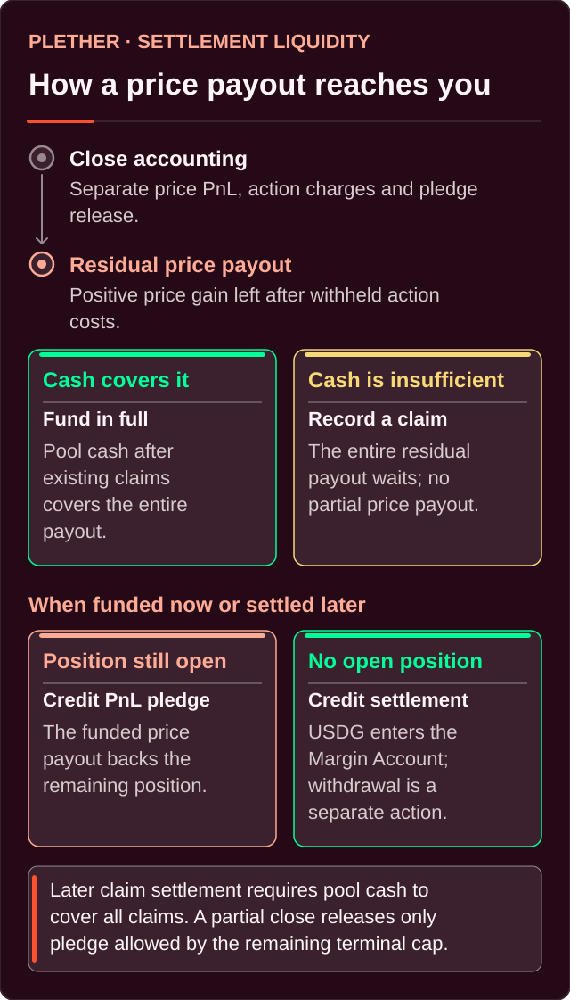
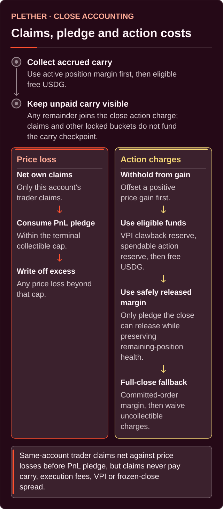

# Settlement liquidity and trader claims

A profitable close and immediately withdrawable wallet USDG[^usdg] are two separate steps. When a position closes, Plether resolves:

1. **Economics:** Realized price PnL[^pnl] versus separate action charges (execution fee, signed VPI[^vpi], unpaid carry[^carry] and any frozen-close spread).
2. **Funding:** Whether unreserved pool cash can pay the entire residual **price payout** immediately.

Released position margin settles separately. The complete residual price payout is either funded in full (crediting **position margin** if a position remains open, or **free Margin Account USDG** if flat) or recorded in full as a **trader claim** — never split between cash and claim. A separate net action rebate pays only from available pool cash, with any unpaid remainder waived rather than becoming a claim.

> **Bounded solvency ≠ instant cash.** Separating close execution from payout funding ensures a temporary liquidity crunch never traps traders inside open positions.



## Key settlement terms

| Value | Meaning |
| --- | --- |
| **Realized PnL** | Gross price movement on the closed size before fees, VPI, carry and frozen spread |
| **Released margin** | Your own unlocked collateral (already inside the Margin Clearinghouse; needs no pool cash) |
| **Price payout** | Positive realized price gain remaining after withheld action charges |
| **Action rebate** | Net negative action charge paid only from available pool cash (unpaid remainder waived) |
| **Trader claim** | Complete unfunded residual price payout owed to your Trading Account by the liquidity pool |
| **Withdrawable USDG** | Free Margin Account USDG permitted to leave for your owner wallet after account checks |

## Losing closes, collection priority and waivers

Plether separates **price-loss backing** from **action-charge funding**:



1. **Carry checkpoint first:** Collected from active position margin first, then eligible free USDG (never from trader claims).
2. **Realized price loss:** Consumes your **same-account trader claim FIRST**, then collectible position margin / pledge (on both losing partial closes and losing full closes / liquidations). Free USDG and committed-order margin never absorb price losses; uncovered excess price loss becomes an explicit **price-loss write-off** (bad debt).
3. **Action charges** (`0.04%` execution fee, still-unpaid carry, positive VPI, `50 bps`[^bps] frozen-close spread during `oracleFrozen`): Withheld from positive price gain first, then collected from dedicated VPI clawback reserve, safely released margin, free USDG and (full close only) eligible committed-order margin — **never** from trader claims and **never** from margin still backing a residual position.
   * **Partial reductions** must settle 100% of action charges without waiver or revert.
   * **Terminal full closes** waive any uncollectible action charges (`assessed spread = paid spread + waived spread`). Waived charges never become bad debt, trader claims or LP[^lp] receivables; every paid USDG of frozen-close spread goes 100% to LPs (never treasury).

**Collection example (full close in `oracleFrozen`):** Suppose a full close has `100 USDG` price loss backed by `100 USDG` position margin, plus `10 USDG` execution fee and `50 USDG` frozen-close spread (`60 USDG` action charges) against `30 USDG` of eligible action funds. `100 USDG` pledge covers the price loss; `10 USDG` pays the execution fee; `20 USDG` pays frozen spread to LPs; the remaining `30 USDG` spread is **waived** (zero bad debt, zero claim). A partial close with the same shortfall would fail unless it could safely release another `30 USDG` of margin.

## Funding a profitable close (all-or-nothing)

Before funding any new profit payout, Plether reserves physical pool USDG for all existing trader claims:

```text
Fresh payout capacity = max(Physical pool assets − Aggregate trader claims, 0)
```

* If `Fresh payout capacity >= Residual price payout`, the entire payout is credited immediately (to **position margin** on a partial close, or **free Margin Account USDG** on a full close).
* Otherwise, **none** of the fresh payout is paid immediately — the **entire** residual price payout is added to the Trading Account's **trader claim**.

The live close preview projects **USDG after execution** and **Trader claim after execution**, while the confirmed onchain receipt is always authoritative. Even an immediate payout lands in your Margin Account (not directly in your owner wallet), so moving it to your wallet requires a separate **Withdraw** operation.

## What a trader claim is — and is not

| Property | Treatment of an unsettled trader claim |
| --- | --- |
| **Denomination & expiry** | Fixed in USDG; earns no interest; never expires; non-transferable |
| **Position equity & price-loss backing** | **Included** for the same Trading Account (nets against price losses before position margin) |
| **Free buying power / Withdrawable** | **Excluded** |
| **Carry & action charges** | **Cannot** pay carry, execution fees, VPI or frozen-close spread |
| **Priority vs LPs** | **Strictly senior** to both Senior and Junior LP withdrawals |
| **Queue order** | **No FIFO queue** — all claims share one aggregate coverage check |

## Settling a trader claim (aggregate coverage)

Claim settlement is all-or-nothing and succeeds only when:

```text
Physical pool assets >= Aggregate trader claims
```

If aggregate claims are under-covered, **no** claimant can settle — preventing an early caller from draining cash ahead of other claimants. Once aggregate coverage returns, any claimant can authorize a sponsored **Settle Claim** operation from the owner wallet (requiring no live oracle[^oracle] or open FX session):

* If the Trading Account is **flat**, the settled claim credits **free Margin Account USDG**.
* If the Trading Account holds an **open position**, Plether checkpoints carry first (from active position margin, then eligible free USDG) and credits the settled claim to **position margin**.

Because the live **Trader claim** card does not pre-check aggregate coverage, an under-covered attempt reverts harmlessly with the claim untouched. See [Check and settle a trader claim](../trading-on-plether-perps/check-and-settle-a-trader-claim.md).

Liquidations obey the exact same rules (with zero frozen-close spread; liquidation charges split `50%` keeper / `50%` LPs from reachable trader collateral without drawing on trader-claim cash).

## Three distinct liquidity tests

| Question | Onchain condition |
| --- | --- |
| **Can a new profitable close pay immediately?** | `Physical pool assets − Aggregate claims >= Residual price payout` |
| **Can an existing claim settle?** | `Physical pool assets >= Aggregate trader claims` |
| **Can an LP withdraw?** | `Physical pool assets > Max bounded liability + 0.25% buffer + Aggregate claims + Other reserves` |

## How claims affect LP withdrawals

Trader claims become reserved liabilities the instant they are created — ranking strictly ahead of both Senior and Junior LP tranches[^tranche].

```text
Free LP liquidity = max(
  Physical pool assets
  − max(LONG max payout, SHORT max payout)
  − 0.25% settlement buffer
  − Aggregate trader claims
  − Other explicit reserves,
  0
)
```

When a profitable position closes into a claim, its contingent live-position liability disappears and becomes a realized claim (never double-counted). When that claim later settles, physical pool assets and aggregate claims drop by the exact same amount.

Every paid USDG of frozen-close spread (collected from eligible action-charge sources — never from trader claims) enters LP revenue; waived spread is never counted as an asset, receivable or bad debt.

## Claims, write-offs, degraded mode and no ADL

* **Claims vs price-loss write-offs:** A **trader claim** is profit the pool owes a trader (reserved ahead of LPs); a **price-loss write-off** is uncovered trader price loss absorbed by the LP waterfall.
* **Degraded mode:** Latches if `max(Physical pool assets − Aggregate claims, 0) < Max bounded liability of remaining open positions`. Degraded mode blocks new trader risk, new LP deposits and new LP withdrawal USDG allocation (closes, liquidations, margin additions and already-funded claims stay active; fully covered claims can still settle).
* **No counterparty ADL:**[^adl] Plether never trims unrelated winners or haircuts claims — instead, unfunded payouts wait as full claims with no guaranteed settlement date.

## Worked examples

1. **Immediate settlement:** Released margin `1,000 USDG`, fresh payout `250 USDG`, physical assets `5,000 USDG`, existing claims `1,000 USDG` → `4,000` free capacity covers `250`, so `1,000` margin unlocks and `250` credits the Margin Account immediately.
2. **Full payout becomes a claim:** Same close, but physical assets are `1,200 USDG` (`200` free above `1,000` claims) → `1,000` margin still unlocks; entire `250 USDG` becomes a claim (aggregate claims `= 1,250 USDG`; settlement waits until physical assets reach `1,250 USDG`).
3. **Coverage restored:** Physical assets reach `1,250 USDG`. Settling your `250 USDG` claim moves `250 USDG` to your Margin Account and drops both physical assets and aggregate claims to `1,000 USDG` (remaining claims stay 100% covered).
4. **Claim netted on later loss:** Account holds a `300 USDG` claim and suffers a `500 USDG` price loss with `0` position margin → `300 USDG` claim absorbs the first `300 USDG` of price loss, leaving a `200 USDG` price-loss write-off.

[^usdg]: USDG is used for margin and settlement. The testnet uses MockUSDG, a test token with no real-world value.
[^pnl]: Profit and loss, the financial result of market-price movement on a position.
[^vpi]: Virtual Price Impact, a separate USDG charge or rebate based on how a trade changes pool directional imbalance.
[^carry]: The time-based cost charged on the portion of a position financed by LP capital.
[^bps]: Basis points; 100 bps equals 1%.
[^lp]: Liquidity provider, a participant that supplies USDG capital to the liquidity pool.
[^oracle]: A service that supplies external market data to smart contracts; Plether uses Pyth price feeds.
[^tranche]: A pool layer with its own loss priority, withdrawal priority and return profile.
[^adl]: Auto-deleveraging, the forced reduction of profitable positions to manage counterparty insolvency.
