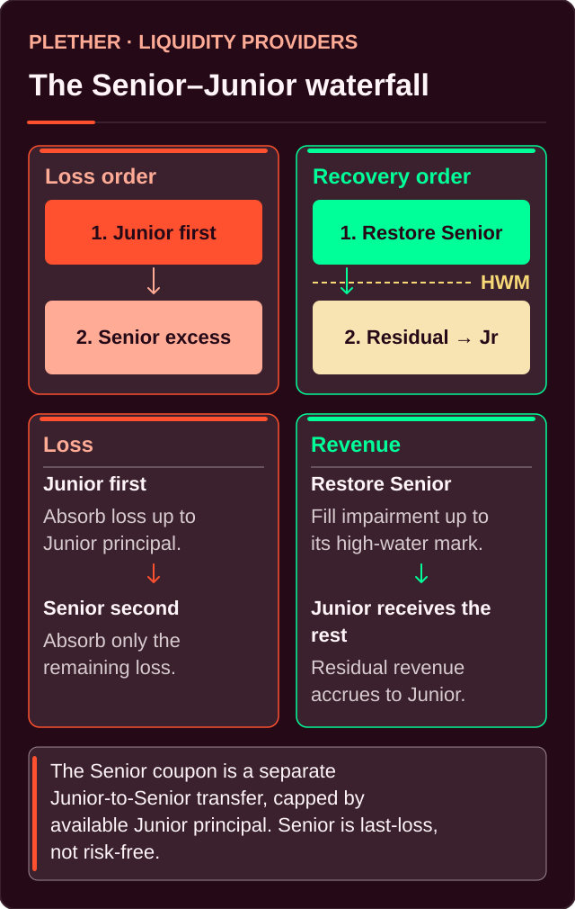
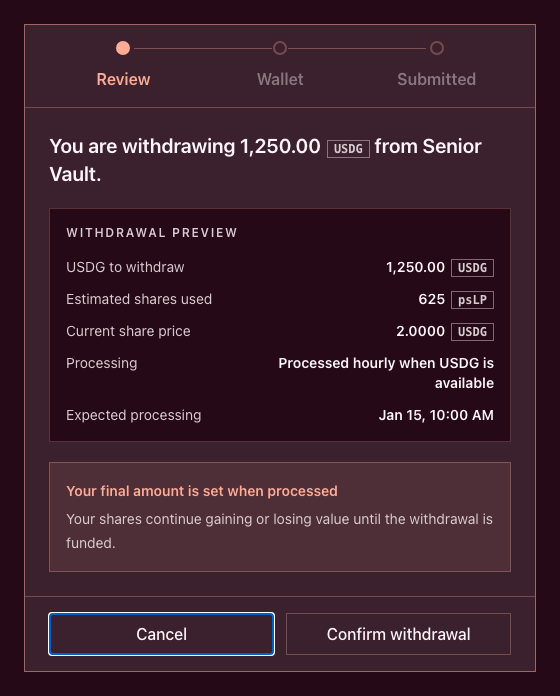

# The liquidity pool and tranche waterfall

The liquidity pool is the shared USDG[^usdg] balance sheet behind Plether Perps[^perps]. It never sets market prices or runs an AMM[^amm] — the oracle[^oracle] sets prices while the pool underwrites bounded trader payouts, collects LP-owned trading inflows, absorbs bad debt and governs trading capacity.

LPs[^lp] supply capital through two asynchronous ERC-4626[^erc4626] tranche[^tranche] vaults issuing **9-decimal shares**: **Senior (`psLP`)** and **Junior (`pjLP`)**. This page is the canonical reference for pool accounting; for step-by-step actions, see the [Liquidity provider quickstart](../liquidity-provider-quickstart.md).

## Capital before yield & physical-asset accounting

Core pool USDG stays inside the pool contract — it is never rehypothecated into external lending protocols, ensuring cash is not trapped elsewhere when traders or LPs need settlement.

Plether measures backing conservatively:

```text
Physical pool assets = min(Raw USDG balance, Accounted pool assets)
```

Unsolicited token transfers are quarantined as excess until explicitly accounted (they cannot inflate share price or capacity), whereas any raw-balance shortfall reduces recognized backing immediately.

## What LP capital underwrites & Senior vs Junior

Both tranches underwrite the same pool and the same bounded `[0.00, 2.00]` `plDXY` liability:

| Dimension | Senior (`psLP`) | Junior (`pjLP`) |
| --- | --- | --- |
| **Return model** | Target nominal APR (`8.00%` on current testnet) transferred from Junior | Variable residual LP-owned revenue |
| **Loss order** | After Junior principal reaches zero | First loss |
| **Recovery order** | Restored to its high-water mark first | Residual upside only after Senior is restored |
| **Withdrawal priority** | Phase 1 (before Junior) | Phase 2 (after Senior backlog clears, capped by `80%` max Senior-share covenant) |
| **Annual maintenance fee** | None | `0%` on Core v2.1.0 (configurable with `72-hour` timelock; paid via share dilution when nonzero) |
| **Frozen-oracle exit fee** | `0.25%` (`25 bps`, retained in Senior) | `0.75%` (`75 bps`, retained in Junior) |
| **Principal & return guarantee** | None — can lose value or be wiped | None — can lose value or be wiped first |

## The waterfall

Reconciliation first computes distributable LP value from one exact signed, collateral-capped **Terminal NAV**[^nav] snapshot:

```text
Distributable LP value = Physical assets − Trader claims ± Signed capped terminal price delta − Other protected buckets
```

Marked trader profits reduce distributable LP value immediately; marked trader losses can increase LP NAV only up to collectible collateral and same-account claims — and remain non-cash receivables until collected.



* **On a reconciled loss:** Junior absorbs losses until Junior reaches `0`; Senior absorbs only excess loss beyond Junior, leaving Senior's high-water mark intact.
* **On reconciled LP-owned gains:** Any Senior impairment (`Senior principal < Senior high-water mark`) is restored first; remaining ordinary LP revenue flows to Junior.
* **Senior target coupon:** `couponPaid = min(Senior principal × seniorRateBps × elapsed ÷ 1 year, available Junior principal)`. Reallocated strictly from Junior to Senior — unpaid coupon **never** accrues as debt. When Senior is unimpaired, paid coupon raises both Senior principal and its high-water mark; withdrawals scale the high-water mark down proportionally.

### Waterfall example

Starting at `Senior = 100 USDG` (`HWM = 100`), `Junior = 50 USDG`:

1. **`8 USDG` target coupon:** `Senior = 108 (HWM = 108)`, `Junior = 42`.
2. **`60 USDG` reconciled loss:** Junior absorbs `42` (`→ 0`), Senior absorbs `18` (`→ 90`, `HWM` stays `108` → impaired by `18`).
3. **`25 USDG` later LP revenue:** Restores Senior by `18` (`→ 108`), remaining `7` goes to Junior (`→ 7`).

## LP inflows vs non-LP fees

* **LP-owned inflows:** Collected trader losses, realized carry[^carry], net positive VPI[^vpi], paid frozen-close spread, **`50%` of collected liquidation charges** (`0.10%` of notional, min `1.00 USDG`) and tranche-retained frozen LP withdrawal fees.
* **Not LP yield:** Protocol execution fees (`0.04%`, treasury), opening execution rewards (keepers, or treasury if liquidated), the `50%` keeper liquidation share, waived close charges and recapitalization injections.

## Tranche shares and 4-phase hourly epoch settlement

Each vault issues 9-decimal shares (`psLP`/`pjLP`) with ERC-4626 virtual-share protection (`VIRTUAL_SHARES = 1000`):

```text
Tranche share value = Tranche accounting principal ÷ Effective share supply
```

All deposits and withdrawals queue into **1-hour epochs** with a **5-minute submission cutoff** based on onchain block-inclusion timestamp (requests included inside the final 5 minutes roll to the next hour). Settlement is permissionless (`settleLpEpoch`, normally run by Plether's LP settlement keeper[^keeper]) and processes phases in strict order:

1. **Senior withdrawals**
2. **Junior withdrawals**
3. **Junior deposits**
4. **Senior deposits**

### Deposit lifecycle & cooldown rules

* **Deposit states:** `Pending` (cancellable) → `Waiting for processing` → `Shares ready` (active, 1-hour cooldown running) → `Withdrawal ready` (cooldown elapsed; unlocks **Queue direct withdrawal** from escrow) or `Refund available` (when an epoch's aggregate deposit quote rounds to zero shares). Narrow contract-level mature-deposit cancellation paths also exist if an epoch is rejected, Senior is impaired or processing would cause a terminal wipe.
* **1-hour withdrawal cooldown (`DEPOSIT_COOLDOWN = 3,600s`):** Starts at deposit activation. **Move shares to wallet** preserves the activation timestamp (taking the later of source and existing wallet timestamps). **Cancel withdrawal** and **Return shares to wallet** restart the 1-hour cooldown for the wallet's entire balance in that tranche. Wallet-to-wallet transfers require an elapsed cooldown and propagate the sender's timestamp.
* **Minimum partial withdrawal:** `1 USDG` (a 100% exit of remaining requestable shares may use the dust exception).

## The withdrawal firewall

Positive tranche NAV never guarantees immediate cash. Before funding LP withdrawals, Plether reserves physical pool USDG for all trader obligations:

```text
Free LP USDG = max(Physical pool assets − Max bounded trader liability − 0.25% settlement buffer − Aggregate trader claims − Protected reserves, 0)
```

Trader claims are strictly senior to both Senior and Junior vaults. After trader reserves, hourly funding follows tranche priority:

```text
Senior cap = min(Free LP USDG, Senior principal)
Junior cap = min(Remaining free LP USDG, Junior principal, max(Junior principal − Required Junior backing, 0))
```

* If any matured Senior withdrawal backlog remains, **zero** Junior withdrawals fund in that cycle.
* Once matured Senior demand is cleared, Junior does **not** reserve dormant Senior principal — instead it enforces the live `maxSeniorShareBps` covenant (`80%` on Core v2.1.0; `maxSeniorExposureAssets = 40,000,000 USDG`).

**Example (illustrative `75%` cap):** With `1,000,000 USDG` physical assets, `700,000 USDG` reserves (`Free = 300,000`), `Senior = 600,000`, `Junior = 400,000` and no matured Senior backlog, required Junior backing is `600,000 × (25% ÷ 75%) = 200,000 USDG`. Senior cap is `300,000 USDG` and Junior cap is `min(300,000, 400,000, 200,000) = 200,000 USDG`.

### Withdrawal lifecycle & frozen-oracle fees

Pending withdrawals escrow quoted shares (which remain exposed to vault PnL until funded) and transition through `Pending` (cancellable) → `Waiting for USDG` → `USDG ready` (**Move USDG to wallet**) and/or `Shares ready to return` (only if remaining shares quote to zero assets; ordinary liquidity shortfalls stay FIFO-queued).

During **`oracleFrozen`**, new deposits pause while withdrawals remain available with a tranche-specific surcharge (**`0.25%` Senior / `0.75%` Junior**) retained inside that tranche for remaining holders. Scheduled close-only windows with live pricing do *not* trigger this fee.



## Solvency at a glance

Plether's solvency check asks whether effective pool backing covers maximum worst-case directional liability plus its settlement buffer:

```text
Effective backing       = max(Physical pool assets − Aggregate trader claims, 0)
Maximum live liability  = max(Aggregate LONG USD max profit, Aggregate SHORT USD max profit)
Required backing        = Maximum live liability + ceil(Maximum live liability × 0.25%)
```

Plether uses the *larger* of LONG and SHORT maximum payouts (not their sum) because their extremes occur at opposite ends of `[0.00, 2.00]`.

**Example:** With `1,000,000 USDG` physical assets, `100,000 USDG` trader claims (`Effective backing = 900,000 USDG`), `700,000 USDG` max LONG payout and `500,000 USDG` max SHORT payout (`Max liability = 700,000 USDG`, `0.25%` buffer `= 1,750 USDG`), solvency headroom and free LP liquidity are both `900,000 − 700,000 − 1,750 = 198,250 USDG`. A new trade lifting max liability to `950,000 USDG` (`+ 2,375` buffer `= 952,375 > 900,000`) is rejected.

**Bad debt accounting:** Accumulated bad debt records uncollectible trader losses that never became pool cash — it is *not* subtracted from physical assets a second time. Clearing it restores backing only when fresh USDG enters the pool via recapitalization.

## Stress modes: pause, degraded mode, impairment and wipeout

* **Deposit pause:** Blocks new deposits; protective withdrawals remain available.
* **Degraded mode (latched):** Triggered if a realized terminal event leaves effective backing below remaining open-position liability. Blocks new trader risk, new LP deposits and new LP withdrawal USDG allocation (closes, liquidations, margin additions and already-funded claims remain open). Even after solvency recovers, the protocol owner must explicitly clear degraded mode before new withdrawal funding resumes.
* **Senior impairment & wipeout:** Whenever `Senior principal < Senior high-water mark`, ordinary deposits into both tranches halt and future LP gains restore Senior first. A tranche with shares outstanding and zero assets is terminally wiped and cannot be silently revived by ordinary deposits.

**Governance notice:** On Core v2.1.0, changes to pool risk parameters, Junior fee settings, engine settings and router settings require a **`72-hour` timelock**.

| Check | Question answered |
| --- | --- |
| **Solvency** | Does effective backing cover max live liability plus the `0.25%` buffer? |
| **Settlement liquidity** | Can the pool immediately pay a trader profit or settle aggregate claims? |
| **Withdrawal liquidity** | How much physically free USDG can leave via Senior/Junior withdrawals? |
| **Tranche waterfall** | Which LP tranche absorbs reconciled losses or receives gains? |

On the Perps trading UI, **Total pool USDG**, **Reserved pool USDG**, **Free pool liquidity** and **Directional limit used** expose these pool-level constraints alongside Senior/Junior balances. All Vaults actions execute directly from your owner wallet (not your sponsored Trading Account) and require Arbitrum Sepolia ETH.

[^usdg]: USDG is used for margin and settlement. The testnet uses MockUSDG, a test token with no real-world value.
[^perps]: Perpetual contracts, derivatives with no scheduled expiry.
[^amm]: Automated market maker, an onchain liquidity mechanism that prices trades using a pool and formula.
[^oracle]: A service that supplies external market data to smart contracts; Plether uses Pyth price feeds.
[^lp]: Liquidity provider, a participant that supplies USDG capital to the liquidity pool.
[^erc4626]: The Ethereum tokenized-vault standard used for Plether tranche shares.
[^tranche]: A pool layer with its own loss priority, withdrawal priority and return profile.
[^nav]: Net asset value, the accounting value of a pool or tranche after assets and liabilities.
[^carry]: The time-based cost charged on the portion of a position financed by LP capital.
[^vpi]: Virtual Price Impact, a separate USDG charge or rebate based on how a trade changes pool directional imbalance.
[^keeper]: A permissionless actor or bot that submits order-finalization or protocol-maintenance transactions.
