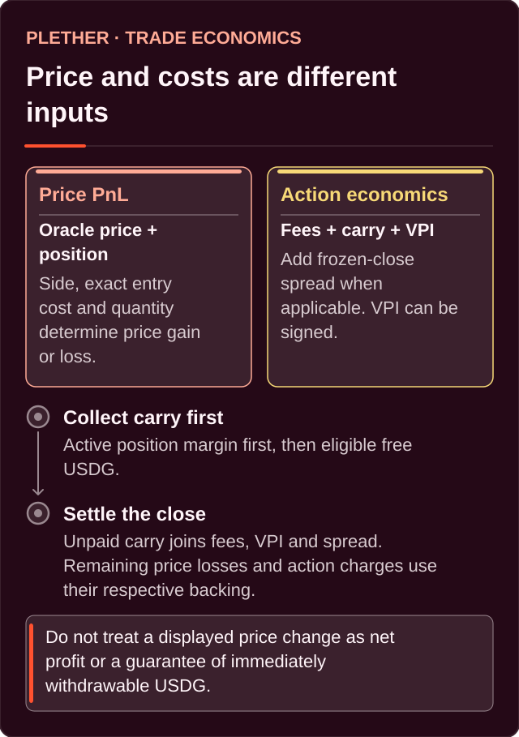
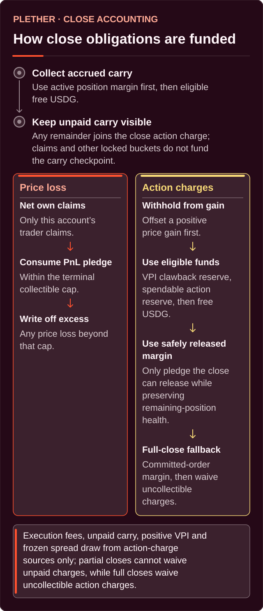
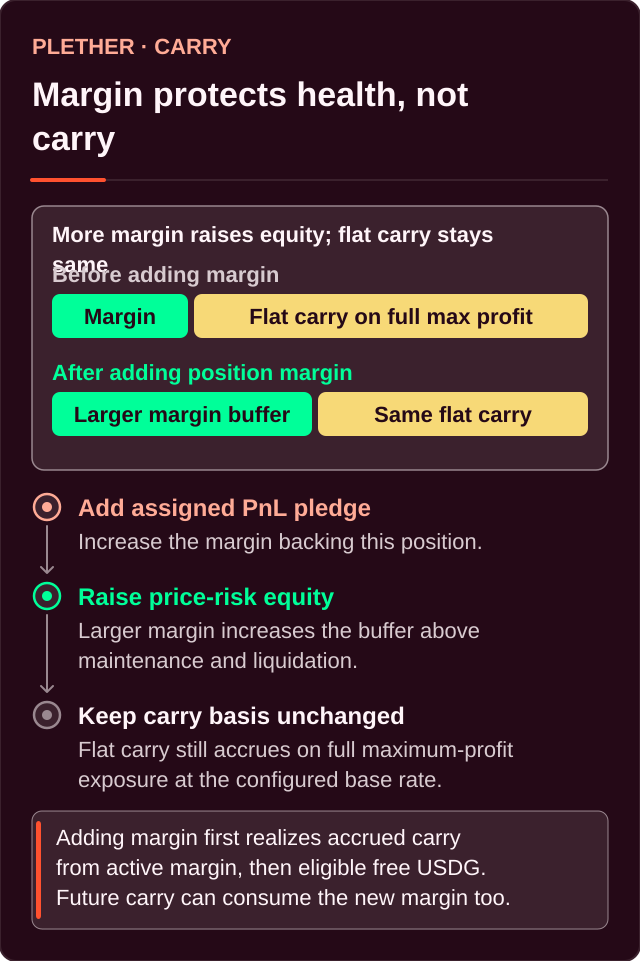

# Trading costs: fees, carry and VPI

A Plether trade has **one** oracle-derived[^oracle] execution price, surrounded by distinct USDG[^usdg] settlement costs. Only the adverse oracle confidence adjustment changes the entry or exit price recorded on your position; every other item settles separately in USDG.



## Cost summary (Core v2.1.0)

| Item | Current live setting | When it applies | Economic destination |
| --- | --- | --- | --- |
| **Sponsored network gas** | Covered by Plether paymaster | Eligible Trading Account UserOperations[^useroperation] | Paid by Plether (does *not* waive USDG trading costs) |
| **Protocol execution fee** | **`0.04%`** (`4 bps`) of executed contract notional | Successful open, increase, reduction or voluntary close | Protocol treasury (when cash-credited) |
| **Virtual Price Impact (VPI)** | Quadratic curve (`vpiFactor = 0.01`, `maxSkew = 40%`) | Successful position-size change | Trader ↔ liquidity pool (LPs[^lp]) |
| **Frozen-close spread** | **`0.50%`** (`50 bps`) of reduced contract notional | Voluntary reduction/close during `oracleFrozen` | **100% liquidity pool (LPs)** |
| **Cost of carry** | Flat **`5.00%` APR** (`baseCarryBps = 500`) | Continuously on full maximum-profit exposure | **100% liquidity pool (LPs)** |
| **Opening execution reward** | **`0.01%`** (`1 bp`), clamped **`0.01–0.25 USDG`** | Opens and increases only (reserved at commit) | Executing/cleanup keeper[^keeper] (or treasury if liquidated first) |
| **Close execution reward** | **`0 USDG`** | Reductions & full closes (including TP/SL closes) | None |
| **TP/SL trigger reserve** | **`0.25 USDG`** | Armed TP/SL protection | Keeper triggering the protection |
| **Liquidation charge** | **`0.10%`** (`10 bps`), min **`1.00 USDG`** | Successful liquidation | **`50%` keeper** (min `0.50 USDG`) / **`50%` LPs** / **`0%` protocol** |
| **Oracle confidence shift** | **`0.25×`** raw basket confidence | Opens, live/FAD[^fad] closes and liquidations | Embedded in fill price (not a separate fee) |

Gas sponsorship removes the need for ETH on eligible web-app Trading Account actions (see [Gas-sponsored trading and your Plether Trading Account](../trading-on-plether-perps/gas-sponsored-trading-and-your-plether-trading-account.md)), while direct permissionless contract calls outside the app still require ETH for gas and Pyth fees.

## Protocol execution fee (`0.04%`)

```text
Executed contract notional = Q_executed × B_execution = Q_executed × (2.00 − D_execution)
Protocol execution fee     = Executed contract notional × 0.04%
```

Applied on opens, increases, reductions and voluntary closes (so a round trip pays it twice; adding margin alone pays `0`). Fees are physical-cash-first: any portion that cannot be cash-credited on a terminal full close is waived rather than booked as LP bad debt or a protocol receivable.

## Virtual Price Impact

**VPI[^vpi]** prices how your trade changes directional imbalance in the liquidity pool without moving the oracle chart or using an AMM[^amm].

```text
Skew cost(K) = ½ × k × K² ÷ L
VPI          = Skew cost(K_after) − Skew cost(K_before)
```

where `K` is the absolute USDG difference between aggregate LONG USD and SHORT USD open interest (valued at raw basket `B`), `L` is total pool assets, and `k = 0.01` (`vpiFactorWad`).

* **Positive VPI** = charge paid to LPs (trade pushes the pool further out of balance).
* **Negative VPI** = rebate funded by LPs (trade moves the pool closer to balance).
* **Direction alone does not decide sign:** If LONG USD is `1,200,000 USDG` and SHORT USD is `800,000 USDG` (`400,000 USDG` skew[^skew]), opening LONG or closing SHORT pays VPI, while opening SHORT or closing LONG reduces skew and can earn a rebate.
* **Quadratic (`K²`):** Moving further from balance gets progressively pricier; splitting one order under unchanged market state yields the same total VPI.

**VPI is not oracle slippage:** Your **Execution limit** bounds only the oracle execution price — not VPI, fees, carry or frozen-close spread.

### Provisional VPI rebates and the lifetime clamp

Each position tracks signed accumulated VPI:

* **Provisional rebate backing:** Negative accumulated VPI requires matching funds in a dedicated `vpiRebateReserve` (excluded from position price equity; an underfunded reserve is an independent liquidation trigger). A `50 USDG` provisional rebate does not add `50 USDG` of price liquidation headroom.
* **Lifetime clamp on close:** For the proportional slice being closed, `VPI_accumulated_slice + VPI_close >= 0`. Closing rebates can offset prior VPI charges paid by that position down to `0`, but cannot turn a round trip into net rebate extraction from LPs.
  * *Example:* If an open paid `60 USDG` VPI and the close quote is a `−80 USDG` rebate, the realized close rebate is capped at `−60 USDG` (lifetime VPI `= 0`). Conversely, if an open received a `−40 USDG` provisional rebate, closing reconciles/claws back that `40 USDG`.

### Frozen-close spread (`50 bps` during `oracleFrozen`)

Voluntary reductions and closes during `oracleFrozen` keep normal signed VPI (plus the lifetime clamp), waive the `0.25×` confidence shift, and add a fixed **`50 bps` (`0.50%`)** spread on reduced contract notional:

```text
Frozen-close spread = Reduced contract notional × 0.50%
```

For `10,000 USDG` reduced contract notional, the spread is `50 USDG`. It applies **only** to voluntary closes executed during `oracleFrozen` (never live, FAD-only or liquidations), goes **100% to LPs**, and is governed via a **`72-hour` timelock** (bounded onchain between nonzero and `1,000 bps` / `10.00%`). Execution-time market state controls whether it applies.



**Collection priority & waiver:** Carry collects first (active position margin → free USDG), then realized price loss consumes same-account trader claim → position margin. Action charges (execution fee, unpaid carry, positive VPI, frozen-close spread) settle separately from positive price PnL, dedicated VPI reserve, safely released margin, free USDG and (full close only) eligible committed-order margin. Partial closes cannot waive any charge; terminal full closes waive uncollectible action charges (`assessed = paid + waived`), and waived spread is neither bad debt, a claim nor an LP receivable.

## Cost of carry

Plether has **no peer-to-peer funding rate**. Instead, **carry[^carry]** is a flat annual fee paid to LPs on a position's full bounded maximum-profit exposure, independent of assigned margin, pool utilization, or direction — so **both LONG USD and SHORT USD pay carry at the same flat rate**.

```text
Max bounded profit  = size × (2.00 − entry price) [LONG]  or  size × entry price [SHORT]
Position carry      = Max bounded profit × Base carry rate (5.00% APR) × elapsed time ÷ 365 days
```

* **Illustrative example:** With `25,000 USDG` max profit and `5.00%` flat base rate, 30 days of carry is `25,000 × 5.00% × 30 ÷ 365 ≈ 102.74 USDG`, regardless of assigned position margin or pool utilization.
* **Accrues continuously:** Follows wall-clock time 24/7 — including while a close is pending, during FAD, during weekend `oracleFrozen` closures and during stale periods.
* **Checkpoints before state changes:** Realizes before increases, reductions, margin edits, deposits, withdrawals or parameter changes, collecting from **active position margin first, then eligible free USDG** (never from trader claims). Reducing position margin via carry lowers price equity immediately; adding position margin (**Add margin**) raises price-loss backing without lowering future carry.



## Putting it together: opens, closes and liquidations

* **Opening / increasing:** Resulting position margin ≈ `carry-adjusted existing margin + submitted margin − execution fee (0.04%) − signed VPI` (opening execution reward is reserved separately from free USDG).
* **Voluntary reduction / close:**
  ```text
  Net close economics = Gross realized PnL − Execution fee (0.04%) − Signed close VPI − Pending carry − Frozen-close spread (if oracleFrozen)
  ```
  Close execution reward is **`0 USDG`**. Released position margin is added separately as unlocked collateral, and gross realized PnL[^pnl] reflects only directional price movement.
  * **Live/FAD example (VPI charge):** `+1,200` PnL `− 25` fee `− 40` VPI `− 75` carry `= +1,060 USDG`.
  * **Live/FAD example (`−40 USDG` eligible VPI rebate):** `+1,200 − 25 − (−40) − 75 = +1,140 USDG`.
  * **Same close during `oracleFrozen` (`10,000 USDG` notional → `50 USDG` spread):** `+1,200 − 25 − 40 − 75 − 50 = +1,010 USDG`.
* **Liquidation:** No execution fee, no new closing VPI and no frozen-close spread; includes pending carry, negative-VPI clawback, side-adverse liquidation mark and the `0.10%` liquidation charge (min `1.00 USDG`, split `50%` keeper / `50%` LPs).

## The order execution reward

* **Opens and increases:** Reserve `1 bp` (`0.01%`) of commit notional clamped to **`0.01–0.25 USDG`** from free USDG. Paid to the keeper on execution, terminal failure or expiry cleanup — or forfeited to the protocol treasury if liquidation clears the order first.
* **Reductions and full closes (including TP/SL closes):** **`0 USDG`** execution reward in every outcome. (TP/SL separately reserves `0.25 USDG` to compensate the keeper that triggers the protection.)

## Oracle confidence adjustment

During opens, live/FAD voluntary closes and liquidations, Plether shifts the fill price adversely by **`0.25×`** raw basket confidence (displayed as **Adverse oracle confidence spread**). It is embedded in the fill price rather than charged as a separate USDG fee, and is waived on `oracleFrozen` voluntary closes (where the `50 bps` frozen-close spread applies instead).

## Reading cost previews in the live UI

* **Ticket & Commit Preview:** Displays **Estimated fee**, **VPI: Pay / Receive**, **Adverse oracle confidence spread** and (for opens) **Estimated execution reward**. Close previews additionally project **Commitment carry**, **USDG after execution**, **Trader claim after execution**, **Position VPI balance** and any frozen-close spread (**Assessed / Paid / Waived**).
* **Two meanings of "Cost of carry":** In the market header it displays the maximum base rate (`5.00%` APR); in **Current Position** it displays your position's accrued unpaid carry in USDG.
* **Final Result:** Reconciles the executed receipt (including **Frozen spread charged**, **Close result before settlement adjustments**, **Settlement adjustment** and **Actual account change**). Always treat the confirmed onchain receipt as authoritative.

## What LPs receive

**Flows into the liquidity pool (LP-owned):** Collected trader losses, realized carry, net positive VPI, paid frozen-close spread, **`50%` of collected liquidation charges** and retained frozen LP withdrawal fees.

**Does *not* belong to LPs:** Protocol execution fees (`0.04%`, treasury), opening execution rewards (keeper, or treasury if liquidated), the `50%` keeper liquidation share and waived close charges.

Once LP revenue enters the pool, it follows the Senior–Junior waterfall (restoring any Senior impairment first, then accruing to Junior while Junior funds Senior's target coupon). See [Understand LP returns and share value](../providing-liquidity/understand-lp-returns-and-share-value.md).

[^oracle]: A service that supplies external market data to smart contracts; Plether uses Pyth price feeds.
[^usdg]: USDG is used for margin and settlement. The testnet uses MockUSDG, a test token with no real-world value.
[^useroperation]: A signed smart-account instruction sent to a bundler for onchain inclusion.
[^lp]: Liquidity provider, a participant that supplies USDG capital to the liquidity pool.
[^keeper]: A permissionless actor or bot that submits order-finalization or protocol-maintenance transactions.
[^fad]: Friday Afternoon Deleverage, Plether’s wider scheduled close-only window around the weekly FX closure.
[^vpi]: Virtual Price Impact, a separate USDG charge or rebate based on how a trade changes pool directional imbalance.
[^amm]: Automated market maker, an onchain liquidity mechanism that prices trades using a pool and formula.
[^skew]: The imbalance between aggregate LONG USD and SHORT USD exposure.
[^carry]: The time-based cost charged on the portion of a position financed by LP capital.
[^pnl]: Profit and loss, the financial result of market-price movement on a position.
