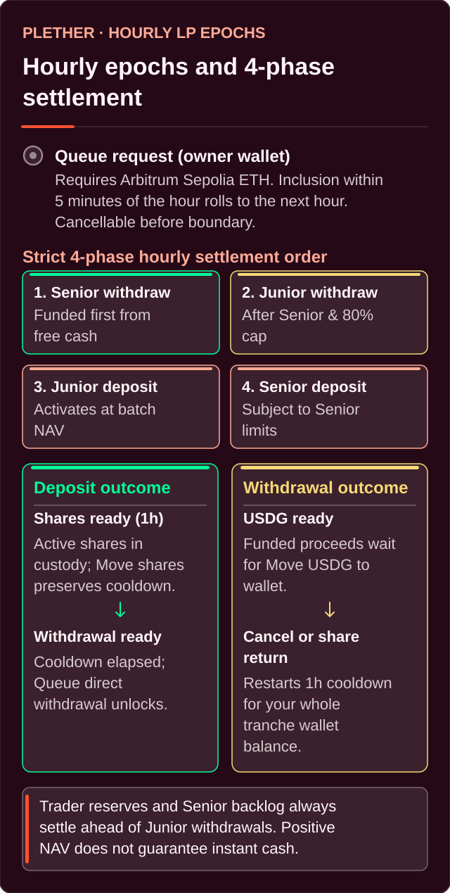
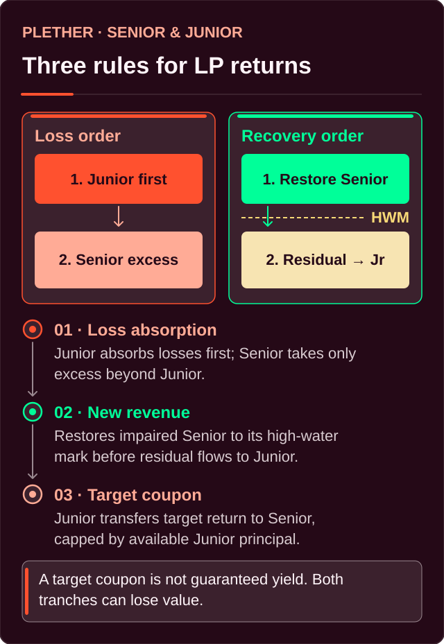
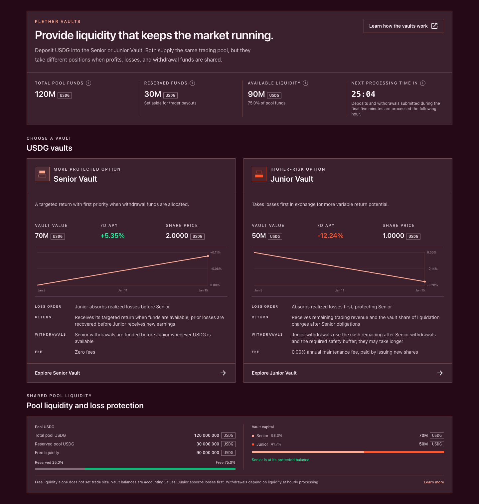

# Liquidity provider quickstart

> **Supply the USDG balance sheet behind Plether Perps.**

Plether liquidity providers (LPs) deposit USDG into the **Senior Vault** (`psLP`) or **Junior Vault** (`pjLP`). Both vaults back the same liquidity pool that stands behind trader payouts and collects realized carry, VPI charges, paid frozen-close spreads, and the LP share of liquidation charges.

Returns appear through changes in **share value**, not separate interest harvests. This is underwriting capital: share value can rise or fall, and withdrawals depend on unencumbered pool cash.

> **Vaults use your owner wallet—not your Trading Account**
>
> * Use the **`Vaults`** page for LP actions. The `Deposit` and `Withdraw` buttons on the Perps page fund or exit your trader **Margin Account**, not an LP vault.
> * LP approvals, deposits, cancellations, claims and withdrawals run directly from your connected **owner wallet** and are **not gas-sponsored**. You need both **MockUSDG** and **Arbitrum Sepolia ETH** in your owner wallet.
> * The trader welcome faucet credits your **Margin Account**, not your owner wallet. To use faucet funds for LP testing, withdraw them to your owner wallet first.

MockUSDG is test collateral with no real-world value. It is not issued by Paxos and cannot be redeemed for real dollars.

### How hourly vault requests work

Every LP deposit and withdrawal enters an hourly processing queue:

Never transfer USDG directly to the liquidity pool or vault contract—always use the Vaults deposit flow so the vault records your request.

### 1. Choose Senior or Junior

Both tranches back the exact same market, but occupy different layers of the loss and withdrawal waterfall:

| | Senior Vault (`psLP`) | Junior Vault (`pjLP`) |
| --- | --- | --- |
| **Return model** | Target coupon funded from available Junior value | Residual pool trading revenue after Senior obligations |
| **Loss priority** | Absorbs losses only after Junior is exhausted | Absorbs losses first |
| **Withdrawal priority** | Matured requests funded before Junior | Funded after Senior, subject to free cash and the Senior-share cap (`80%` in v2.0.0) |
| **Main risk** | Coupon can pause; principal can be impaired if Junior is wiped out | First-loss capital; can be wiped out before Senior takes a loss |

Read [Choose Senior or Junior](providing-liquidity/choose-senior-or-junior.md) for the full trade-off before choosing.

### 2. Review the pool and vault state

Open `Vaults` on [app.sepolia.plether.com/vaults](https://app.sepolia.plether.com/vaults). The overview shows **Total pool funds**, **Reserved funds**, **Available liquidity**, **Next processing time in**, and both vault cards.

Select **Explore Senior Vault** or **Explore Junior Vault** and review:

* **Current vault value**, **Share price**, and **Estimated withdrawal liquidity**
* **Deposit availability** and **Next processing time** (note the 5-minute cutoff before each hour)
* **Shared pool status** (check for any pause, shortfall, degraded safety restrictions, or frozen pricing)
* For Junior, **Market exposure** (shows trader skew and ±1% USD index impact on Junior capital)

### 3. Queue your first deposit

1. Confirm your connected owner wallet is on **Arbitrum Sepolia** and holds MockUSDG + ETH for gas.
2. In the right-hand action panel, choose **Deposit**, enter an amount within **Wallet balance** and the vault deposit limit, and select `Review deposit`.
3. Verify **USDG to deposit**, **Estimated shares received**, **Current share price**, and **Expected processing**.
4. Select `Confirm deposit`. If allowance is needed, confirm `Approve USDG` (verify the spender is the exact selected Tranche Vault from [Deployments, contracts and live parameters](reference/deployments-and-parameters.md)), then confirm `Queue deposit`.
5. Keep the dialog open until `Deposit submitted`, then open **Your position**.

The preview share count is an estimate—final shares are fixed when the hourly batch settles. While the status is **Pending** (before the processing hour), you can cancel with `Cancel deposit`.

### 4. Claim shares (or withdraw after cooldown)

An automated permissionless keeper settles eligible hourly batches (there is no manual finalize button in the UI). Once your deposit processes:

* Your shares are active and begin participating in vault performance immediately, and their **one-hour withdrawal cooldown** starts.
* Under **Your position → Pending deposits**, the record moves to **Shares ready** (and then **Withdrawal ready** once the 1-hour cooldown finishes).
* Select **`Move shares to wallet`** to deliver `psLP` or `pjLP` to your owner wallet (preserving the activation timestamp without restarting the cooldown), **or** once cooldown completes, select **`Queue direct withdrawal`** to exit straight from vault custody without moving shares to your wallet first.

### 5. Withdraw when ready

1. Open the vault's **Withdraw** mode, enter a target USDG amount (converted to **Estimated shares used**), and select `Review withdrawal`.
2. Confirm `Queue withdrawal` in your owner wallet. Locked shares continue gaining or losing value until the withdrawal is funded at an eligible hourly cycle (Senior requests are funded first).
3. Once funded, status changes to **USDG ready**—select **`Move USDG to wallet`** to receive your USDG.

Note: Cancelling a pending withdrawal (or returning a zero-value share remainder) restarts the **one-hour cooldown** for your entire wallet balance in that tranche.

### Continue from here

* [Choose Senior or Junior](providing-liquidity/choose-senior-or-junior.md)
* [Deposit liquidity](providing-liquidity/deposit-liquidity.md) & [Manage a pending deposit](providing-liquidity/manage-a-pending-deposit.md)
* [Read your LP position and pool health](providing-liquidity/read-your-lp-position-and-pool-health.md)
* [Withdraw liquidity](providing-liquidity/withdraw-liquidity.md)
* [LP risks and safeguards](providing-liquidity/lp-risks-and-safeguards.md) & [LP troubleshooting](providing-liquidity/lp-troubleshooting.md)
