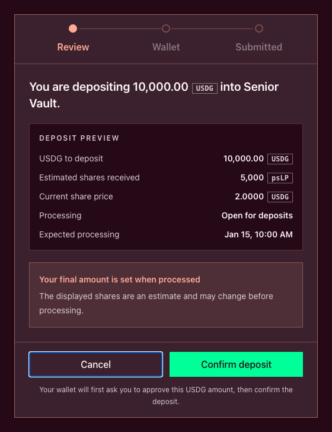

# Deposit liquidity

> **Use the Vaults page for LP deposits.** The Perps-page **Deposit** button funds a trader Margin Account — it never mints Senior or Junior LP shares.

Plether liquidity-provider (LP)[^lp] deposits are queued for hourly epoch settlement. Submitting a deposit escrows USDG[^usdg] in the chosen Senior or Junior tranche[^tranche] vault; active 9-decimal vault shares (`psLP` or `pjLP`) are minted only when the hourly epoch settles.

If you have not yet chosen a tranche, start with [Choose Senior or Junior](choose-senior-or-junior.md) and [LP risks and safeguards](lp-risks-and-safeguards.md).

## Before you start

On Arbitrum Sepolia, prepare:

* A compatible connected **owner wallet** on Arbitrum Sepolia
* **MockUSDG in your owner wallet** (not only in your separate Trading Account or Margin Account — check **Wallet balance** on the deposit form)
* **Arbitrum Sepolia ETH** in your owner wallet — LP approvals, deposits, cancellations and claims are direct owner-wallet transactions and are **not** gas-sponsored

## 1. Open the selected vault (not the Perps deposit)

Open **Vaults** → **Explore Senior Vault** or **Explore Junior Vault** → **Deposit** (**Deposit USDG**).

| | LP vault deposit | Trader Margin Account deposit |
| --- | --- | --- |
| **Where it starts** | **Vaults** → Senior or Junior Vault → **Deposit** | Perps page **Margin Account** → **Deposit** |
| **USDG source** | Connected owner wallet | Trading Account (plus owner shortfall transfer if needed) |
| **Result** | Queued deposit → `psLP` or `pjLP` vault shares | Margin Account collateral |
| **Gas policy** | Owner wallet pays Arbitrum Sepolia ETH | Eligible Trading Account actions are gas-sponsored |

## 2. Verify network, balance and vault contract

Confirm your owner wallet, Arbitrum Sepolia network and **Wallet balance**. Open the vault address link in the header and confirm it matches the active deployment's official Senior or Junior Vault address (see [Deployments & live parameters](../reference/deployments-and-parameters.md)).

> Never send MockUSDG directly to a vault or the liquidity pool. Always use the **Deposit USDG** flow (`requestDeposit`) so the vault tracks your deposit for settlement, cancellation and share delivery.

## 3. Check deposit availability and the five-minute cutoff

Check **Deposit availability**, current limits (including **Senior deposit limits** for Senior), **Next processing time** and whether hourly processing is paused.

* **Five-minute cutoff:** The vault assigns your request based on its **onchain block-inclusion timestamp**. Inclusion strictly more than 5 minutes before the hour targets that hour's epoch; inclusion within the final 5 minutes targets the following hour.
* **No guaranteed conversion or timing:** **Estimated shares you'll receive** is indicative only — final shares are computed at hourly settlement from the reconciled share price. Deposits pay no frozen-oracle fee, but cannot activate while the oracle is frozen, pricing is stale, Senior is impaired or a pool shortfall/pause is active.

## 4. Enter amount and review

Enter an amount within your **Wallet balance**, the vault's live minimum and current deposit capacity, then select **Review deposit**.

## 5. Confirm transactions in your owner wallet

Select **Confirm deposit**. Up to two owner-wallet transactions are required:

1. **Approve USDG** (only when current allowance is lower than your deposit amount): verifies `MockUSDG.approve(selectedTrancheVault, depositAmount)` for the **exact** deposit amount to the official selected Tranche Vault. Approval changes allowance only and moves no tokens.
2. **Queue deposit**: moves MockUSDG into vault escrow and creates your queued deposit record.

Keep the modal open until it reports **Deposit submitted**, and note both transaction hashes.

## 6. Track status and complete your deposit

Open **Vaults → Your position** to follow your deposit record. Permissionless hourly settlement is normally executed by Plether's LP settlement keeper[^keeper] (in strict order: Senior withdraw → Junior withdraw → Junior deposit → Senior deposit); there is no manual **Finalize** button in the UI.

| Status | Meaning | Available action |
| --- | --- | --- |
| **Pending** | Escrowed before its target hourly epoch | Wait or **Cancel deposit** (returns USDG, mints no shares) |
| **Waiting for processing** | Target hour passed; waiting for keeper settlement or safety gate | Wait and check pool status (do not duplicate) |
| **Shares ready** | Epoch settled; shares are active and accruing performance while the 1-hour withdrawal cooldown runs | **Move shares to wallet** (preserves activation timestamp) |
| **Withdrawal ready** | Shares are active and the 1-hour source cooldown has elapsed | **Move shares to wallet** or **Queue direct withdrawal** |
| **Refund available** | Batch aggregate deposit quote rounded to zero shares (epoch rejected) | **Return USDG to wallet** |

Once **Shares ready** or **Withdrawal ready** appears, your shares already participate in vault gains and losses. **Move shares to wallet** delivers them to your owner wallet without restarting the 1-hour cooldown (applying the later of the deposit's activation time and any existing wallet cooldown). Once the source cooldown expires (**Withdrawal ready**), **Queue direct withdrawal** lets you exit straight from vault escrow without moving shares to your wallet first.

## Common deposit surprises

* **Approval confirmed, no deposit row:** Approval sets allowance only — confirm **Queue deposit** next.
* **USDG left wallet, wallet shares still zero:** Check **Your position**; queued deposits only become wallet shares after settlement and **Move shares to wallet**.
* **Final shares differ from preview:** Settlement uses the batch share price at execution, not the request-time estimate.

For step-by-step tracking and edge cases, continue to [Manage a pending deposit](manage-a-pending-deposit.md) or [LP troubleshooting](lp-troubleshooting.md).

[^lp]: Liquidity provider, a participant that supplies USDG capital to the liquidity pool.
[^usdg]: USDG is used for margin and settlement. The testnet uses MockUSDG, a test token with no real-world value.
[^tranche]: A pool layer with its own loss priority, withdrawal priority and return profile.
[^keeper]: An enabled service that submits eligible protocol-maintenance transactions, including hourly vault processing, through the permissionless settlement path.
