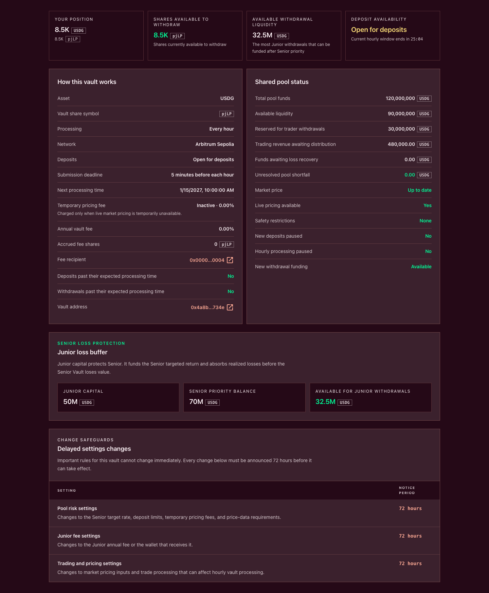

# LP risks and safeguards

> **LP return is compensation for underwriting trader liabilities — not risk-free yield.** Both Senior and Junior shares can lose value, face withdrawal delays, or be completely wiped out.

Plether combines solvency checks, a Senior–Junior waterfall, conservative accounting, a withdrawal firewall and hourly epoch processing to manage specific risks. These controls shape *how* losses and delays occur; they never guarantee principal, return, processing time or instant liquidity.

> **Owner wallet & testnet scope:** On Arbitrum Sepolia, LP actions use MockUSDG (no real-world value), execute directly from your connected owner wallet (not your gas-sponsored Trading Account) and require Arbitrum Sepolia ETH for gas.

## Core economic risk

The liquidity pool is the USDG[^usdg] counterparty to Plether Perps[^perps]. LP[^lp] capital pays profitable traders, funds negative VPI[^vpi] rebates and absorbs bad debt in exchange for collectible trader losses, realized carry[^carry], positive VPI, paid frozen-close spreads, `50%` of collected liquidation charges and retained frozen withdrawal fees.

* **Directional exposure:** Although LPs do not choose LONG USD or SHORT USD, the pool sits on the opposite side of net aggregate trader skew.
* **Bounded payoff ≠ zero loss:** The `0.00–2.00` index range and entry solvency check ensure maximum modeled trader liability is backed at entry, but when an admitted trader position wins, LP capital still pays it out.

## Safeguards are controls, not guarantees

| Safeguard | Designed to do | Does *not* guarantee |
| --- | --- | --- |
| **Bounded `0.00–2.00` range & entry solvency check** | Reject new trader exposure when effective backing cannot cover max liability plus the `0.25%` settlement buffer | That LP principal cannot decline or that bad debt is impossible |
| **Physical-asset & Terminal NAV accounting** | Count `min(raw, accounted)` assets and deduct marked trader gains while capping marked trader losses at collectible collateral | That NAV equals withdrawable cash or locks a future redemption price |
| **Junior first-loss & Senior recovery priority** | Absorb losses in Junior first and restore impaired Senior to its high-water mark before Junior earns residual revenue | Principal protection for Senior or a cap on Junior losses |
| **Withdrawal firewall & 4-phase hourly settlement** | Reserve cash for trader liabilities and claims first, then settle Senior withdrawals → Junior withdrawals → Junior deposits → Senior deposits | Instant or guaranteed-date LP redemptions |
| **1-hour cooldown & frozen-oracle withdrawal fee** | Limit short-term arbitrage and retain `0.25%` (Senior) / `0.75%` (Junior) inside the tranche on frozen exits | Zero arbitrage loss or uninterrupted frozen pricing past the `3-day` staleness cap |
| **Pause & degraded-mode controls** | Halt new deposits, hourly processing or new withdrawal funding during stress | A loss-free recovery or uninterrupted access |
| **Non-upgradeable perps core & `72-hour` settings timelocks** | Prevent silent in-place logic swaps and give 72 hours' notice on pool risk, Junior fee, engine and router parameter changes | Bug-free contracts, safe governance decisions or immutability of external dependencies |

## Tranche-specific principal risk

* **Senior Vault (`psLP`):** Last-loss inside the LP stack, but still loses principal (and can be wiped out) once Junior reaches zero. Its target coupon comes strictly from available Junior principal — unpaid coupon never accrues as debt.
* **Junior Vault (`pjLP`):** First-loss and subordinated for withdrawals. Junior can be wiped to zero while Senior stays whole. If governance activates a nonzero **Annual vault fee** (`0%` on active v2.1.0; subject to a `72-hour` timelock), newly issued `pjLP` fee shares dilute existing holders.
* **Terminal wipeout:** A tranche with outstanding shares and zero accounting assets cannot be silently revived by ordinary deposits; recovery requires waterfall revenue or explicit recapitalization.

See [Choose Senior or Junior](choose-senior-or-junior.md) and [The liquidity pool and tranche waterfall](../how-plether-works/the-liquidity-pool-and-tranche-waterfall.md).

## Queueing, pricing, liquidity and cooldown risks

* **No locked rate:** Queued deposits and withdrawals execute at the future hourly batch share price. Final shares received (on deposit) or USDG paid (on withdrawal) can differ materially from request-time previews.
* **No guaranteed settlement hour:** Requests included within the final 5 minutes roll to the next hour, and any request can wait past **Expected processing** due to keeper downtime, hourly-processing pauses, stale pricing, degraded mode, Senior impairment or insufficient free cash.
* **Narrow cancellation window:** Ordinary **Cancel deposit** and **Cancel withdrawal** actions disappear once the target hourly boundary begins (even while the request sits at **Waiting for processing** or **Waiting for USDG**).
* **Illiquidity despite positive NAV:** Trader liabilities and claims rank ahead of both tranches, and Senior ranks ahead of Junior. Positive marked trader losses raise Terminal NAV without adding physical cash until collected.
* **1-hour cooldown:** Starts at deposit activation and is preserved by **Move shares to wallet**, but **restarts for your entire wallet balance in that tranche** whenever you cancel a withdrawal or call **Return shares to wallet**. While active, wallet shares cannot be transferred or queued for withdrawal.
* **Frozen-oracle exits:** During `oracleFrozen`, deposits are blocked and withdrawals incur the tranche-specific frozen fee (`0.25%` Senior / `0.75%` Junior). Because queued withdrawals lock a fixed share count, later price or fee changes alter final USDG rather than pulling extra shares.

See [Deposit liquidity](deposit-liquidity.md) and [Withdraw liquidity](withdraw-liquidity.md) for the exact state lifecycles.

## Pause and safety states

| Warning | Effect |
| --- | --- |
| **New deposits paused** | Blocks new deposit requests; eligible withdrawals remain available |
| **Safety restrictions (degraded mode)** | Blocks deposits and pauses new withdrawal USDG allocation until solvency recovers and the owner clears degraded mode |
| **Hourly processing paused** | New requests, pre-boundary cancellations and already-ready claims stay available, but no new epochs settle |
| **Unresolved pool shortfall / Senior impaired** | Blocks new deposits and triggers recovery rules |

## Technical, oracle and external risks

* **Smart-contract & immutability risk:** Core perps logic is non-upgradeable; a severe defect could cause permanent loss or require migration. Always verify deployed addresses against [Deployments & live parameters](../reference/deployments-and-parameters.md).
* **Oracle risk:** All 6 FX feeds come from Pyth[^pyth]. Confidence (`0.10%`) and alignment (`5s`) filters catch bad ticks but cannot eliminate upstream feed compromise or extended outages.
* **USDG & issuer risk:** Real USDG carries issuer, freeze and depeg risk; testnet MockUSDG carries zero economic value.
* **Keeper, RPC & indexing risk:** Hourly settlement relies on the permissionless LP settlement keeper (or any permissionless caller); UI Activity/Performance panels rely on explorer indexing, so treat onchain state and transaction receipts as authoritative (`Unavailable` / `--` never means zero).
* **Wallet & approval risk:** Verify the exact Tranche Vault spender and exact deposit amount before signing.

## Suitability check

Do not provide liquidity if you require guaranteed principal or APY[^apy], a fixed conversion rate, a guaranteed withdrawal date, cancellable requests at any time or gas-sponsored LP transactions.

For a shorter overview of protocol-wide risks, see [Key risks at a glance](../welcome/key-risks-at-a-glance.md). For full protocol disclosures, see [Full risk disclosures](../welcome/risks-you-should-understand-first.md) and [Security & governance](../reference/security-and-governance.md).

[^usdg]: USDG is used for margin and settlement. The testnet uses MockUSDG, a test token with no real-world value.
[^perps]: Perpetual contracts, derivatives with no scheduled expiry.
[^lp]: Liquidity provider, a participant that supplies USDG capital to the liquidity pool.
[^vpi]: Virtual Price Impact, a separate USDG charge or rebate based on how a trade changes pool directional imbalance.
[^carry]: The time-based cost charged on the portion of a position financed by LP capital.
[^pyth]: The oracle network that supplies Plether's external FX price feeds.
[^apy]: Annual percentage yield, an annualized return measure that includes compounding.
