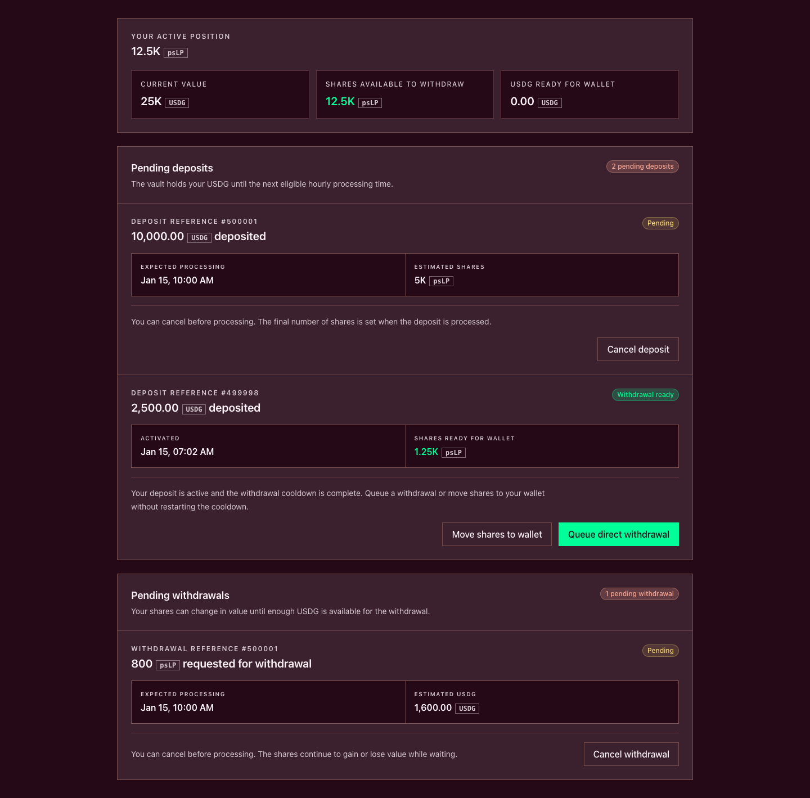

# LP troubleshooting

Liquidity-provider (LP)[^lp] actions can stall before submission, during an owner-wallet transaction or while waiting for hourly epoch settlement. Identify which balance, vault and request state you are looking at before submitting anything new.

> **Two separate systems:** The Perps-page **Deposit** and **Withdraw** buttons operate your gas-sponsored Trading Account's **Margin Account**. LP deposits and withdrawals happen only on the **Vaults** page from your connected **owner wallet** and require Arbitrum Sepolia ETH for gas.

## Check these first

1. Confirm your connected **owner wallet**, **Arbitrum Sepolia** network and official Senior or Junior Vault address (see [Deployments & live parameters](../reference/deployments-and-parameters.md)).
2. Identify where your value currently sits: owner-wallet MockUSDG, Trading Account / Margin Account MockUSDG, **Pending deposits**, wallet-held `psLP`/`pjLP`, **Pending withdrawals** or **USDG ready for wallet**.
3. Check the transaction receipt on Arbiscan before retrying.
4. Check **Expected processing**, the 5-minute cutoff, your 1-hour cooldown (**Available in**), oracle[^oracle] state, **Hourly processing paused**, **Safety restrictions**, **New withdrawal funding** and **Trading Account activity → Trading status → LP settlement**.

> Never transfer USDG[^usdg] directly to a vault or the liquidity pool, and never approve an unfamiliar contract.

## Quick symptom guide

| Symptom | Likely cause | Safe next step |
| --- | --- | --- |
| **Used `Deposit`, no shares appeared** | Either used Perps Margin Account deposit, only completed **Approve USDG**, or deposit is queued/ready in vault custody | Confirm target was the Tranche Vault, finish **Queue deposit** if only approved, then check **Vaults → Your position** |
| **Review deposit is disabled** | Pause, `oracleFrozen`, stale mark, pool shortfall, Senior impairment, deposit cap, sub-minimum amount or insufficient owner-wallet USDG | Read the displayed reason and **Available again** message (note: Trading Account USDG cannot fund owner-wallet LP deposits) |
| **Switch to Arbitrum Sepolia appears** | Wallet is on the wrong network | Switch wallet network to Arbitrum Sepolia first |
| **Deposit stuck at `Waiting for processing`** | Hourly settlement paused, keeper delayed, stale price, `oracleFrozen` or safety gate active | Check pool status and **Trading status → LP settlement**; do not submit a duplicate |
| **`Cancel deposit` / `Cancel withdrawal` missing** | Target hourly epoch has already started | Ordinary UI cancellation closes at the epoch boundary; monitor until **Shares ready** / **USDG ready** / refund |
| **`Shares ready` or `Withdrawal ready`, wallet shows 0 shares** | Shares are active in vault custody | Select **Move shares to wallet** (or **Queue direct withdrawal** once **Withdrawal ready** appears) |
| **Final shares or USDG differ from preview** | Batch settlement uses the live share price at processing, not the request-time estimate | Compare against the processed record rather than the preview |
| **`Refund available` on a deposit** | Processed batch aggregate quote rounded to zero shares (epoch rejected) | Select **Return USDG to wallet** and confirm receipt before re-depositing |
| **`Shares available to withdraw` is zero** | Shares are still in vault escrow, locked in a pending withdrawal, or inside the 1-hour cooldown | Wait for **Available in** to reach zero (note: cancelling a withdrawal or returning shares restarts the 1h cooldown for your entire wallet balance in that tranche) |
| **Withdrawal passes review but reverts onchain** | Partial withdrawal estimated below the live minimum (`1 USDG`) | Increase to at least `1 USDG` or exit 100% of remaining requestable shares |
| **Junior withdrawal stuck at `Waiting for USDG`** | Trader reserves and Senior withdrawals are funded first (plus `80%` Senior-share protection) | Monitor **Available withdrawal liquidity** and **New withdrawal funding**; do not duplicate |
| **`USDG ready`, wallet balance unchanged** | Proceeds are allocated in vault custody awaiting claim | Select **Move USDG to wallet** and confirm the owner-wallet transaction |
| **`Shares ready to return` shown** | Remaining shares quoted to zero assets during settlement (ordinary liquidity shortfalls stay queued instead) | Select **Return shares to wallet** (restarts 1-hour wallet cooldown) |
| **Withdrawal quotes more shares than expected** | `oracleFrozen` temporary pricing fee (`0.25%` Senior / `0.75%` Junior) is active | Wait for live pricing if not urgent; queued shares stay fixed once submitted |
| **`Older activity is unavailable`** | Block-explorer request discovery failed temporarily | Select **Retry history**; recent request IDs are still checked via direct onchain reads, and onchain receipts remain authoritative |
| **Share value dropped or Senior below target** | Trader payouts, rebates, bad debt, waterfall losses or insufficient Junior principal to fund Senior's non-accruing target coupon | Review **Performance** (and Junior **Return breakdown**) and confirmed pool events |

## Distinguishing pause and safety states

* **New deposits paused (safety pause):** Blocks new deposits; eligible withdrawals remain available.
* **Safety restrictions active (degraded mode):** Blocks deposits; eligible withdrawals can still queue, but zero new USDG is allocated until effective solvency recovers and degraded mode is explicitly cleared. Already-funded claims remain usable.
* **Hourly processing paused:** New requests, pre-boundary cancellations and already-ready claims work normally; no new hourly epochs settle until resumed.
* **Live pricing unavailable (`oracleFrozen`):** Blocks deposits; withdrawals remain available with the tranche-specific temporary pricing fee while frozen data stays within its staleness window.

## Why pool metrics differ from your personal balance

Read each Vaults number as a distinct layer — they are not interchangeable:

* **Total pool funds:** `min(raw pool assets, accounted assets)`, excluding quarantined excess.
* **Reserved for trader withdrawals:** Cash locked ahead of all LP withdrawals.
* **Available liquidity:** Pool cash after protected reserves (`max(Total pool funds − Reserved funds, 0)`).
* **Available withdrawal liquidity:** Estimated pool funding capacity for your tranche after Senior-first priority.
* **Current value:** Accounting value of your wallet-held `psLP`/`pjLP` shares (including any non-cash collectible marked trader loss receivables).
* **Shares available to withdraw:** Your wallet shares eligible to queue right now after cooldown and vault limits.
* **USDG ready for wallet:** Funded withdrawal USDG ready to claim via **Move USDG to wallet**.

## Information to include when reporting an issue

Include the **transaction hash**, **owner-wallet address**, **network**, **Senior or Junior Vault address**, **action and amount**, **deposit or withdrawal reference**, **Expected processing time and current status**, **Current value / Shares available to withdraw / USDG ready for wallet**, **cooldown countdown**, **oracle/fee state** and the **exact error message**. Never share a private key, seed phrase or unrelated signature.

Return to [Liquidity provider quickstart](../liquidity-provider-quickstart.md) or [The liquidity pool and tranche waterfall](../how-plether-works/the-liquidity-pool-and-tranche-waterfall.md).

[^lp]: Liquidity provider, a participant that supplies USDG capital to the liquidity pool.
[^oracle]: A service that supplies external market data to smart contracts; Plether uses Pyth price feeds.
[^usdg]: USDG is used for margin and settlement. The testnet uses MockUSDG, a test token with no real-world value.
