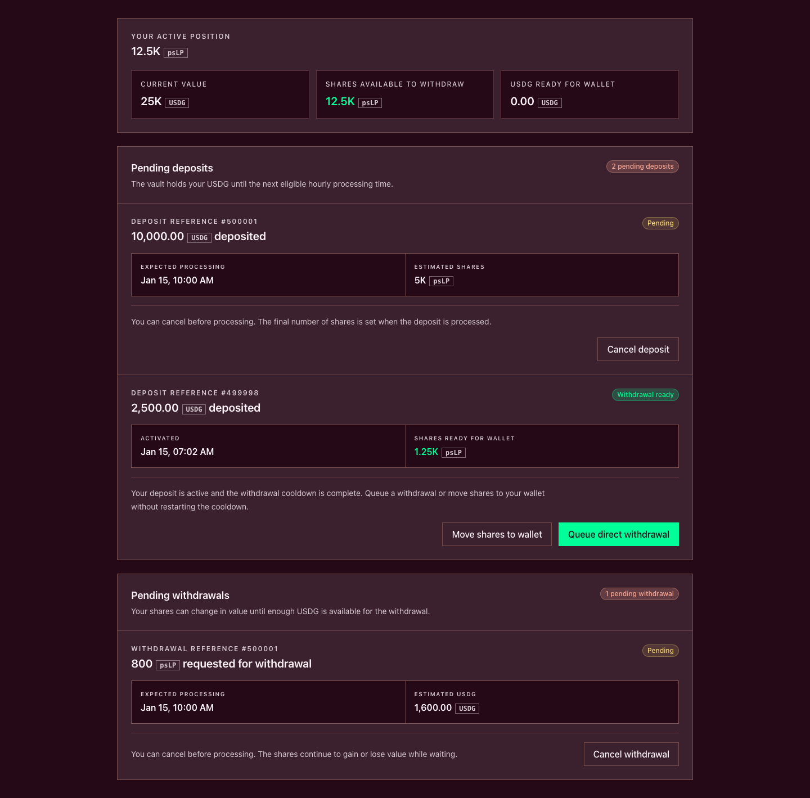

# Manage a pending deposit

Every Plether LP[^lp] deposit enters an hourly queue before active vault shares exist in your wallet.

Normal lifecycle:

```text
Queue deposit → Pending → Hourly settlement (1h cooldown starts) → Shares ready → Withdrawal ready → Move shares to wallet (or Queue direct withdrawal)
```

Alternate exits:

```text
Pending → Cancel deposit → USDG returned
Epoch rejected (aggregate deposit quote rounded to zero) → Refund available → Return USDG to wallet
```

Hourly settlement is permissionless and normally handled by Plether's LP settlement keeper[^keeper]; there is no user-facing **Finalize epoch** button.



## Read each deposit status

Open **Vaults → Your position** after **Deposit submitted** and match your record by tranche[^tranche], **Deposit reference**, USDG[^usdg] amount and **Expected processing** time.

| Status | Where the value sits | What it means | Action |
| --- | --- | --- | --- |
| **Pending** | Vault USDG escrow | Target hourly boundary has not arrived | Wait or **Cancel deposit** |
| **Waiting for processing** | Vault USDG escrow | Target hour passed; waiting for settlement or entry gate | Wait and check pool status |
| **Shares ready** | Vault share custody | Deposit is active and earning/losing with the vault; 1-hour source cooldown is still running | **Move shares to wallet** |
| **Withdrawal ready** | Vault share custody | Deposit is active and its 1-hour source cooldown has elapsed | **Move shares to wallet** or **Queue direct withdrawal** |
| **Refund available** | Vault USDG escrow | Processed batch rounded to zero shares; epoch rejected | **Return USDG to wallet** |

Queued USDG is not active LP exposure until settlement succeeds. Once **Shares ready** or **Withdrawal ready** appears, the shares are active even while still held in vault custody.

## 1. Use the cancellation window (while `Pending`)

**Cancel deposit** is available in the interface only while the record is **Pending** (before its target hourly epoch starts). Confirming cancellation in your owner wallet removes the request, returns escrowed USDG to your wallet and mints zero shares.

Once the expected processing time passes and status becomes **Waiting for processing**, ordinary UI cancellation disappears — even if settlement is delayed. Do not submit a duplicate deposit while an earlier request is waiting.

## 2. Wait for hourly settlement

Requests included onchain strictly more than 5 minutes before the hour target that hour's epoch; requests included within the final 5 minutes target the next hour. During settlement, Plether processes phases in strict order (**Senior withdraw → Junior withdraw → Junior deposit → Senior deposit**), reconciles pool accounting, sets the batch share price, moves accepted USDG into the pool and allocates your shares.

Because tranche share price and trader outcomes can move between submission and settlement, final shares can differ from **Estimated shares**.

If **Waiting for processing** persists past **Expected processing**, check:

* **Hourly processing paused** or **New deposits paused**
* Live pricing availability — scheduled close-only does not block deposit settlement by itself, but **`oracleFrozen`** halts deposit activation until live pricing resumes (deposits never pay the frozen-oracle withdrawal fee)
* Stale oracle mark, Senior impairment, deposit caps, safety restrictions or an unresolved pool shortfall
* Keeper status under **Trading Account activity → Trading status → LP settlement**

See [Market states and oracle closures](../how-plether-works/market-states-and-oracle-closures.md#what-closures-mean-for-lps) for pricing rules.

## 3. Move shares to wallet — or queue a direct withdrawal

When settlement succeeds, your deposit activates and its **1-hour withdrawal cooldown** starts immediately:

* **Move shares to wallet** (available under **Shares ready** and **Withdrawal ready**): transfers your `psLP` or `pjLP` shares into your owner wallet. It **preserves** the deposit's activation timestamp (applying the later of it and any existing wallet cooldown, so claiming never restarts a fresh hour and never shortens a newer wallet cooldown).
* **Queue direct withdrawal** (available once the badge changes to **Withdrawal ready**): routes shares from that single settled deposit straight into the current withdrawal queue without transferring them to your wallet or approving the vault first.

## 4. Recover a rejected epoch (`Refund available`)

If a processed batch's aggregate deposit quote rounds to zero shares, the epoch is rejected and shows **Refund available** with **USDG ready to return**. Select **Return USDG to wallet**, confirm the owner-wallet transaction and verify your wallet balance before submitting any new deposit.

## Before you stop monitoring

Confirm that your deposit reached one complete owner state: **Cancelled** (USDG returned), **Delivered** (`psLP`/`pjLP` in wallet), **Directly queued** (routed into a withdrawal request) or **Refunded** (USDG recovered).

Continue to [Understand LP returns and share value](understand-lp-returns-and-share-value.md) or [Read your LP position and pool health](read-your-lp-position-and-pool-health.md).

[^lp]: Liquidity provider, a participant that supplies USDG capital to the liquidity pool.
[^keeper]: An enabled service that submits eligible protocol-maintenance transactions, including hourly vault processing, through the permissionless settlement path.
[^tranche]: A pool layer with its own loss priority, withdrawal priority and return profile.
[^usdg]: USDG is used for margin and settlement. The testnet uses MockUSDG, a test token with no real-world value.
