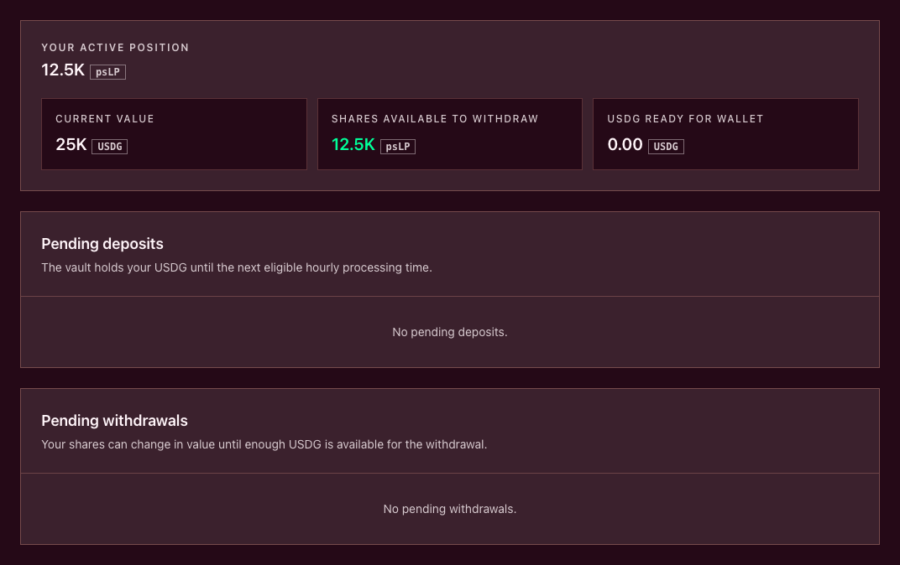
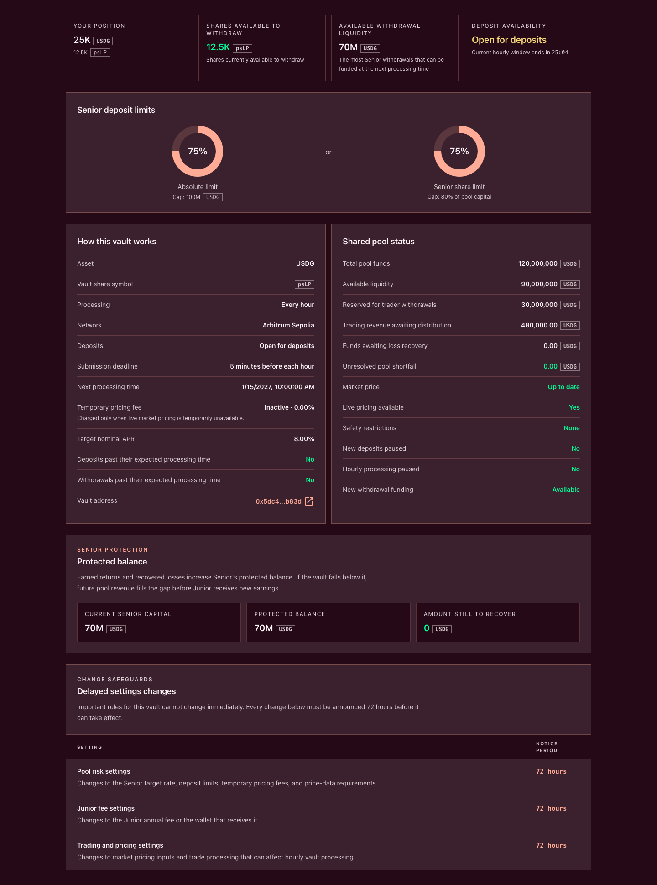

# Read your LP position and pool health

An LP[^lp] position is a balance of 9-decimal Senior (`psLP`) or Junior (`pjLP`) vault shares — a proportional claim on one tranche[^tranche] of the liquidity pool, not a fixed USDG[^usdg] balance.

Read any vault page by separating three distinct questions:

1. **What is my claim worth on paper?** Check wallet shares, **Share price** and **Current value**.
2. **How many shares can I queue to withdraw right now?** Check **Shares available to withdraw** and any **Available in** cooldown countdown.
3. **How much pool cash can fund withdrawals?** Check **Available liquidity**, **Available withdrawal liquidity**, Senior priority and hourly processing status.

> **Owner wallet & ETH gas:** The **Vaults** page reads your connected owner wallet on Arbitrum Sepolia (not your separate Perps Trading Account). All LP transactions are owner-wallet transactions and require Arbitrum Sepolia ETH.

## Navigate a vault detail page

From **Vaults**, select **Explore Senior Vault** or **Explore Junior Vault** to access:

* **Overview:** Your position summary, **How this vault works**, **Senior deposit limits** (Senior only), **Shared pool status**, **Protected balance** (Senior) or **Junior loss buffer** (Junior) and **Delayed settings changes**.
* **Market exposure** *(Junior Vault only)*: Live pool directional exposure and skew against the active cap.
* **Performance** *(shown only when complete 7-day deployment-matched history exists)*: **Seven-day share price**, **7d realized APY**[^apy], **7d return**, **Start/Current share price**, and — on the **Junior Vault** — the **Return breakdown** waterfall attributing Junior performance across trading revenue, carry, VPI[^vpi], Senior coupon and fees.
* **Your position:** **Your active position**, **Current value**, **Shares available to withdraw**, **USDG ready for wallet**, plus pending deposit and withdrawal records.
* **Activity:** The 7-day **Total assets and locked value** chart (comparing **Total assets (TVL)** against **Locked value**), **Holder distribution** and **Recent deposits and withdrawals**.

## Read the header and position metrics

| Label | What it measures |
| --- | --- |
| **Current vault value** | Accounting value assigned to this tranche (not immediately withdrawable cash) |
| **Share price** | Accounting value per `psLP` or `pjLP` share (`tranche accounting value ÷ effective share supply`, using ERC-4626[^erc4626] virtual-share accounting and, for Junior, any accrued fee shares) |
| **7d realized APY** | Historical annualized 7-day share-price return (can be negative; not a forecast) |
| **Estimated / Available withdrawal liquidity** | Pool-level USDG estimated to fund this tranche at the next hourly settlement (after trader reserves and Senior-first priority) |
| **Current value** | Approximate USDG value of your wallet-held shares (`shares × share price`) |
| **Shares available to withdraw** | Wallet shares eligible for a new withdrawal request after the 1-hour cooldown and vault limits |
| **USDG ready for wallet** | Already-funded withdrawal proceeds awaiting **Move USDG to wallet** |

LP returns appear inside **Share price** — there is no separate yield to harvest. Plether uses a single exact signed, collateral-capped **Terminal NAV** snapshot for entry and exit pricing: marked trader gains reduce LP value, while marked trader losses increase LP value only up to collectible collateral (and remain non-cash receivables until realized). See [Understand LP returns and share value](understand-lp-returns-and-share-value.md) for full return drivers.

## Read the Overview panels

* **How this vault works:** Confirms hourly processing, 5-minute **Submission deadline**, **Next processing time**, **Temporary pricing fee** (frozen-oracle withdrawal fee), backlog indicators, vault address, Senior **Target nominal APR** or Junior **Annual vault fee** / **Accrued fee shares** / **Fee recipient**.
* **Senior deposit limits** *(Senior Vault)*: Two donut rings (`0–100%`) showing **Absolute limit** usage (currently `40,000,000 USDG`) and **Senior share limit** usage (currently `80%` max Senior share of protected capital). Both count accepted pending deposits and `max(projected Senior capital, Senior high-water mark)`. Rings shift peach (`< 85%`) → amber (`>= 85%`) → red (`100%` / **Limit exceeded**).
* **Shared pool status:**

| Label | Meaning |
| --- | --- |
| **Total pool funds** | Canonical physically backed pool depth: `min(raw pool assets, accounted assets)`, excluding quarantined excess |
| **Available liquidity** | `max(Total pool funds − Reserved funds, 0)` before tranche priority and holder limits |
| **Reserved for trader withdrawals** | USDG protected for bounded trader liabilities, settlement buffer and trader claims |
| **Trading revenue awaiting distribution** | Collected LP value pending tranche reconciliation |
| **Funds awaiting loss recovery** | Recovery capital awaiting waterfall assignment (not ordinary yield) |
| **Unresolved pool shortfall** | Remaining deficit — any positive value blocks deposits and signals severe stress |
| **Market price / Live pricing available** | Freshness and live vs frozen oracle state |
| **Safety restrictions** | Whether degraded mode is active (blocks deposits and new withdrawal funding) |
| **New deposits paused / Hourly processing paused** | Independent pause controls for new requests vs hourly settlement |
| **New withdrawal funding** | Whether current conditions allow allocating new USDG to waiting withdrawals |

* **Delayed settings changes:** Lists any queued governance changes. On Core v2.1.0, changes to pool risk settings, Junior fee settings, engine settings and router settings require a **`72-hour` timelock** before taking effect.

If required onchain data is unavailable, metrics display `Unavailable` or `--` and action previews disable safely — never interpret missing data as zero.

## Read pending deposits, withdrawals and cooldowns

* **Pending deposits** transition through **Pending** (cancellable) → **Waiting for processing** → **Shares ready** (active, 1h cooldown running) → **Withdrawal ready** (cooldown elapsed; unlocks **Queue direct withdrawal**) or **Refund available** (**Return USDG to wallet**).
* **Pending withdrawals** lock shares (not fixed USDG) and transition through **Pending** (cancellable) → **Waiting for USDG** → **USDG ready** (**Move USDG to wallet**) and/or **Shares ready to return** (only when remaining shares quote to zero assets). Ordinary liquidity shortfalls stay queued rather than becoming returnable.
* **1-hour cooldown:** Starts when a deposit activates. **Move shares to wallet** preserves that timestamp; **Cancel withdrawal** and **Return shares to wallet** restart the 1-hour cooldown for your entire wallet balance in that tranche.

## Read Performance, Activity and stress warnings

* **Performance** (and Junior's **Return breakdown**) reflects hourly checkpoints over the last 7 days; if complete deployment-matched data is unavailable, the section is omitted rather than shown as zero.
* **Activity** combines the 7-day **Total assets and locked value** chart with block-explorer-indexed **Holder distribution** (wallet-held shares only, excluding vault escrow) and **Recent deposits and withdrawals**. If **Older activity is unavailable** appears, select **Retry history**.
* **Senior impairment (`Senior principal < Protected balance`):** Blocks ordinary deposits into both tranches and routes future reconciled LP gains back to Senior before Junior earns new residual value. A tranche with shares outstanding and zero assets is terminally wiped and cannot be silently revived by ordinary deposits.

## Market and protocol states at a glance

| State | Vaults behavior |
| --- | --- |
| **Scheduled close-only (live pricing)** | Normal LP rules; does not activate the temporary withdrawal pricing fee |
| **Oracle frozen (live pricing unavailable)** | Deposits blocked; withdrawals can queue with the tranche-specific frozen fee (`0.25%` Senior / `0.75%` Junior), retained inside that tranche |
| **New deposits paused** | Deposits blocked; eligible withdrawals remain available |
| **Safety restrictions (degraded mode)** | Deposits blocked; withdrawal requests can queue, but zero new USDG is allocated until solvency recovers and degraded mode is cleared |
| **Hourly processing paused** | New requests, pre-boundary cancellations and already-ready claims stay available; no new epoch settlement runs until resumed |

When planning an exit, continue to [Withdraw liquidity](withdraw-liquidity.md). For anomalies, see [LP troubleshooting](lp-troubleshooting.md).

[^lp]: Liquidity provider, a participant that supplies USDG capital to the liquidity pool.
[^tranche]: A pool layer with its own loss priority, withdrawal priority and return profile.
[^usdg]: USDG is used for margin and settlement. The testnet uses MockUSDG, a test token with no real-world value.
[^apy]: Annual percentage yield, an annualized return measure that includes compounding.
[^vpi]: Virtual Price Impact, a separate USDG charge or rebate based on how a trade changes pool directional imbalance.
[^erc4626]: The Ethereum tokenized-vault standard used for Plether tranche shares.
