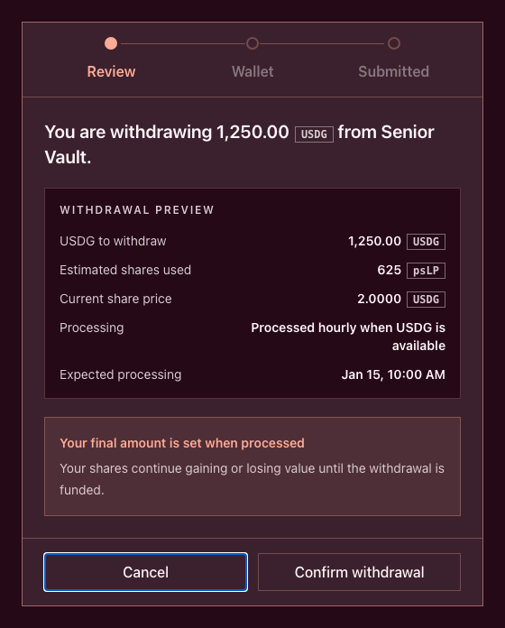

# Withdraw liquidity

> **Use the Vaults page for LP withdrawals.** The Perps-page **Withdraw** button withdraws trader Margin Account collateral — it never redeems Senior or Junior LP shares.
>
> All Vault transactions execute directly from your connected **owner wallet** and require Arbitrum Sepolia ETH for gas.

Withdrawing liquidity redeems active 9-decimal Senior (`psLP`) or Junior (`pjLP`) shares for USDG[^usdg] through the hourly vault queue:

```text
Review withdrawal → Queue withdrawal → Pending → Hourly funding (Senior first) → USDG ready → Move USDG to wallet
```

Locking shares in a withdrawal request does **not** lock a fixed USDG amount — queued shares remain exposed to vault gains and losses until hourly settlement funds them.

## 1. Check eligible shares and cooldown

| What you hold | Can you queue a withdrawal? |
| --- | --- |
| **Wallet-held `psLP` or `pjLP`** | Yes, up to **Shares available to withdraw** (after the 1-hour cooldown) |
| **Claimable deposit (`Withdrawal ready`)** | Yes — use **Queue direct withdrawal** straight from vault custody without transferring shares or approving |
| **Claimable deposit (`Shares ready`)** | Not yet — wait for its 1-hour activation cooldown to elapse (or move shares to wallet and wait for the same timer) |
| **Queued deposit (`Pending` / `Waiting`)** | No — must either cancel while Pending or settle into shares first |
| **Shares already in `Pending withdrawals`** | No — monitor the existing request |

### Cooldown rules to keep in mind

* Deposit activation starts a **1-hour** withdrawal cooldown. **Move shares to wallet** preserves that timestamp without resetting it.
* **Cooldown restart traps:** Selecting **Cancel withdrawal** or **Return shares to wallet** (for a zero-value share remainder) restarts the **1-hour** cooldown for your **entire wallet balance** in that tranche. Moving funded USDG to your wallet does **not** restart the cooldown.

## 2. Check the withdrawal firewall and tranche priority

Positive **Current value** does not guarantee immediate cash. Before funding LP[^lp] withdrawals each hour, Plether reserves physical pool USDG for maximum bounded trader liabilities, the `0.25%` settlement buffer and all outstanding trader claims.

Remaining free LP liquidity is then processed in strict 4-phase order:

1. **Senior withdrawals** (funded first, up to demand, Senior principal and free cash)
2. **Junior withdrawals** (funded only after matured Senior backlog clears, capped by remaining free cash, Junior principal and the `80%` max Senior-share ratio)
3. **Junior deposits**
4. **Senior deposits**

Because of this waterfall, Junior can hold positive share value while **Available withdrawal liquidity** is zero, and Senior can also wait when pool cash is reserved for open trader exposure. See [The liquidity pool and tranche waterfall](../how-plether-works/the-liquidity-pool-and-tranche-waterfall.md#the-withdrawal-firewall).

## 3. Check request limits, pauses and frozen-oracle fees

* **Minimum partial withdrawal:** Partial withdrawals must estimate to at least the live minimum (currently `1 USDG`); exiting 100% of remaining requestable shares can use the dust-exit exception. Because the UI may not block every sub-minimum partial request upfront, verify your amount before confirming.
* **Five-minute cutoff:** Onchain inclusion strictly more than 5 minutes before the hour targets that hour's epoch; inclusion within the final 5 minutes targets the following hour.
* **Frozen-oracle withdrawal fee:** During `oracleFrozen`, deposits are blocked, while withdrawals can still queue with a tranche-specific **Temporary pricing fee** (`0.25%` Senior / `0.75%` Junior), retained inside that tranche for remaining LPs. Because the request locks the quoted share count, subsequent share-price or fee changes adjust your final USDG receipt. Wait for live pricing if the exit is not urgent. (Scheduled close-only windows with live pricing do *not* trigger this fee.)
* **Degraded mode / Hourly processing paused:** Eligible withdrawal requests can still be queued, but no new USDG is allocated until degraded mode is cleared or hourly processing resumes. Already-funded USDG can still be moved to your wallet.

## 4. Queue the withdrawal

1. Open **Vaults** → **Explore Senior Vault** or **Explore Junior Vault** → **Withdraw** (**Withdraw USDG**).
2. Confirm **Shares available to withdraw**, **Available withdrawal liquidity**, pool status and any active temporary pricing fee.
3. Enter your target **Amount to withdraw** and check **Estimated shares used**.
4. Select **Review withdrawal**, confirm the tranche vault address and **Expected processing** time, then select **Confirm withdrawal** and sign **Queue withdrawal** in your owner wallet.



## 5. Monitor, cancel or claim proceeds

Open **Vaults → Your position → Pending withdrawals**:

| Status | Meaning | Action |
| --- | --- | --- |
| **Pending** | Shares queued before target hourly epoch; still exposed to vault PnL | Wait or **Cancel withdrawal** (restarts 1-hour wallet cooldown) |
| **Waiting for USDG** | Target hour arrived or passed; waiting for settlement, liquidity or Senior priority | Wait and monitor (ordinary cancellation is no longer available; do not duplicate) |
| **USDG ready** | USDG allocated to all or part of your request | **Move USDG to wallet** (separate owner-wallet tx) |
| **Shares ready to return** | A remaining share portion quoted to zero assets (terminal refund state) | **Return shares to wallet** (restarts 1-hour wallet cooldown) |

Ordinary insufficient-liquidity remainders stay queued in FIFO for future epochs rather than entering **Shares ready to return**. Partially funded requests can show **USDG ready** alongside **Return shares to wallet** if a zero-value remainder exists.

**USDG ready** stays in vault custody until **Move USDG to wallet** confirms onchain. After claiming, verify your updated owner-wallet MockUSDG balance and transaction receipt on Arbiscan.

If funding takes longer than expected or a status looks unfamiliar, see [LP troubleshooting](lp-troubleshooting.md) and [LP risks and safeguards](lp-risks-and-safeguards.md).

[^usdg]: USDG is used for margin and settlement. The testnet uses MockUSDG, a test token with no real-world value.
[^lp]: Liquidity provider, a participant that supplies USDG capital to the liquidity pool.
