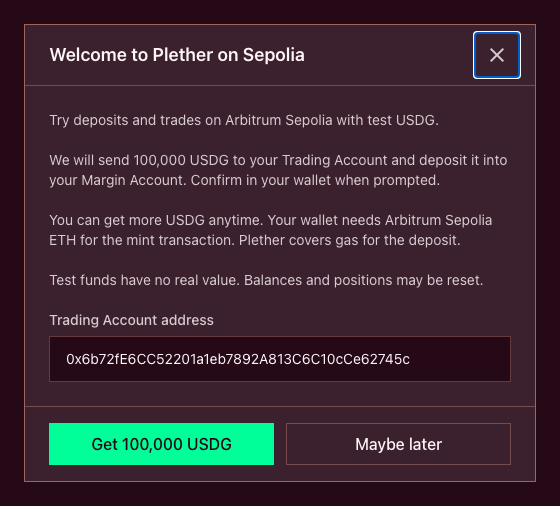
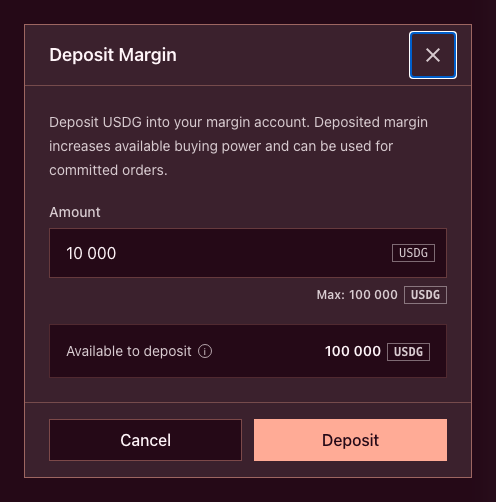
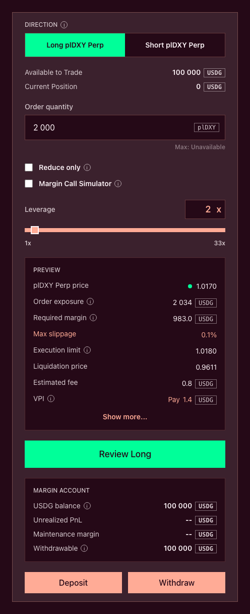
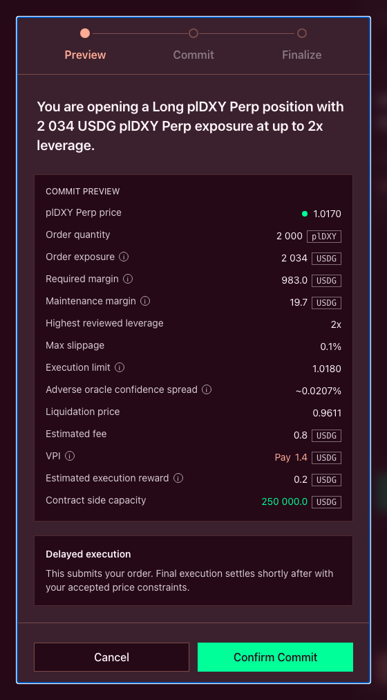
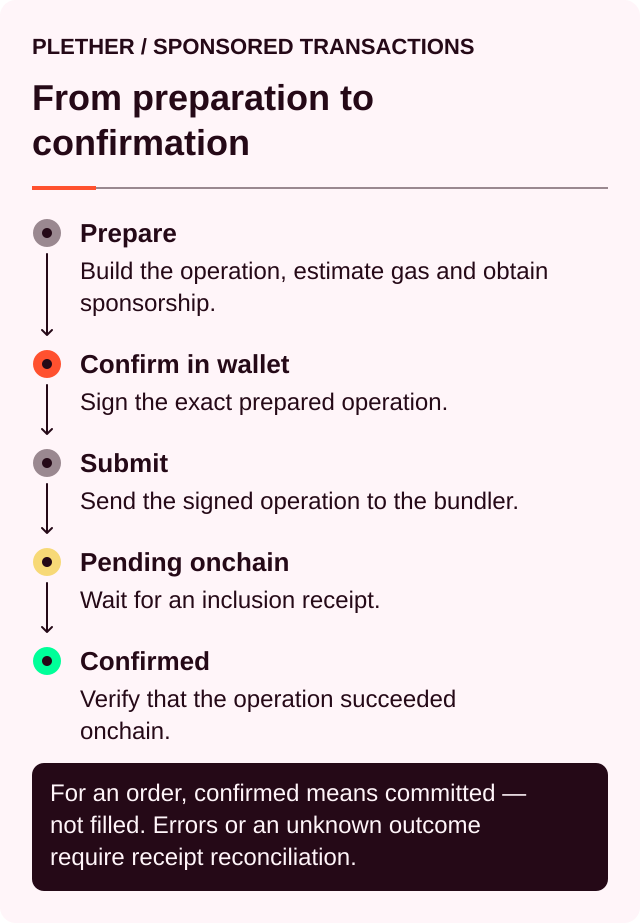

# Trader quickstart

> **Connect your wallet. Deposit test USDG. Review your first dollar trade.**

Try Plether on **Arbitrum Sepolia** with MockUSDG, a test token with no real-world value. This walkthrough uses a **100,000 USDG test allocation** and a **2,000 plDXY order at 2x leverage** to illustrate the controls. Prices, fees and limits change; follow the live preview.

The USDG release is being prepared. Follow these steps after funding and trading open. Product screenshots show illustrative USDG states.

Your wallet controls a separate **Plether Trading Account**. That account holds your collateral and positions. You do not receive a LONG or SHORT token in your wallet.

You need MetaMask or another compatible wallet and time to watch the order finish. Your owner wallet needs Arbitrum Sepolia ETH to mint test USDG. Eligible deposits and trades are gas-sponsored while sponsorship is available. Use only the official app and never share your seed phrase.

### 1. Connect and get test funds

Open [Plether on Arbitrum Sepolia](https://app.sepolia.plether.com), select `Connect Wallet`, then choose `MetaMask`.

In MetaMask, check **app.sepolia.plether.com** and select your intended owner account. Connect it, then confirm that the app and wallet use **Arbitrum Sepolia**, chain ID **421614**.

Select `Get USDG` in the testnet banner. Check the pre-filled **Trading Account address**, then select `Get 100,000 USDG`. Confirm the mint transaction in your owner wallet. It needs Arbitrum Sepolia ETH for gas and sends test USDG to your Trading Account.

After the mint confirms, authorize the sponsored deposit when prompted. If confirmation is delayed, use `Check confirmation` to resume the saved transaction.

### 2. Check your USDG balance

Wait for `USDG deposited into your Margin Account. You are ready to trade.`, then check **Available to Trade**. The welcome flow deposits the 100,000 USDG test allocation; it does not open a position.

To deposit funds already held by the Trading Account, select `Deposit` in **Margin Account**, enter an amount within **Available to deposit**, and authorize the sponsored action. The example below shows a separate 10,000 USDG deposit.

In MetaMask, verify the owner account, requesting site and **Arbitrum Sepolia** network before confirming. If the button says `Transfer & Deposit`, the app first transfers the shortfall from your owner wallet; that transfer needs ETH for gas. See [deposit sources and account balances](trading-on-plether-perps/your-margin-account.md).

### 3. Set a small example order

Check the market banner above the ticket. A new position needs an **Open** market and a valid preview. If the interface blocks the order, follow its message before continuing.

Choose your direction:

| Button | Dollar view | Benefits when the displayed price… |
| --- | --- | --- |
| **Long plDXY Perp** | USD strengthens against the currency basket | Rises |
| **Short plDXY Perp** | USD weakens against the currency basket | Falls |

For the example, select `Long plDXY Perp`, enter `2000` in **Order quantity**, and set **Leverage** to `2x`. Leave **Reduce only**, **Take profit / stop loss** and **Margin Call Simulator** unchecked for this first walkthrough.

Quantity is measured in **plDXY contracts**. **Order exposure** values those contracts in USDG at the current price. It is not the deposit amount. Higher leverage uses less position margin and leaves less room before liquidation; keep free USDG available in the account.

Review **Max slippage**. It sets the worst acceptable execution price. Avoid **Infinity**, which removes that protection. The [position-opening guide](trading-on-plether-perps/open-or-increase-a-position.md) covers sizing and limits in more detail.

### 4. Review and authorize

Select `Review Long` or `Review Short`. In **Commit Preview**, check:

* **Direction, Order quantity and Order exposure** — the trade you intend.
* **Required margin, Highest reviewed leverage and Liquidation price** — the collateral and risk.
* **Execution limit, Estimated fee, VPI, oracle confidence spread and execution reward** — the price protection and costs.

VPI is a separate USDG charge or credit for price impact. The preview is an estimate; execution uses eligible oracle data published after commitment. Learn more in [trading costs](how-plether-works/trading-costs-fees-carry-and-vpi.md).

**Once confirmed onchain, the order is binding and cannot be cancelled.** Its margin and execution reward are reserved while it waits to execute.

If the preview matches your intent, select `Confirm Commit`. Plether prepares the sponsored action, then MetaMask asks for a signature. Check the account, site and network again. MetaMask may label the message `PackedUserOperation`; the readable trade terms are in Plether's preview.

### 5. Wait, then check the position

**Confirmed** means the commitment reached the chain. Wait for `Finalizing execution price` to finish; confirmation alone does not mean you have an open position.

A keeper finalizes the order automatically. Follow **Open Orders** while it is pending and **Order History** for the result. Do not submit a duplicate because the first order is still waiting.

When the status is **Executed**, open **Position** and check direction, quantity, entry price, leverage, liquidation price and unrealized profit or loss. Use the executed values rather than the original estimate.

Carry accrues while the position is open. Monitor account health even when the market price is quiet. See [position and account health](trading-on-plether-perps/read-your-position-and-account-health.md) for adding margin and other management actions.

If the order **fails**, read its reason before trying again. If it **expires**, wait for keeper cleanup. Neither is retried automatically. [Pending and failed orders](trading-on-plether-perps/why-is-my-order-pending-or-failed.md) explains the next steps.

### 6. Close when you are ready

In **Position**, select `Close position`. Review the close terms, select `Confirm Commit`, authorize it in MetaMask and wait for **Executed** again. A pending close leaves the position exposed until execution.

Closing releases funds into the **Margin Account**; it does not send them directly to your owner wallet. In a pool funding shortfall, a payout may instead become a [trader claim](trading-on-plether-perps/check-and-settle-a-trader-claim.md) that must settle before it becomes available margin.

For partial closes or changing direction, see [reduce or close a position](trading-on-plether-perps/reduce-or-close-a-position.md). An existing position must finish closing before you open the opposite direction.

### 7. Withdraw to your wallet

Select `Withdraw` in **Margin Account**. Enter an amount within **Withdrawable**, review it and authorize the sponsored action in MetaMask. It sends the exact withdrawal through your Trading Account to the connected owner wallet.

Withdrawable can be below USDG balance because margin or rewards are reserved and withdrawal checks apply. Free-fund withdrawals reduce carry coverage; price equity is backed separately by position margin and claims. See [your Margin Account](trading-on-plether-perps/your-margin-account.md) for the balance rules.

For connection, sponsorship or validation problems, use [trader troubleshooting](trading-on-plether-perps/trader-troubleshooting.md).
