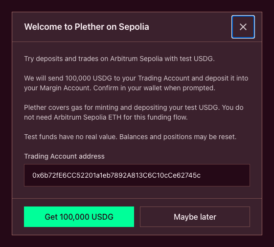
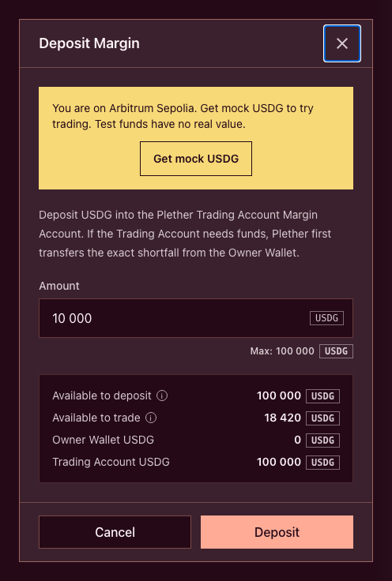
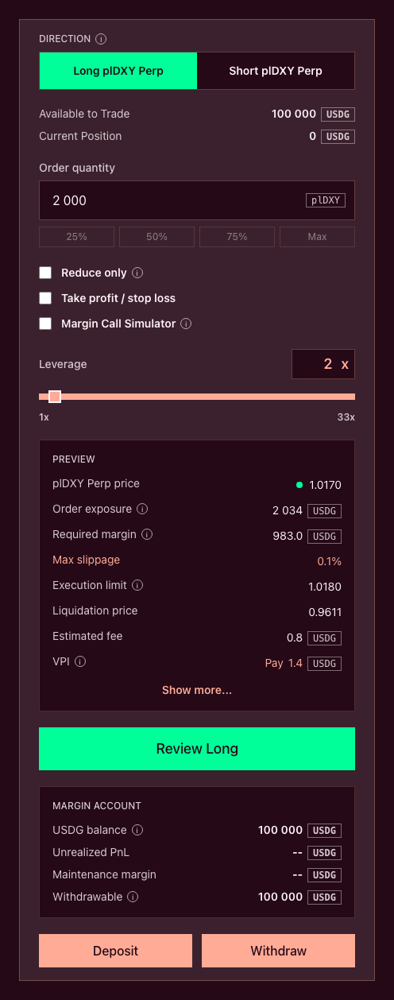
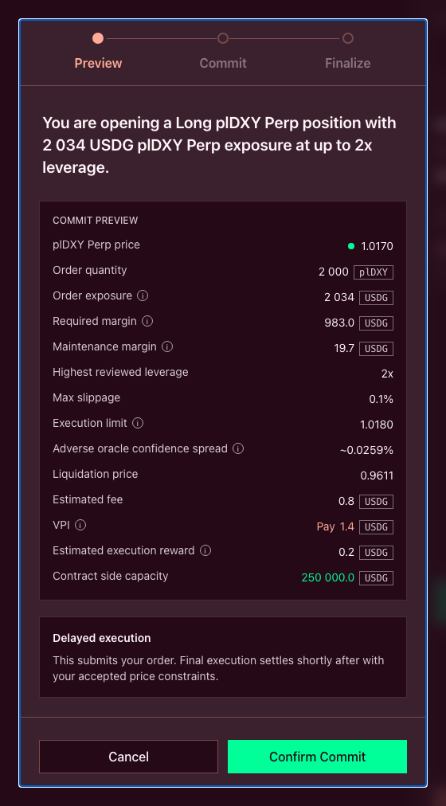
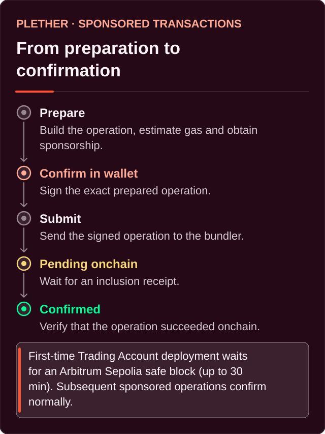

# Trader quickstart

> **Sign in or connect your wallet. Claim 100,000 test USDG. Place your first dollar trade in minutes.**

Try Plether Perps DEX on **Arbitrum Sepolia** (`chainId: 421614`) with **MockUSDG**, a test token with no real-world value. This walkthrough uses the **100,000 USDG test allocation** and a **2,000 plDXY order at 2x leverage** to show every control. Live prices, fees and limits change—always check the live preview.

Your connected wallet (or Privy social login) controls a separate **Plether Trading Account** that holds your margin and positions. Eligible trading actions and test funding are **gas-sponsored**—you do not need Arbitrum Sepolia ETH to claim test USDG or trade.

### 1. Connect and claim test USDG

1. Open [app.sepolia.plether.com](https://app.sepolia.plether.com) and select `Connect Wallet`.
2. Sign in with **Email**, **Google**, or a **passkey** (which creates an embedded EOA wallet via Privy), **or** connect an external wallet such as **MetaMask**, **Coinbase Wallet**, **Rainbow**, or **WalletConnect**.
3. Confirm the app and wallet are on **Arbitrum Sepolia** (chain ID `421614`).
4. In the **Welcome to Plether on Sepolia** dialog (or via `Get USDG` in the top banner), check your pre-filled **Trading Account address** and select `Get 100,000 USDG`.

Plether mints and deposits **100,000 USDG directly into your Margin Account** and covers all funding gas—no wallet signature or separate deposit step is required. Funding continues in the background if you close the dialog; use `Check funding` if confirmation is delayed.

### 2. Verify your balance (optional manual deposit)

Wait for `USDG deposited into your Margin Account. You are ready to trade.`, then confirm `100,000 USDG` appears in **Available to Trade**.

You only need the **Deposit** button in **Margin Account** if you later want to deposit additional USDG held in your Trading Account or owner wallet:

* If your **Trading Account** already holds the amount, the deposit is gas-sponsored.
* If the button reads `Transfer & Deposit`, the app first sends the shortfall from your **owner wallet** to your Trading Account (a regular Arbitrum Sepolia transfer that requires ETH for gas), then runs the sponsored Margin Account deposit.

See [Your Margin Account](trading-on-plether-perps/your-margin-account.md) for all balance buckets and deposit rules.

### 3. Configure an example order

Check the market banner above the trade ticket. Opening a position requires an **Open** market and a valid preview.

Choose your direction:

| Button | Your view | Profits when the displayed price… |
| --- | --- | --- |
| **Long plDXY Perp** | USD strengthens against the basket | Rises |
| **Short plDXY Perp** | USD weakens against the basket | Falls |

For this walkthrough:

1. Select `Long plDXY Perp`.
2. Enter `2000` in **Order quantity** (typed orders use `100 plDXY` increments).
3. Set **Leverage** to `2x`.
4. Leave **Reduce only**, **Take profit / stop loss**, and **Margin Call Simulator** unchecked.

**Order quantity** is measured in `plDXY` contracts; **Order exposure** values those contracts in USDG at the current price. Review **Max slippage** (`0.1%` default live) to set your worst acceptable execution price—avoid `Infinity`, which removes price protection.

### 4. Review and authorize

Select `Review Long` (or `Review Short`). In **Commit Preview**, check:

* **Order quantity** and **Order exposure** — the trade you intend.
* **Required margin**, **Highest reviewed leverage**, and **Liquidation price** — collateral and risk.
* **Execution limit**, **Estimated fee**, **VPI**, **Adverse oracle confidence spread**, and **Estimated execution reward** — price bounds and costs.

**Once confirmed onchain, the order is binding and cannot be cancelled.** Its margin and opening execution reward are reserved while it waits in the global FIFO queue.

Select `Confirm Commit` and approve the signature in your wallet (MetaMask may label it `PackedUserOperation`; the human-readable terms are in Plether’s preview).

> **First-time Trading Account confirmation**
>
> Your Trading Account smart contract deploys automatically with your first sponsored action. On Arbitrum Sepolia, waiting for the network's `safe` block to confirm that new account before your *next* action can take several minutes; a sticky banner under the header tracks this automatically.

### 5. Wait for keeper execution, then check your position

**Confirmed** means your commitment reached the chain—not that the trade filled. Wait for `Finalizing execution price` to finish.

A permissionless keeper finalizes the order automatically using the first eligible post-commit Pyth update. Track active commitments in **Open Orders** and completed outcomes in **Order History**. Do not submit a duplicate order while the first is still pending.

Once status reaches **Executed**, open **Position** to verify direction, exposure, **Order quantity**, entry price, leverage, liquidation price, unrealized PnL, and **Cost of carry**. Carry accrues continuously while open—see [Read your position and account health](trading-on-plether-perps/read-your-position-and-account-health.md).

If an order **fails** or **expires** (after 60 seconds), it is never retried automatically; see [Why is my order pending or failed?](trading-on-plether-perps/why-is-my-order-pending-or-failed.md).

### 6. Close when you are ready

In **Position**, select `Close position`, review the close preview, click `Confirm Commit`, authorize in your wallet, and wait for **Executed**. Reductions and closes have **zero USDG keeper execution reward**. A pending close leaves your position exposed until it executes.

Closing releases margin and settles profit into your **Margin Account** (or records a senior [trader claim](trading-on-plether-perps/check-and-settle-a-trader-claim.md) if pool free cash cannot fund a full fresh payout immediately). For partial exits or switching sides, see [Reduce or close a position](trading-on-plether-perps/reduce-or-close-a-position.md).

### 7. Withdraw to your owner wallet

Select `Withdraw` in **Margin Account**, enter an amount within **Withdrawable**, review the verified owner recipient, and sign the sponsored action. Plether withdraws from your Margin Account and transfers the exact USDG to your connected owner wallet in one atomic sponsored batch.

### Continue from here

* Want to rank on the testnet leaderboard? See [Plether Divisions](get-started/plether-divisions.md).
* Ready to automate exits? Read [Take profit and stop loss](trading-on-plether-perps/take-profit-and-stop-loss.md).
* Hit a snag? Jump to [Trader troubleshooting](trading-on-plether-perps/trader-troubleshooting.md).
