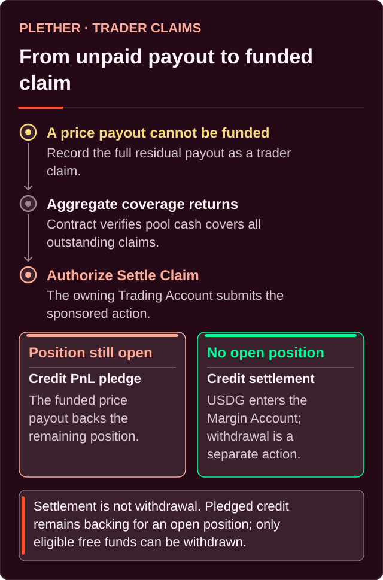
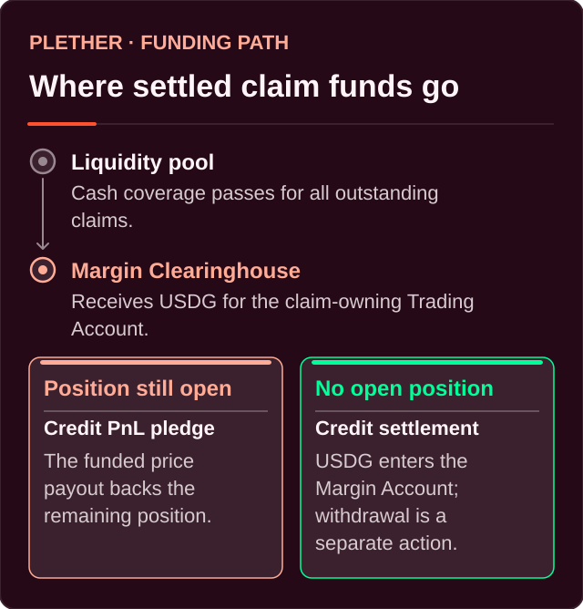

# Check and settle a trader claim

A trader claim records USDG[^usdg] owed to your **Trading Account** when the liquidity pool cannot fund a fresh trader profit payout in full at execution. The Trading Account owns the claim, and its connected owner wallet authorizes settlement.

Claims can arise from:

* A profitable position reduction
* A profitable full close
* A positive residual after liquidation

The position action itself still completes. Released position margin follows its normal Margin Account path, while only the unfunded fresh payout from the liquidity pool is recorded as a trader claim.



## How a claim is created

After a reduction, full close or liquidation settles realized PnL[^pnl], execution fee, signed VPI[^vpi], carry[^carry] and any frozen-close spread, any remaining fresh payout owed by the liquidity pool follows an all-or-nothing rule:

* **Fully covered:** If free recognized pool cash covers the entire fresh payout, Plether credits it immediately (to position margin if a position remains open, or to free Margin Account USDG if flat).
* **Under-covered:** If free recognized pool cash falls short by even a fraction, the **entire** fresh payout is recorded as a trader claim. Plether never splits a fresh payout between immediate cash and a partial claim.

For example, if a profitable close releases `2,000 USDG` of position margin and earns a `500 USDG` fresh payout while only `300 USDG` of free pool cash is available, the `2,000 USDG` of released margin settles normally and the entire `500 USDG` fresh payout becomes a trader claim. Additional unfunded payouts add to the same balance.

## Check your claim

Open the **Position** tab and look for the **Trader claim** card. It appears only while the active Trading Account has a nonzero claim and shows:

* Your current claim balance in USDG
* The **Settle Claim** button

The interface does not display aggregate pool coverage or a pre-flight eligibility indicator. The smart contract performs the final coverage check when your sponsored settlement operation is simulated and executed.

Before settlement, an unsettled claim does not earn interest and never expires. It cannot be spent or withdrawn, but it counts toward price-risk backing for the same account:

| Account value | Treatment of an unsettled claim |
| --- | --- |
| **Margin Account balance** | Excluded |
| **Available to Trade** | Excluded |
| **Withdrawable** | Excluded |
| **Position equity** | Included for the same account |
| **Price health & price-loss backing** | Included for the same account |

Claims are strictly senior to LP[^lp] withdrawals while outstanding.

## When a claim can be settled

Claim settlement succeeds only when recognized pool cash covers **all** outstanding trader claims across the protocol:

```text
Recognized pool assets >= Total outstanding trader claims
```

Recognized pool assets are the USDG physically held and admitted into pool accounting (which can differ from headline TVL[^tvl]).

* **Aggregate test, no queue:** Claims are not queued by creation time. If your claim is `600 USDG`, another trader's claim is `400 USDG` (total `1,000 USDG`), and recognized pool assets are `900 USDG`, **neither** claim can settle until recognized assets reach `1,000 USDG`. Once coverage returns, any claimant can settle immediately; paying your `600 USDG` leaves `400 USDG` in pool assets covering the remaining `400 USDG` claim.
* **All-or-nothing:** Settlement always settles your entire current claim balance. There is no partial-settlement input.

## How to settle your claim

1. **Connect the owner wallet** that controls the claim-owning Trading Account, and confirm the active Trading Account address in **Trading Account activity**.
2. **Review the Trader claim card** under the **Position** tab.
3. **Select Settle Claim.** There is no separate amount field or review modal.
4. **Authorize the sponsored operation** in your wallet. While gas sponsorship is available, settlement requires no native gas token, no USDG approval, no Pyth update, no acceptable-price bound and no execution fee or keeper[^keeper] reward.
5. **Confirm the result.** Settlement does not depend on a live FX[^fx] oracle[^oracle] or an open session — FAD[^fad], oracle-frozen and degraded states do not block it when aggregate cash coverage is met.



After confirmation, your claim balance falls to zero and the full amount is credited to your **Margin Account**:

* **If your account is flat:** The settled USDG credits **free Margin Account USDG** (updating Available to Trade and Withdrawable).
* **If you hold an open position:** Plether checkpoints accrued carry first (collecting from active position margin, then eligible free USDG — the claim itself cannot pay carry), then credits the settled claim to **position margin**. Because collected carry reduces your existing balance in the same transaction, the net visible increase in total Margin Account USDG can be smaller than the settled claim.

To move settled USDG to your external wallet, run a separate **Withdraw** operation from the Margin Account once it is withdrawable (see [Your Margin Account](your-margin-account.md)).

## Claims can be netted before settlement

An unsettled claim backs price risk for the same Trading Account. On a losing **partial close, full close or liquidation**, Plether nets the same-account claim against realized price loss **before** drawing down position margin. It never uses a claim to pay execution fees, carry, VPI or frozen-close spread.

For example, if you hold a `3,000 USDG` claim and realize a `1,200 USDG` price loss on a close, `1,200 USDG` of the claim is consumed, leaving a `1,800 USDG` claim and zero margin loss. If your claim decreases without a settlement transaction, review your latest partial close, full close or liquidation receipt.

## Common settlement issues

| Symptom | Cause and next step |
| --- | --- |
| **Settlement fails or reverts during simulation** | Aggregate recognized pool assets are below total outstanding claims (or changed before inclusion). Your complete claim stays intact; retry once pool coverage recovers. |
| **Card disappeared or shows zero** | The claim was already settled, consumed by a losing partial close, full close or liquidation, or belongs to a different Trading Account. |
| **Wallet USDG did not increase** | Settlement credits your Margin Account, not your owner wallet. Submit a separate **Withdraw** operation to move available funds to your wallet. |
| **Margin Account grew by less than the claim** | Carry was checkpointed during settlement on an open position. Check the settled claim, carry deduction and updated position margin together. |
| **Cannot withdraw after settling** | If a position is open, settled claims credit position margin; pending orders, maintenance requirements and carry also restrict Withdrawable. |

For the deeper pool-solvency and LP-firewall mechanics behind claims, see [Settlement liquidity and trader claims](../how-plether-works/settlement-liquidity-and-trader-claims.md).

[^usdg]: USDG is used for margin and settlement. The testnet uses MockUSDG, a test token with no real-world value.
[^pnl]: Profit and loss, the financial result of market-price movement on a position.
[^vpi]: Virtual Price Impact, a separate USDG charge or rebate based on how a trade changes pool directional imbalance.
[^carry]: The time-based cost charged on the portion of a position financed by LP capital.
[^lp]: Liquidity provider, a participant that supplies USDG capital to the liquidity pool.
[^tvl]: Total value locked, the headline value of assets deposited in a protocol.
[^keeper]: A permissionless actor or bot that submits order-finalization or protocol-maintenance transactions.
[^fx]: Foreign exchange, the market for trading one currency against another.
[^oracle]: A service that supplies external market data to smart contracts; Plether uses Pyth price feeds.
[^fad]: Friday Afternoon Deleverage, Plether’s wider scheduled close-only window around the weekly FX closure.
