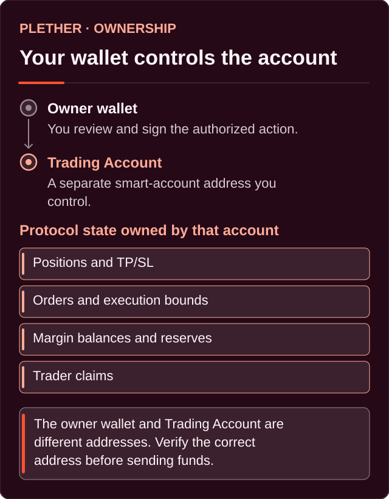
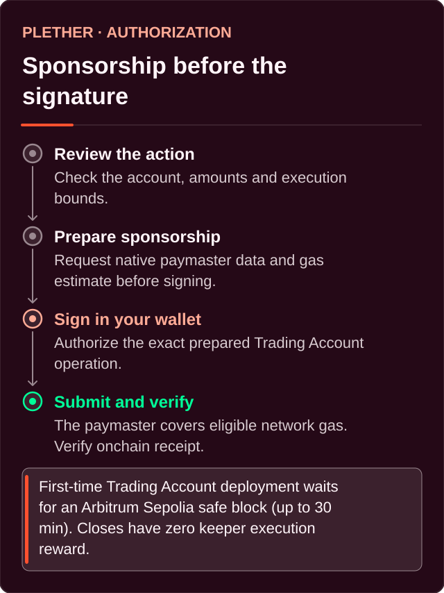
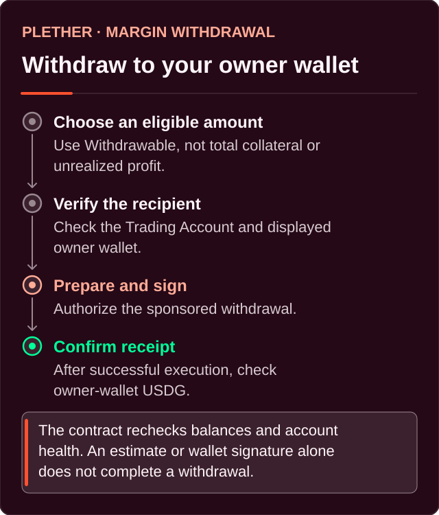

# Gas-sponsored trading and your Plether Trading Account

Plether Perps uses a dedicated ERC-4337 smart account for trading — your **Plether Trading Account** — powered by EntryPoint v0.8 and Plether's self-hosted verifying paymaster and bundler[^bundler]. Your connected wallet (or Privy embedded sign-in wallet) is the owner and signature surface; the derived Trading Account is the onchain address that submits trading operations and holds all positions, orders, margin and claims.

Plether sponsors network gas for eligible Trading Account operations, subject to availability and policy limits. There is no direct owner-wallet trading route or self-funded Trading Account fallback in the web application.

> Gas sponsorship covers **network gas only**. Protocol execution fees (`0.04%`), VPI[^vpi], carry[^carry], opening-order execution rewards (`0.01–0.25 USDG`), TP/SL trigger reserves (`0.25 USDG`) and the `50 bps`[^bps] frozen-close spread remain USDG[^usdg] costs. **Vault LP actions** are separate: they execute directly from your owner wallet and require Arbitrum Sepolia ETH for gas.

## Sign-in methods, owner wallet and Trading Account

You can connect using **email, Google or Passkey** (via Privy embedded wallets) or an **external EVM wallet** (MetaMask, Rabby, WalletConnect and compatible wallets). In every case, your connected EOA is the owner of one deterministic Trading Account:

| Term | Role |
| --- | --- |
| **Owner wallet** | The connected wallet (embedded or external) that authorizes Trading Account actions via signatures |
| **Trading Account** | Your separate ERC-4337 smart-account address that owns positions, pending orders, Margin Account state, tokens and trader claims |
| **Margin Account** | Plether's internal USDG ledger for that Trading Account (not a separate address) |

```text
Owner wallet:     0xOwner...
Trading Account:  0xTrading...
```

Protocol state belongs strictly to the Trading Account address. Connecting a different owner wallet derives a different Trading Account with separate balances and positions. Open **Trading Account activity** (the round activity button beside your connected wallet) to copy either address or open it in a block explorer.



## First-time Trading Account deployment (`safe` confirmation wait)

Your Trading Account is deployed automatically on its first sponsored operation. After that deployment transaction lands on Arbitrum Sepolia, Plether waits for the deployment block to reach **`safe`** confirmation before allowing additional Trading Account actions.

* During this one-time wait, the app displays the **"Trading Account awaiting confirmation"** banner.
* On Arbitrum Sepolia, `safe` confirmation can take up to **30 minutes**.
* Once confirmed as `safe`, all subsequent Trading Account actions proceed immediately without waiting for `safe` finality.

## Which actions Plether sponsors

| Sponsored action | What the Trading Account executes |
| --- | --- |
| **Deposit margin** | Atomically approves and deposits an exact amount of Trading Account USDG into the Margin Account |
| **Open or increase** | Commits a risk-increasing order to the global FIFO[^fifo] queue |
| **Reduce or close** | Commits a risk-reducing order to the global FIFO queue (**zero USDG keeper execution reward**) |
| **Add position margin** | Assigns free Margin Account USDG to an existing position |
| **Set, edit or remove TP/SL** | Manages position protection triggers onchain (when enabled for the deployment) |
| **Settle a trader claim** | Credits a serviceable claim balance to the Margin Account |
| **Withdraw margin** | Atomically withdraws eligible USDG and transfers the exact amount to the verified owner wallet |

All sponsored calls send zero native value. Plether's verifying paymaster validates the Trading Account, verified owner and exact allowlisted call data before signing sponsorship. Arbitrary contract calls and unrelated token transfers are rejected.

### Commitment sponsorship vs keeper execution

Gas sponsorship covers the operation that **commits** an order or sets a TP/SL rule. Separate permissionless keeper[^keeper] transactions later execute orders with Pyth oracle[^oracle] data, trigger armed TP/SL exits or clean up expired orders.

In the sponsored web interface:

* Your wallet is never asked to finalize an order or clean up an expired order, and never pays native gas or Pyth update fees for keeper processing.
* **Opens and increases** reserve an opening-order execution reward (`1 bp`, clamped `0.01–0.25 USDG`) paid to the keeper that executes, terminally fails or cleans up the order (or forfeited to the protocol treasury if liquidation clears it first).
* **Reductions and full closes** (including TP/SL closes) have **zero USDG execution reward**. Committing a close reserves no execution reward, though carry still checkpoints from active position margin first, then eligible free USDG, and TP/SL separately reserves `0.25 USDG` for triggering the protection.
* Expired rows under **Open Orders** display **Keeper cleanup in progress** / **Keeper processing** rather than a manual **Clean Up** button.

## What you sign

For each eligible action, the app prepares the UserOperation[^useroperation], obtains paymaster data from Plether's sponsorship endpoint and asks your owner wallet to sign the authorization hash. Before signing, verify the network, owner wallet, Trading Account, action, USDG amount and (for withdrawals) recipient.

Signing is offchain and costs no gas. The paymaster and bundler can relay your signed operation, but they cannot forge your signature or alter the call data.



## Funding, deposits and withdrawals

* **Testnet faucet (no ETH needed):** Select **Get USDG** → **Get 100,000 USDG**. Plether's backend pays gas to mint, approve and deposit one `100,000 USDG` MockUSDG allocation directly into your Trading Account's Margin Account. Select **Check funding** if you closed the dialog before completion.
* **Depositing existing wallet or Trading Account USDG:** Select **Deposit** under **Margin Account**. **Available to deposit** combines Trading Account and owner-wallet USDG. If the Trading Account already holds enough USDG, one atomic sponsored batch approves and deposits it. If the Trading Account is short and the button reads **Transfer & Deposit**, your owner wallet first sends the exact shortfall in a regular ERC-20 transfer (requiring Arbitrum Sepolia ETH for gas), followed by the sponsored deposit batch.
* **Withdrawing to your owner wallet:** Select **Withdraw** and enter an amount up to **Withdrawable**. One atomic sponsored batch withdraws the USDG from the Margin Account to the Trading Account and transfers that exact amount to your verified owner wallet. The paymaster rejects any withdrawal targeting a different recipient or mismatched amount.



## Trading Account activity, Trading status and Wallet-Verified Recovery

Open **Trading Account activity** from the round activity button beside your connected wallet to inspect:

1. **Account addresses and operation history:** View both your Owner wallet and Trading Account addresses, UserOperation hashes, transaction hashes and live statuses:

| Activity label | Meaning |
| --- | --- |
| **Preparing sponsored transaction** | Building the operation, estimating gas and requesting paymaster data |
| **Confirm in wallet** | Waiting for your owner-wallet signature |
| **Submitting** | Relaying the signed UserOperation to the bundler |
| **Pending onchain** | Waiting for an inclusion receipt (separate from delayed order execution) |
| **Confirmed** | The sponsored operation succeeded onchain |
| **Failed onchain** | The included smart-account execution reverted |
| **Dropped by bundler** | The bundler stopped tracking the operation before inclusion |
| **Replaced** | A replacement UserOperation superseded this attempt |
| **Expired** | The prepared or submitted operation passed its validity window |
| **Inclusion timeout** | No receipt arrived within the app's waiting window |
| **Cancelled locally** | The app stopped tracking the attempt locally |
| **Failed** | Preparation, sponsorship or submission did not complete |

2. **Trading status (collapsible live monitor):** Check the health of Plether's offchain execution services directly inside the modal — **Bundler executors**, **Trade keeper**, **Oracle updater**, **Liquidation worker**, **Protection worker** and **LP settlement**.
3. **Wallet-Verified Recovery:** If your browser refreshes, disconnects or loses state while a sponsored operation is in flight, **Trading Account activity** guides you through a two-step recovery flow:
   * **Step 1 — Verify wallet to recover:** Sign a gasless `personal_sign` challenge proving ownership of the Trading Account.
   * **Step 2 — Resolve saved transaction:** Check the onchain transaction outcome, **Resume** tracking an in-flight operation or **Discard** a stale local draft so you never submit an accidental duplicate.

## Sponsorship limits, outages and safe retries

Sponsorship can be unavailable due to an unsupported network, non-allowlisted call, per-account or per-IP rate limits, gas-budget caps, failed simulation, invalid nonce/signature or temporary bundler/RPC[^rpc] downtime.

* **No owner-wallet fallback:** Submitting a Perps call directly from your owner wallet would target a different Margin Account. If sponsorship is temporarily unavailable, the app preserves your Trading Account context instead of switching callers.
* **Positions stay live during outages:** Carry continues accruing, pending orders remain in FIFO and liquidation rules still apply while sponsorship is paused or rate-limited.
* **Retry safely:** If an operation fails before submission, no onchain state changed. If an operation was already submitted and its outcome is unclear, inspect **Trading Account activity** (or run Wallet-Verified Recovery) and check **Open Orders** before requesting a fresh operation.

## Frequently asked questions

* **Do I need a new seed phrase for my Trading Account?** No. Your owner wallet (external or Privy embedded) controls the Trading Account with its existing credentials. Never share your private key or recovery phrase.
* **Can Plether move my funds?** No. The paymaster only decides whether to sponsor gas for operations you sign; it cannot forge signatures or withdraw funds. Margin Account funds remain governed strictly by onchain margin and settlement rules.
* **Why do I still need ETH for some actions?** Eligible Perps trading operations and the testnet faucet are gas-sponsored. Direct owner-wallet ERC-20 shortfall transfers (**Transfer & Deposit**) and all **Vault LP** deposits, cancellations and withdrawals execute directly from your owner wallet and require Arbitrum Sepolia ETH.
* **Why is my order still pending after the sponsored operation confirmed?** Sponsorship confirms the **commit** transaction. Execution is a separate keeper transaction after the next eligible post-commit Pyth price arrives.

[^bundler]: A service that packages smart-account operations and submits them for onchain inclusion.
[^vpi]: Virtual Price Impact, a separate USDG charge or rebate based on how a trade changes pool directional imbalance.
[^carry]: The time-based cost charged on the portion of a position financed by LP capital.
[^bps]: Basis points; 100 bps equals 1%.
[^usdg]: USDG is used for margin and settlement. The testnet uses MockUSDG, a test token with no real-world value.
[^fifo]: First in, first out; orders at the front of the queue are processed before later orders.
[^keeper]: A permissionless actor or bot that submits order-finalization or protocol-maintenance transactions.
[^oracle]: A service that supplies external market data to smart contracts; Plether uses Pyth price feeds.
[^useroperation]: A signed smart-account instruction sent to a bundler for onchain inclusion.
[^rpc]: Remote Procedure Call, an interface used to communicate with a blockchain node.
