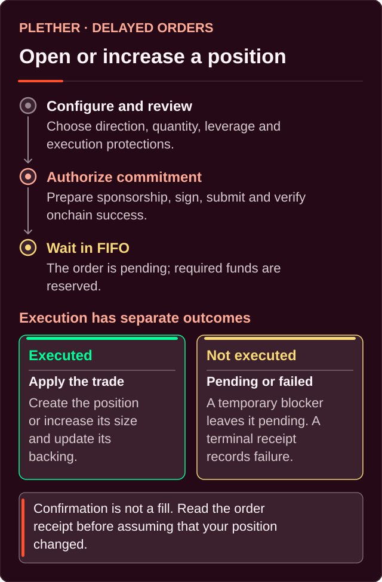
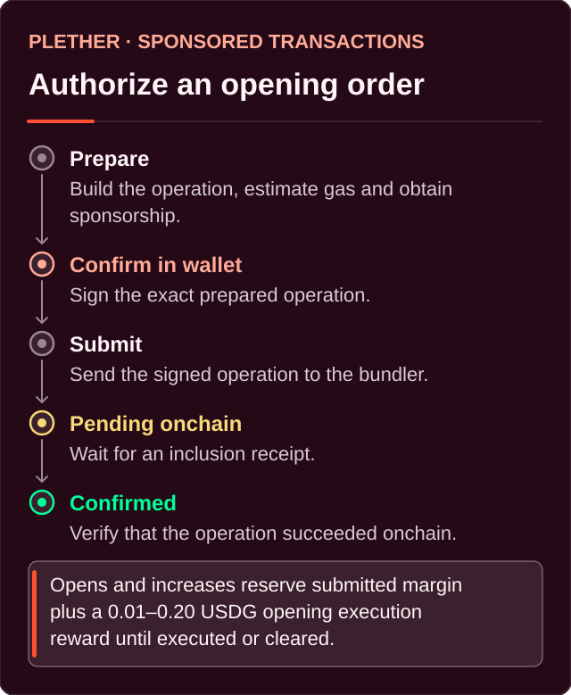

# Open or increase a position

Use the trade ticket to open a **Long plDXY Perp** (LONG USD) or **Short plDXY Perp** (SHORT USD) position, or to add size to an existing position in the same direction.

Both actions submit a gas-sponsored commitment that enters Plether’s global FIFO execution queue:



**Confirmed** means your commitment reached the chain. Your position changes only when a keeper executes that queued order against the next eligible Pyth observation.

### Opening vs. increasing

| Action | Account state before execution | Result after execution |
| --- | --- | --- |
| **Open** | No live position | Creates a new LONG USD or SHORT USD position |
| **Increase** | Live position in the same direction | Merges the added quantity into your existing position and recalculates weighted average entry, leverage, liquidation price and carry basis |

Each Trading Account holds **one live direction at a time**. To flip from LONG USD to SHORT USD (or vice versa), wait for a full close to execute first.

### Before you start

* Confirm **Market State** is `Open` (new risk is blocked during close-only, `oracleFrozen`, degraded mode, and router pause).
* Confirm **Available to Trade** covers submitted margin, the opening execution reward (`1 bp`, `0.01–0.20 USDG`), and any accrued carry on an existing position.
* **Active TP/SL blocks discretionary orders.** If your existing position has untriggered TP/SL, remove it in the **TP/SL** tab and wait for confirmation before increasing. You can attach new TP/SL directly in the trade ticket only when opening from zero; see [Take profit and stop loss](take-profit-and-stop-loss.md).

### 1. Choose direction and order quantity

| Ticket button | Market view | Profits when displayed price… |
| --- | --- | --- |
| **Long plDXY Perp** | USD strengthens against the basket | Rises |
| **Short plDXY Perp** | USD weakens against the basket | Falls |

Enter the **Order quantity** to add in `plDXY` contracts (typed values must be multiples of **`100 plDXY`**; use `25%`, `50%`, `75%`, or `Max` for quick sizing).

* **Order quantity** (`Q`) is fixed at commitment; minimum open notional is `1,000 USDG`.
* **Order exposure** (`Q × displayed price D`) is the dollar-oriented estimate shown in the preview.
* **Contract notional** (`Q × raw basket B`, where `D = 2.00 − B`) is used onchain for margin checks, execution fees (`0.04%`), and pool solvency.

### 2. Set leverage and review margin

Move the **Leverage** slider (`1x` to `33x` normally; `Margin Call Simulator` unlocks testing closer to onchain `0.20%` initial-margin boundaries—see [Margin, leverage and liquidation](../how-plether-works/margin-leverage-and-liquidation.md#margin-call-simulator)).

For the same Order quantity, lower leverage assigns more **position margin**, increases your price-loss buffer, and reduces your LP-backed **borrow base** for future carry.

When an open or increase executes:

```text
Resulting position margin
= existing position margin after carry
+ submitted margin
− execution fee
− signed VPI
```

Accrued carry on an existing position is collected from **active position margin first, then eligible free USDG**. If active margin and free USDG together cannot cover carry due at execution, the increase fails.

### 3. Set Max slippage

Click **Max slippage** in the inline preview (`0%` / `Exact`, `0.05%`, `0.1%` default live, `0.25%`, or `Infinity`).

* **Open / increase LONG USD:** execution price must be **at or below** your Execution limit.
* **Open / increase SHORT USD:** execution price must be **at or above** your Execution limit.

Max slippage constrains the **confidence-adjusted oracle execution price** (shifted adversely against the trade during live execution). It does not cap execution fees, VPI, carry, or the execution reward. Selecting `Infinity` shows `Market` and removes execution-price protection.

### 4. Review Commit Preview and Execution protections

Select `Review Long` or `Review Short`. **Commit Preview** displays:

* **plDXY Perp price**, **Order quantity**, and **Order exposure**
* **Required margin**, **Maintenance margin**, **Highest reviewed leverage**, and **Liquidation price**
* **Max slippage**, **Execution limit**, and **Adverse oracle confidence spread**
* **Estimated fee**, **Position VPI balance** (on increases), **VPI** (shown as `Pay` or `Receive`), **Estimated execution reward**, and **Contract side capacity**

Expand **Execution protections** to inspect the signed Order V3 safety bounds:

* **Client order ID** (prevents duplicate submissions on retry)
* **Deadline (`submitBy`)** — `120 seconds` from review block (signing requires at least `45s` left; submission requires `30s`)
* **Execution window** — `60 seconds` after onchain commitment
* **Pinned regime** (`Live`) and **Maximum execution reward**

#### How an increase averages entry price

Entry price is weighted by **contract quantity**, not displayed USDG exposure:

```text
New entry price = (existing Q × existing entry + added Q × execution price) ÷ total Q
```

Example: `10,000 plDXY` at `1.0500` + `5,000 plDXY` at `1.1000` produces `15,000 plDXY` at `1.0667`.

### 5. Confirm Commit and wait for execution

Select `Confirm Commit` and authorize the sponsored operation in your wallet.



Once the commitment confirms onchain:

* Submitted margin and the opening execution reward leave **Available to Trade** and stay reserved until execution or cleanup.
* The order joins the global FIFO queue and **cannot be cancelled**.
* A keeper executes it automatically against the first eligible Pyth observation strictly after commitment (no same-block execution).

Track pending commitments under **Open Orders** (`Pending`, `Pending reveal`, or `Expired` while awaiting keeper cleanup) and final outcomes in **Order History** (`Executed` or `Failed`). If an order fails or expires (after 60 seconds), committed margin is released and the opening execution reward is paid to the processing keeper; failed orders are never retried automatically. See [Why is my order pending or failed?](why-is-my-order-pending-or-failed.md).

### 6. Verify your executed position

Once **Executed**, open the **Position** tab to verify direction, **plDXY Perp exposure**, **Order quantity**, **Entry price**, **Leverage**, **Liquidation price**, **Unrealized PnL**, and **Cost of carry**.

Because entry includes the adverse oracle confidence shift while account valuation uses the neutral mark, a brand-new position can immediately show a small unrealized loss even if the market hasn’t moved.

### Common reasons an open or increase is blocked

| Condition | What to check |
| --- | --- |
| Market is close-only, frozen, paused or degraded | Market banner and reopening schedule |
| Active TP/SL on account | Remove untriggered TP/SL in the **TP/SL** tab first |
| Insufficient **Available to Trade** | Margin + opening execution reward + pending carry |
| Direction conflict | Close existing opposite-side position and wait for execution |
| Below minimum size (`1,000 USDG` notional) or invalid increment | Enter a `100 plDXY` multiple meeting minimum notional |
| Skew or solvency capacity limit reached | Check **Directional limit used** and **Free pool liquidity** |
| Max pending orders (`5`) reached | Wait for active orders in **Open Orders** to execute or clean up |

For execution mechanics and exact formulas, see [How orders execute](../how-plether-works/how-orders-execute.md) and [Trading costs: fees, carry and VPI](../how-plether-works/trading-costs-fees-carry-and-vpi.md).
