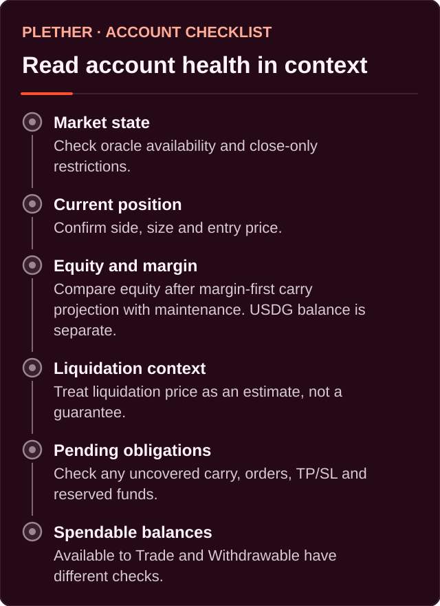
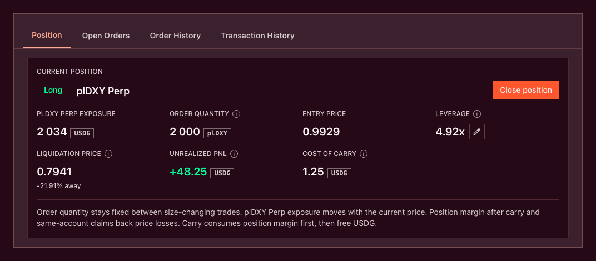
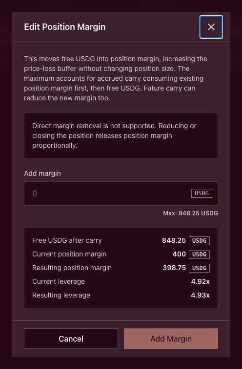

# Read your position and account health

The **Current Position** panel shows your live market exposure and price performance; the **Margin Account** card shows the collateral supporting it.



### 1. Check the market state first

Before trusting any valuation or liquidation estimate, verify:

* **Market banner** (`Open`, `Close-only`, `Closed`, `Degraded`, or `Paused`) and oracle freshness dot (`updated … ago`).
* Whether a **FAD close-only** window is active (maintenance margin jumps from `0.10%` to **`2.00%`**, which can make an account liquidatable without any price move).
* Whether **Open Orders** holds pending orders that have not executed yet.

### 2. Read the Current Position panel

| Field | Meaning |
| --- | --- |
| **Direction** | `Long` (LONG USD) or `Short` (SHORT USD) `plDXY Perp` |
| **plDXY Perp exposure** | Current dollar-oriented exposure (`Order quantity × displayed price D`) |
| **Order quantity** | Fixed contract size in `plDXY` (changes only when you increase or reduce) |
| **Entry price** | Quantity-weighted average execution price of your remaining position |
| **Leverage** | Position leverage (`contract notional ÷ position margin`); hover for **Equity leverage** (`contract notional ÷ Position equity`) and click the pencil icon to **Add Margin** |
| **Liquidation price** | Estimated displayed price where Position equity reaches maintenance (plus `% away`), `Not in range` if outside `0.00–2.00`, or `Unavailable` if risk reads failed |
| **Unrealized PnL** | Gross directional price PnL at the current mark (before close fee, close VPI, and pending carry) |
| **Cost of carry** | Persisted unpaid carry plus carry accrued since the last checkpoint |



### Unrealized PnL

Unrealized PnL is linear in **Order quantity** (`Q`) and displayed price (`D`):

* **LONG USD:** `Q × (current D − entry D)`
* **SHORT USD:** `Q × (entry D − current D)`

It excludes pending carry, future close fees, close VPI, and any frozen-close spread. See [How PnL is calculated](../how-plether-works/how-pnl-is-calculated.md).

### Cost of carry

**Cost of carry** accrues continuously with wall-clock time—including during weekends and oracle closures—on the LP-backed portion of your position (`max(max profit − position margin, 0)`).

* When realized or projected, carry consumes **active position margin first, then eligible free USDG**.
* Because carry eats active position margin before touching free USDG, it lowers **Position equity** and moves your **Liquidation price** closer even while free USDG sits in your account.
* Carry left uncovered after exhausting both position margin and free USDG independently makes the account liquidatable.

### Adding position margin

Click the pencil icon beside **Leverage** to open **Edit Position Margin**.

* **Depositing USDG** adds free funds (`Available to Trade`)—it provides a fallback for carry beyond active margin, but does **not** move your price-liquidation threshold.
* **Add Margin** moves free USDG into **Position margin** (after checkpointing carry from existing margin first). This immediately increases price-loss backing and lowers displayed leverage (flat carry on full maximum-profit exposure is unchanged).
* Direct margin removal is not supported; position margin unlocks proportionally when you reduce or fully close. Adding margin bypasses the FIFO queue and works even when the oracle is stale or frozen.



### 3. Read the Margin Account card

The **Margin Account** card in the trade ticket displays **five** values (with **Available to Trade** directly above Order quantity, **Position margin** inside **Edit Position Margin**, and any **Trader claim** in its own card under **Position**):

| Field | Meaning |
| --- | --- |
| **USDG balance** | All USDG credited to your clearinghouse account (free + position margin + pending-order margin + reserves); excludes unrealized PnL and unsettled claims |
| **Position equity** | Signed `position margin after carry + same-account trader claim + exact price PnL` (shown while a position is open) |
| **Unrealized PnL** | Gross price-only PnL of your open position |
| **Maintenance margin** | Minimum Position equity required to avoid price liquidation (`contract notional × active maintenance rate`) |
| **Withdrawable** | Maximum free USDG permitted to leave for your owner wallet right now |

> **Three separate liquidation tests**
>
> Your position becomes eligible for full liquidation with no grace period if **any** of these occur:
> 1. **Price health:** `Position equity ≤ Maintenance margin` (evaluated onchain at the adverse confidence-adjusted liquidation price, which can cross before the central displayed mark reaches your estimated liquidation price).
> 2. **Uncovered carry:** Accrued carry exceeds active position margin plus eligible free USDG.
> 3. **Underfunded VPI reserve:** A provisional VPI rebate lacks its dedicated reserve backing.

### How pending orders affect health

* **Pending open or increase:** Locks submitted margin and the opening execution reward out of `Available to Trade`. Does **not** add live exposure or increase price-risk backing while pending.
* **Pending reduce or close:** Reserves **zero** execution reward, but checkpoints carry at commitment (which can lower position margin). The full live position remains exposed and liquidatable until execution.
* **If liquidation executes first:** Account pending orders are cleared as failed, pending opening execution rewards are forfeited to the protocol treasury, and **committed-order margin is released through cleanup—it does not back price losses**.

### Worked example

Suppose your Margin Account holds `3,000 USDG` total (`1,500` position margin, `500` committed-order margin, `10` VPI reserve, `20` liquidation reserve, `0.20` opening execution-reward reserve → `969.80` free USDG), plus a `250 USDG` same-account trader claim, a `600 USDG` unrealized price loss, `40 USDG` pending carry, and `750 USDG` maintenance margin:

```text
Position margin after carry = 1,500 − 40 = 1,460 USDG
Position equity             = 1,460 + 250 − 600 = 1,110 USDG
Liquidation buffer          = 1,110 − 750 = 360 USDG (148.0% of maintenance)
```

Because `1,500` active margin absorbs the `40 USDG` carry, free USDG stays `969.80 USDG` (withdrawable if post-withdrawal initial/FAD margin and mark-freshness checks pass). Settling the `250 USDG` claim while the position stays open converts it into position margin (`1,460 → 1,710 USDG`), leaving Position equity unchanged at `1,110 USDG`.

### Practical monitoring checklist

1. Check the market state banner, oracle freshness, and upcoming Friday 16:50 NY close-only transition.
2. Compare **Position equity** against **Maintenance margin** and check for any **Liquidatable** banner.
3. Watch **Cost of carry** even during quiet or closed markets.
4. Keep **Available to Trade** and **Withdrawable** distinct; remember **only opening/increasing orders** reserve a keeper execution reward.
5. Before approaching maintenance, either **Add Margin** (to raise price-loss backing) or submit a reduction early enough to survive FIFO delay.

For exact formulas, see [Margin, leverage and liquidation](../how-plether-works/margin-leverage-and-liquidation.md).
