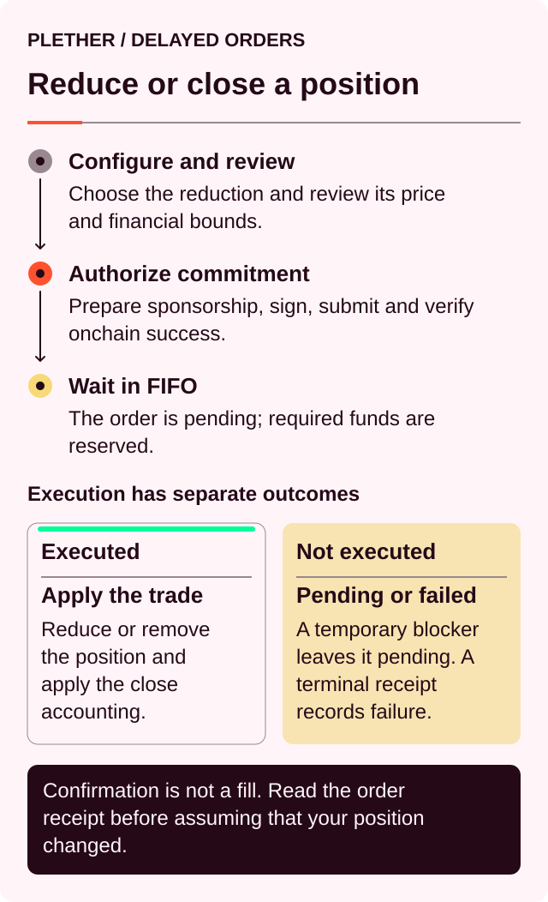
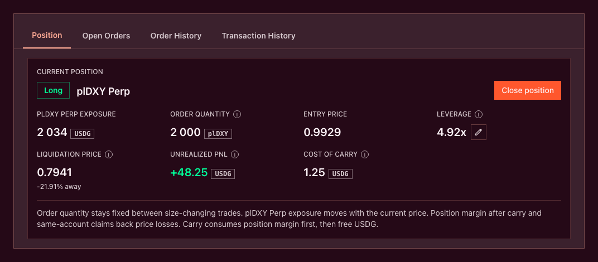
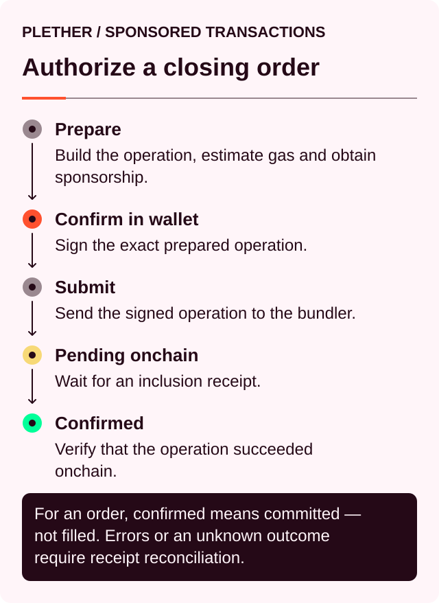

# Reduce or close a position

Reducing removes part of an existing position. Closing removes the complete position.

Both actions begin with a sponsored submission and then use Plether’s delayed-order process:

Reductions and full closes have **zero USDG keeper execution reward**, including closes created by TP/SL. They still incur applicable protocol fees, VPI, carry and frozen-close spread. A separate TP/SL trigger reward may apply when protection triggers.



The sponsored operation is **Confirmed** when the close commitment reaches the chain. The position remains exposed until the committed order later executes.

### Reduce or close

| Action     | Amount submitted                      | Result after execution                                       |
| ---------- | ------------------------------------- | ------------------------------------------------------------ |
| **Reduce** | Less than the available position size | Part of the exposure is settled and the remainder stays open |
| **Close**  | The complete available position size  | The position is settled and removed                          |

A successful partial reduction:

* Realizes PnL[^pnl] on the reduced exposure
* Releases a proportional share of position margin
* Leaves the remaining entry price unchanged
* Updates leverage and liquidation information
* Continues carry[^carry] accrual on the remaining position

A successful full close:

* Realizes PnL on the complete position
* Releases all remaining position margin
* Settles accrued carry
* Ends future carry accrual for that position
* Removes the position from the account

Changing direction requires closing the existing position before opening exposure in the opposite direction.

### Before you start

If your position has untriggered TP/SL, remove it in the **TP/SL** tab and wait for confirmation before submitting a discretionary reduction or close. Removing TP/SL leaves the position open. If protection is **Close queued** or **Close delayed**, its triggered exit remains binding and cannot be edited or removed; you can still add margin. See [Take profit and stop loss](take-profit-and-stop-loss.md).

Selecting **Reduce only** hides the trade-ticket TP/SL checkbox. That checkbox attaches triggers to new positions; it does not attach partial exits to a reduction.

Check:

* The account has an executed open position.
* Earlier pending closes have been accounted for.
* The correct owner wallet and Trading Account are selected.
* Sponsorship is shown as available for the prepared action.
* The acceptable execution price reflects the exit you intend.
* The position has enough liquidation buffer to remain open while the order waits.

Exposure that exists only as a pending opening order cannot be reduced yet. Wait for the opening order to execute first.

Risk-reducing close orders remain available during normal trading, FAD-only[^fad] close windows, `oracleFrozen`, degraded mode and router pause. Usable oracle[^oracle] data and the ordinary close validations are still required. No close-execution reward needs to be funded.



### 1. Choose the amount in the trade ticket

Use the Position panel to review the exposure you currently hold. For a full close, select `Close position` to fill the available position quantity and open **Commit Preview**. Review and wallet authorization are still required before the close is submitted; earlier pending reductions can affect the amount available, as explained below.

For a partial reduction, or to set up the exit manually, use the trade ticket:

In the trade ticket, enable `Reduce only`. This ensures the order can only reduce or close the current position; it cannot increase exposure or open a position in the opposite direction.

For a partial reduction, enter the plDXY amount to remove in `Order quantity`. Typed quantities must use `100 plDXY` increments; the interface asks you to correct an unsupported quantity instead of rounding it silently.

The action becomes `Review Reduce`. The remaining position is calculated from the whole-lot Order quantity:

```
Remaining contract quantity
= current contract quantity − Order quantity
```

The ticket keeps the entered **Order quantity** visible above the **Preview**, which shows the derived **Order exposure** in USDG at the current displayed price. **Commit Preview** confirms both values before submission. The committed Order quantity remains fixed, but both the reduced and remaining displayed exposure can be revalued at the final execution price.

For a full close with no earlier pending orders, select `Current Position` or `Max`. This fills the exact live position quantity, so the full close does not leave a rounding residual. The action becomes `Review Close`.

Earlier pending reductions count against the amount available to later orders. If the live position is 10,000 units and an earlier order is already reducing 3,000, only the projected remaining 7,000 units are available to a later order. Because the earlier reduction may fail, the later 7,000-unit order is treated as a conditional reduction, not a guaranteed full close. If that remainder is below the minimum partial-reduction size, finalize or clean up the earlier order before trying to close it.

Review the current exposure, Order quantity, Order exposure and the projected remaining amount. Treat the USDG exposure amounts as current-price estimates until execution.

#### Minimum-size rules

Plether rejects:

* A zero-size reduction
* An amount larger than the projected available position
* A partial reduction below the minimum close size
* A partial reduction that leaves insufficient margin on the residual position
* A partial reduction whose settlement obligation cannot be fully funded

A complete close can settle a small residual that falls below the ordinary minimum for partial reductions.

A reduce-only order cannot cross through zero and create exposure in the opposite direction.

### 2. Set the acceptable price

The price boundary protects the exit against an execution price outside the range you accept.

Using the dollar-oriented index displayed by the application:

| Position being reduced | Required execution condition                                          |
| ---------------------- | --------------------------------------------------------------------- |
| **LONG USD**           | Execution price must be at or above the minimum acceptable exit price |
| **SHORT USD**          | Execution price must be at or below the maximum acceptable exit price |

For example, a LONG USD close with a minimum acceptable price of `1.0400` can execute at `1.0400` or higher. A lower result fails the price check.

A SHORT USD close with a maximum acceptable price of `0.9700` can execute at `0.9700` or lower. A higher result fails the check.

During live and FAD-only execution, the price includes the adverse Pyth confidence adjustment:

* LONG USD receives a lower closing price.
* SHORT USD receives a higher closing price.

During `oracleFrozen`, the close uses the validated oracle price without that confidence-based shift. The separate frozen-close spread described below applies instead.

Slippage remains active in every market state. It applies to the execution price; fees, carry, VPI[^vpi] and the frozen-close spread are reviewed separately.

When the selector is available, choosing `Infinity` for Max slippage shows `Market` as the execution limit and removes the execution-price boundary. During `oracleFrozen`, the current ticket instead fixes Max slippage to `Exact` and disables the selector. The other close requirements continue to apply.

### 3. Review the close preview

The preview estimates the order using the current account, oracle and pool state. Execution recalculates it after all earlier FIFO[^fifo] orders have been processed.

The current `Commit Preview` lets you review:

* Position direction and whether the order reduces or closes
* Order exposure, meaning the whole-lot Order quantity valued at the current displayed price
* Order quantity in plDXY
* Estimated plDXY Perp price and contract notional
* Resulting leverage, or `Closed` for a complete close
* Max slippage and execution limit
* Adverse oracle confidence spread, or estimated frozen-close spread
* Estimated protocol execution fee
* VPI / Price impact
* Execution reward: zero USDG

The **Commit Preview** does not present these estimates as final accounting. After execution, **Final Result** uses the executed order receipt to show realized PnL, carry, execution fee, signed VPI, frozen spread paid, net close result, Margin Account balance change, trader-claim change and any uncovered loss. It shows remaining position margin after a partial reduction and shows released margin only when the ticket captured an execution-bound pre-close margin snapshot with no earlier FIFO order.

The shared preview component also renders open-position rows such as `Initial margin`, `Maintenance margin`, `Liquidation price` and `Contract side capacity`. On a close these can be `0`, `Unavailable` or otherwise not decision-relevant; do not interpret them as a complete post-close account projection.

A positive VPI value is a charge. A negative value is a rebate. The lifetime VPI clamp prevents the closed portion from receiving more cumulative VPI rebates than it previously paid.

Carry forms part of the final close economics, but it is not included as a separate row in the current close preview. Read `Cost of carry` in the Position panel and allow for continued accrual while the order waits.

An invalid preview may contain partial or zero economic values. Read the invalid reason before relying on the remaining fields.

### 4. Commit the order

After reviewing the close, confirm the wallet authorization. Plether submits the sponsored Trading Account operation.

The interface reports:



If the wallet signature, sponsorship request or UserOperation[^useroperation] submission fails before confirmation, no close order is created. Check the operation status before retrying.

After the sponsored commitment confirms:

* The order enters the global FIFO queue.
* No execution reward or new opening margin is reserved.
* The amount counts against exposure available to later close orders.
* The position remains fully open.
* Carry continues to accrue.
* Liquidation rules continue to apply.

The zero execution reward is separate from the protocol execution fee, which may still apply when the reduction or close executes. You do not need free USDG solely to back a close reward.

Commitment realizes accrued carry from active position margin first, then eligible free USDG[^usdg]. That carry collection can lower position margin, increase leverage and reduce the liquidation buffer even though no reward is reserved. Carry resumes while the order is pending, and later execution collects any additional accrued carry.

Close orders cannot currently be cancelled by the trader.

### 5. Wait for execution

The order appears under **Open Orders**.

While it remains pending:

* The unreduced position continues to move with the market.
* Unrealized PnL continues to change.
* Carry continues to accrue.
* The position can still be liquidated.
* The execution-time market state determines the final pricing path.
* Earlier FIFO orders may change the account state before the close is reached.

A pending close does not provide liquidation protection.

A voluntary full close also does not clear unrelated queued orders. Review the account’s remaining orders after the close. A later opening order may create new exposure after the account becomes flat.

If liquidation occurs first, Plether clears the account’s pending orders. Any execution rewards reserved for opening orders are forfeited to the protocol treasury; the close order has no execution reward.

### How settlement is calculated

Position margin is released in proportion to the contract quantity being reduced:

```
Released position margin
=
position margin at execution
× reduction contract quantity
÷ current contract quantity
```

PnL is realized only on the reduced exposure:

```
LONG USD realized PnL
= reduced contract quantity × (exit price − entry price)
```

```
SHORT USD realized PnL
= reduced contract quantity × (entry price − exit price)
```

The close economics can be summarized as:

```
Net close settlement
=
realized PnL
− signed VPI
− execution fee
− accrued carry
− frozen-close spread, when applicable
```

A negative signed VPI increases the settlement result. The reduce/close execution reward is zero. Carry already collected at commitment is not collected a second time at execution.

Released margin is existing collateral, accounted for separately from profit. A funded price payout is assigned to remaining position margin after a partial reduction; a full close credits free account funds. An unfunded price payout becomes a trader claim. The economic close result therefore does not equal the amount newly available to withdraw.

Carry is collected from active position margin first, then eligible free USDG, before close settlement. Price losses and other close costs can consume some or all of the margin released by the close. The execution reward recorded for a reduction or full close is zero.

Any reduction checkpoints carry accrued by the complete position through execution. After a partial reduction, the remaining position begins a new carry period using its reduced margin and LP-backed[^lp] borrow base.

For the underlying calculations, see [**How PnL is calculated**](../how-plether-works/how-pnl-is-calculated.md) and [**Fees, VPI and cost of carry**](../how-plether-works/trading-costs-fees-carry-and-vpi.md).

### After a partial reduction

A successful partial reduction:

* Decreases position size
* Releases the same proportion of assigned position margin
* Reduces the maximum-profit envelope proportionally
* Allocates the position’s accumulated VPI proportionally
* Leaves direction and entry price unchanged
* Recalculates leverage and liquidation information

Rounding remains with the residual position.

Because size and position margin generally fall in the same proportion, isolated leverage may remain close to its previous level. Carry settlement, PnL and rounding can change the exact result. No close-execution reward is deducted.

#### Partial reductions must settle in full

A partial reduction can use:

* Free Margin Account USDG
* Margin released by the reduced portion

Carry is realized before the close is planned and can consume active position margin. After that checkpoint, the residual position margin is protected from the reduced portion's price loss and other action charges. Margin committed to other pending orders and reserved opening-order execution rewards also remain protected.

If the available amount cannot cover the complete loss and close costs, the reduction fails with an underwater partial-close result.

A partial reduction cannot:

* Create bad debt
* Waive a frozen-close spread
* Pass an unpaid obligation to the remaining position

The trader can deposit additional USDG, choose a different reduction amount or submit a complete close.

### After a full close

A full close releases all remaining position margin and removes the position.

For a losing full close, settlement can reach:

* Free Margin Account USDG
* All released position margin
* Eligible margin committed to other pending orders
* An existing trader claim belonging to the same account

Reserved execution rewards remain isolated.

If reachable collateral and existing claim value cannot cover the base trading obligation, the uncovered remainder becomes protocol bad debt. The position still reaches its terminal state and the trader is not left with a negative position balance.

Consuming margin committed to other orders can cause those orders to fail when they reach execution.

### Closing while the oracle is frozen

A voluntary reduction or full close executed during `oracleFrozen` is assessed the frozen-close spread.

The current setting is **50 bps[^bps]**, or **0.50%**, of the reduced contract notional[^notional]:

```
Frozen-close spread
= reduced contract notional × 0.50%
```

A reduction of `10,000 USDG` in contract notional therefore carries a `50 USDG` frozen-close spread.

The execution-time market state controls the charge:

* Committed live and executed frozen: spread applies
* Committed frozen and executed live or FAD-only: spread does not apply

During a frozen close:

* The validated oracle price is used without the adverse confidence-price shift.
* Normal signed VPI and its lifetime clamp remain active.
* The slippage boundary remains active.
* The frozen spread is charged separately.
* Confidence-width validation of the oracle data remains active.

The spread is absent from:

* Live-market closes
* FAD-only closes
* Liquidations

Settlement follows this order:

1. Execution fee
2. Base close obligation
3. Frozen-close spread

A partial reduction must fund the complete spread.

A terminal full close may waive only the uncollectible part of the frozen spread. Waived spread does not become bad debt, a trader claim or an LP receivable.

Paid frozen spread belongs entirely to LPs. The onchain `FrozenCloseSpreadSettled` event records the assessed, paid and waived amounts. Before commitment, the ticket shows the estimated assessed spread. After execution, **Final Result** always shows the paid amount and also shows assessed and waived amounts when any spread was waived.

The active parameter is timelocked, must remain nonzero and cannot exceed `1,000 bps`. The value shown by the current onchain preview is authoritative.

### Immediate payout or trader claim

When a close produces a fresh payment from the liquidity pool, Plether checks physical settlement liquidity after reserving cash for existing trader claims.

The fresh payment follows one complete path:

* Fully credited to the Margin Account
* Fully recorded as a trader claim

A new payment is not split between immediate settlement and a claim.

Released position margin comes from the trader’s existing collateral. After losses and costs have been deducted, the remainder returns to the free Margin Account independently of liquidity pool payout liquidity.

A same-account claim contributes to position equity, but remains outside Available to Trade and Withdrawable. Settlement credits position margin while a position remains open, or account funds when flat. Withdrawal remains a separate action.

An existing same-account claim can later be consumed when settling a losing terminal full close.

See [**Settlement liquidity and trader claims**](../how-plether-works/settlement-liquidity-and-trader-claims.md) for the complete process.

### If the close does not execute

Some conditions leave the order pending for another attempt. These include temporarily unavailable oracle data and a blocked FIFO head. Under the current configuration, an order expires after `60 seconds` if it has not reached a terminal result; sponsored keeper cleanup then removes it from Open Orders.

Terminal outcomes include:

* Acceptable price exceeded
* Requested size no longer matches the executable position
* Partial reduction would leave an invalid residual
* Partial settlement cannot be fully funded
* Order expiry
* Other terminal engine validation failures

After a terminal failure:

* Position size remains unchanged.
* No execution reward is paid for the failed reduction or close.
* A new close requires a new commitment.
* Carry already collected at commitment remains paid, so position margin and health may be lower than before commitment.

### Example: reducing a LONG USD position

Assume:

```
Current contract quantity:     10,000
Entry displayed price:          1.0000
Position margin before carry:  2,000 USDG
Reduction contract quantity:    2,500
Exit displayed price:           1.0400
Carry due at commitment:           12 USDG
Execution fee:                   0.96 USDG
VPI charge:                         8 USDG
Close execution reward:             0 USDG
```

For this example, assume no additional carry accrues between commitment and execution, no frozen-close spread applies, and no other reserves are released. The remaining position passes the partial-close checks and permits the full 25% margin release.

Commitment collects the 12 USDG carry from position margin first:

```
Position margin after carry
= 2,000 − 12
= 1,988 USDG
```

The trader reduces 25% of the position. The proportional margin release is:

```
Released margin
= 1,988 × 2,500 ÷ 10,000
= 497 USDG

Remaining position margin before the price payout
= 1,988 − 497
= 1,491 USDG
```

The closed portion realizes a price gain:

```
Realized price PnL
= 2,500 × (1.0400 − 1.0000)
= +100 USDG

Price payout after execution fee and VPI
= 100 − 0.96 − 8
= 91.04 USDG
```

The 12 USDG carry was already collected at commitment; it is not charged a second time in this payout. No keeper execution reward is reserved or deducted.

Because a position remains open, a funded price payout is added to its position margin rather than to free USDG:

```
Free USDG increase from released margin:       497 USDG
Remaining position margin: 1,491 + 91.04 = 1,582.04 USDG
Remaining contract quantity:                 7,500
Displayed exposure at 1.0400:                 7,800 USDG
```

Released margin is existing collateral. The net change in the account's credited USDG across commitment and execution is:

```
Net account result
= price PnL − execution fee − VPI − carry
= 100 − 0.96 − 8 − 12
= +79.04 USDG
```

If the pool cannot fund the complete 91.04 USDG price payout, it becomes a trader claim. In that case, free USDG still increases by the released 497 USDG and position margin remains 1,491 USDG. Credited USDG falls by the 12 USDG carry already paid, while the new 91.04 USDG claim makes the combined USDG-plus-claim change +79.04 USDG. Settling the claim later adds it to position margin if the position is still open.

### Check the result

After a partial reduction, use the **Position** panel to confirm remaining plDXY Perp exposure, unchanged entry price, updated leverage, liquidation price, unrealized PnL and cost of carry. Open `Edit Position Margin` if you need to inspect the remaining assigned position margin.

The lifecycle window’s **Final Result** separates execution details from close accounting and account outcome. Execution exposure can differ from previewed Order exposure because the fixed Order quantity is valued at the final execution price. The close result shows realized PnL, carry, execution fee, zero execution reward, the signed VPI charge or rebate, frozen spread paid and the net close result. When spread was waived, it also shows the assessed and waived amounts. The account outcome shows the receipt-backed Margin Account and trader-claim changes, any terminal uncovered loss, remaining margin after a partial reduction and execution-bound released margin when that snapshot is available.

**Transaction History → Result** remains the gross realized price PnL. Select **View breakdown** on a matched executed close to open the same receipt-backed close result and account outcome. Historical breakdowns omit released margin because they do not have the ticket’s execution-bound pre-close snapshot.

After a full close, confirm:

* The account has no active position.
* All remaining position margin has been released.
* The realized close result appears in **Transaction History**.
* Final execution costs and any frozen-spread assessed, paid and waived amounts are recorded from the executed receipt in **Final Result** and remain available through **Transaction History → View breakdown**.
* The Margin Account reflects released margin and any complete fresh payout funded immediately.
* If pool liquidity cannot fund that complete fresh payout, it appears in full as a trader claim instead.
* Remaining pending orders still match your intended exposure.

### Before confirming

* Verify the amount being reduced.
* Check the projected remaining exposure.
* Review earlier pending orders.
* Set the intended exit-price boundary.
* Estimate PnL and carry, and review the ticket’s VPI, execution fee and execution reward.
* Check whether the frozen-close spread applies.
* Review remaining leverage and liquidation risk.
* Allow for continued exposure while the order waits.
* Monitor the order until it executes, fails or expires.

[^pnl]: Profit and loss, the financial result of market-price movement on a position.
[^carry]: The time-based cost charged on the portion of a position financed by LP capital.
[^fad]: Friday Afternoon Deleverage, Plether’s wider scheduled close-only window around the weekly FX closure.
[^oracle]: A service that supplies external market data to smart contracts; Plether uses Pyth price feeds.
[^vpi]: Virtual Price Impact, a separate USDG charge or rebate based on how a trade changes pool directional imbalance.
[^fifo]: First in, first out; orders at the front of the queue are processed before later orders.
[^useroperation]: A signed smart-account instruction sent to a bundler for onchain inclusion.
[^usdg]: USDG is used for margin and settlement. The testnet uses MockUSDG, a test token with no real-world value.
[^lp]: Liquidity provider, a participant that supplies USDG capital to the liquidity pool.
[^bps]: Basis points; 100 bps equals 1%.
[^notional]: The face value of a position’s market exposure, not the amount of collateral posted.
