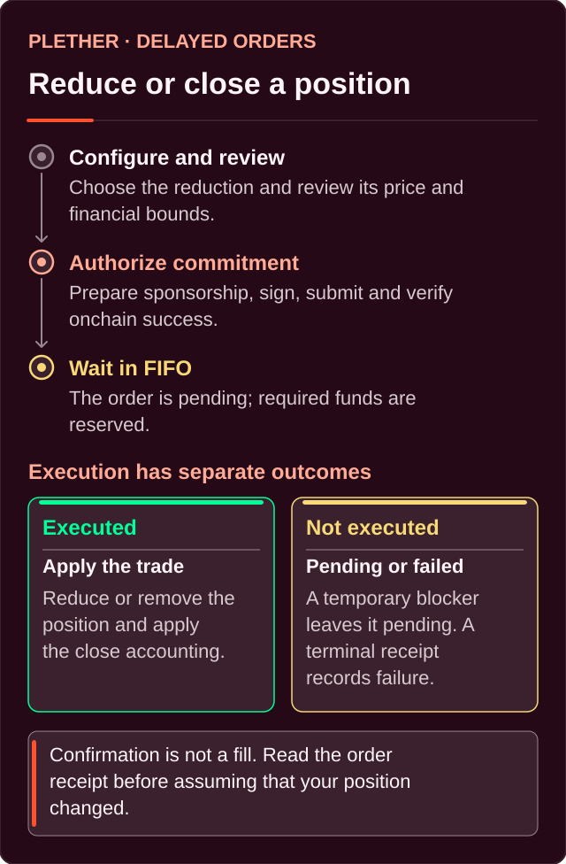
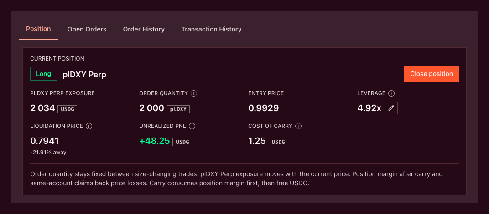
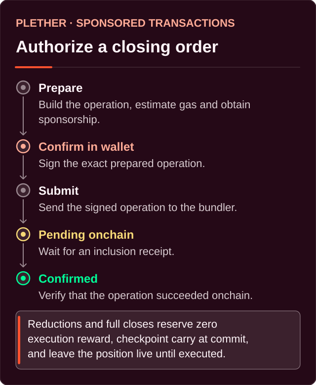

# Reduce or close a position

Reducing settles part of an open position; closing settles the entire position and removes it.

Both actions are gas-sponsored commitments that enter Plether’s global FIFO queue—and both carry **zero USDG keeper execution reward** (including closes triggered by TP/SL). Applicable protocol execution fees (`0.04%`), signed VPI, accrued carry and any frozen-close spread still apply.

**Confirmed** means your close commitment reached the chain. **Your position stays fully open, accrues carry and remains liquidatable until the close order executes.**

### Reduce or close

| Action | Amount submitted | Result after execution |
| --- | --- | --- |
| **Reduce** | Part of available position quantity (`100 plDXY` multiples) | Realizes PnL on reduced size, unlocks eligible margin, keeps average entry price unchanged, continues carry on remaining size |
| **Close** | Full available position quantity | Realizes PnL on full size, releases all remaining position margin, settles carry, removes the position |

### Before you start

* **Remove active TP/SL first:** If your position has untriggered TP/SL, remove it in the **TP/SL** tab and wait for confirmation before submitting a manual reduce or close (removing TP/SL leaves the position open). Once TP/SL is **Close queued** or **Close delayed**, it cannot be removed; you can still add margin.
* **Pending opens cannot be reduced yet:** Wait for an opening order to execute before reducing it.
* **Available in every protective regime:** Reductions and closes remain available during live trading, close-only (FAD) windows, `oracleFrozen`, degraded mode, and router pauses (subject to eligible oracle data).

### 1. Compose the reduction or close

* **Fastest full close:** In the **Position** tab, select `Close position` to pre-fill the full available quantity and open **Commit Preview**.
* **Partial reduction or custom close:** In the trade ticket, check **`Reduce only`** (this prevents accidentally flipping sides and hides the new-order TP/SL checkbox). Enter a `100 plDXY` multiple in **Order quantity** for `Review Reduce`, or click `Max` / `Current Position` with no earlier pending closes for `Review Close`.

Earlier pending reductions reserve quantity against later close orders. If your live position is `10,000 plDXY` and a pending reduction already covers `3,000 plDXY`, only `7,000 plDXY` is available to a later order—and because the first order could fail, the second is treated as a conditional partial reduction rather than a guaranteed full close.

### 2. Set Max slippage

| Position | Required execution price condition (displayed index `D`) |
| --- | --- |
| **LONG USD** | At or **above** your minimum acceptable exit price |
| **SHORT USD** | At or **below** your maximum acceptable exit price |

During live and live-oracle close-only windows, the execution price includes the adverse Pyth confidence shift. During **`oracleFrozen`**, the adverse confidence shift is waived, the separate frozen-close spread applies, and the trade ticket locks Max slippage to **`Exact`** (`0%`).

### 3. Review Commit Preview and authorize

In **Commit Preview**, check:

* **Order quantity**, **Order exposure**, and **Estimated remaining leverage** (or `Closed` on a full close)
* **Execution limit**, **Adverse oracle confidence spread** (or **Estimated frozen close spread**), **Estimated fee**, **Position VPI balance**, **VPI**, and **Estimated execution reward** (`0 USDG`)
* **Close projections:** **Commitment carry** (carry debited when committing the close), **USDG after execution** (projected total clearinghouse balance, not withdrawable cash), and **Trader claim after execution**

Select `Confirm Commit` and sign in your wallet.

Committing a close collects accrued carry immediately from **active position margin first, then eligible free USDG**. That checkpoint can lower position margin while the close waits in the FIFO queue. Close commitments cannot be cancelled.

### Partial reductions vs. full closes

| Rule | Partial reduction | Full close |
| --- | --- | --- |
| **Price losses** | Netted against same-account trader claim first, then collectible position margin | Same; excess beyond collectible cap becomes a price-loss write-off |
| **Action charges** (fee, unpaid carry, positive VPI, frozen spread) | **Must settle in full** from price gains, VPI clawback reserve, free USDG, or safely released margin—never invades margin still backing the remaining position | Same sources plus eligible committed-order margin; any uncollectible action charge (including frozen spread) is **waived**, not bad debt |
| **Funded profit destination** | Credited to **remaining position margin** (or recorded as a trader claim if pool free cash cannot fund it in full) | Credited to **free Margin Account USDG** (or recorded as a trader claim) |
| **Remaining margin release** | Releases only margin permitted while preserving the remaining position's collectible cap | Releases all remaining position margin |

If a partial reduction cannot fund its full costs or leaves a residual position below minimum size/margin, the reduction fails terminally (`OrderFailed`) and your position stays unchanged.

### Closing while the oracle is frozen

Voluntary reductions and closes executed during **`oracleFrozen`** (Friday 17:00 – Sunday 17:00 NY and configured holidays) follow special rules:

* Uses the validated stored Pyth basket within the 3-day frozen staleness limit, **without** the adverse confidence price shift (confidence-width and slippage checks remain active).
* Normal signed **VPI** and its lifetime clamp still apply.
* Assesses a fixed **frozen-close spread**—currently **`50 bps` (`0.50%`) of reduced contract notional**—paid 100% to LPs (never to the protocol treasury).
* **Execution time controls the spread:** a close committed live that executes after `oracleFrozen` begins pays the spread; one executed after `oracleFrozen` ends does not.
* Partial reductions must pay the full spread; a terminal full close waives any uncollectible portion (waived spread is not bad debt, a trader claim, or an LP receivable).

Liquidations never pay the frozen-close spread. See [Market states and oracle closures](../how-plether-works/market-states-and-oracle-closures.md) and [Settlement liquidity and trader claims](../how-plether-works/settlement-liquidity-and-trader-claims.md).

### Example: reducing a LONG USD position

Assume a `10,000 plDXY` LONG USD position opened at `1.0000` with `2,000 USDG` position margin and `12 USDG` carry due at commitment. You reduce `2,500 plDXY` (25%) at displayed exit price `1.0400` (`B = 0.96`, reduced contract notional `2,400 USDG`) during a live market, with `0.96 USDG` execution fee (`4 bps`), `8 USDG` VPI charge, and `0 USDG` close execution reward:

1. **Commitment carry checkpoint (margin first):** `2,000 − 12 = 1,988 USDG` position margin.
2. **Proportional margin release (25%):** `1,988 × 25% = 497 USDG` released to free USDG; `1,491 USDG` remains assigned.
3. **Realized price PnL:** `2,500 × (1.0400 − 1.0000) = +100 USDG`.
4. **Net price payout after close costs:** `100 − 0.96 − 8 = 91.04 USDG`.
5. **Result (position still open):** If pool free cash covers `91.04 USDG`, it is added to remaining position margin (`1,491 + 91.04 = 1,582.04 USDG`), while `497 USDG` released margin enters free USDG. Across commitment and execution, total account change is `100 − 0.96 − 8 − 12 = +79.04 USDG`. If pool cash cannot fund `91.04 USDG` immediately, the complete `91.04 USDG` becomes a [trader claim](check-and-settle-a-trader-claim.md) while the `497 USDG` released margin still becomes free USDG.

### Check your close breakdown

After execution, **Final Result** (and **Transaction History → View breakdown** on any matched executed close) displays three receipt-backed sections:

* **This close:** realized PnL, execution fee, signed VPI, carry, frozen spread charged (plus assessed/waived if waived), and net close result.
* **Position lifetime:** cumulative result across the position with a **VPI breakdown**.
* **Collateral & balances:** remaining/released position margin (released margin requires the ticket's pre-close snapshot), Margin Account balance change, trader-claim change, and any settlement adjustment.

**Transaction History → Result** displays gross realized price PnL before fees, VPI, and carry; open **View breakdown** for full net economics. For full accounting formulas, see [How PnL is calculated](../how-plether-works/how-pnl-is-calculated.md) and [Trading costs: fees, carry and VPI](../how-plether-works/trading-costs-fees-carry-and-vpi.md).
