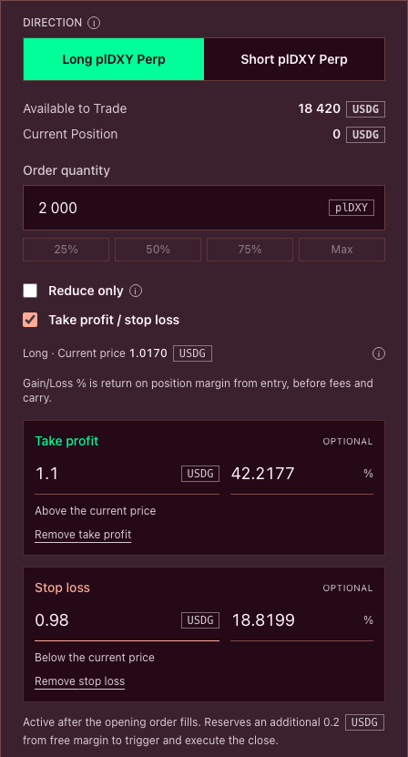
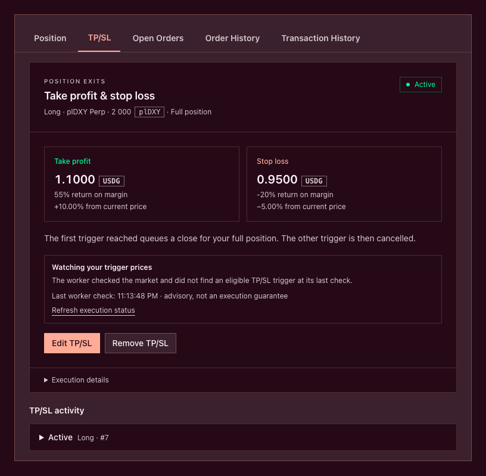
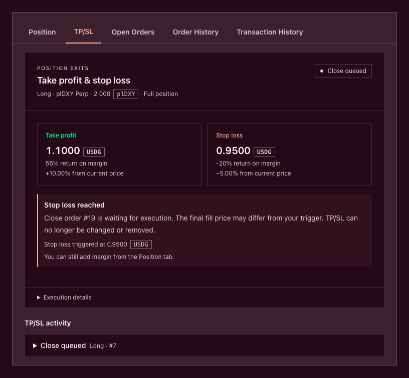
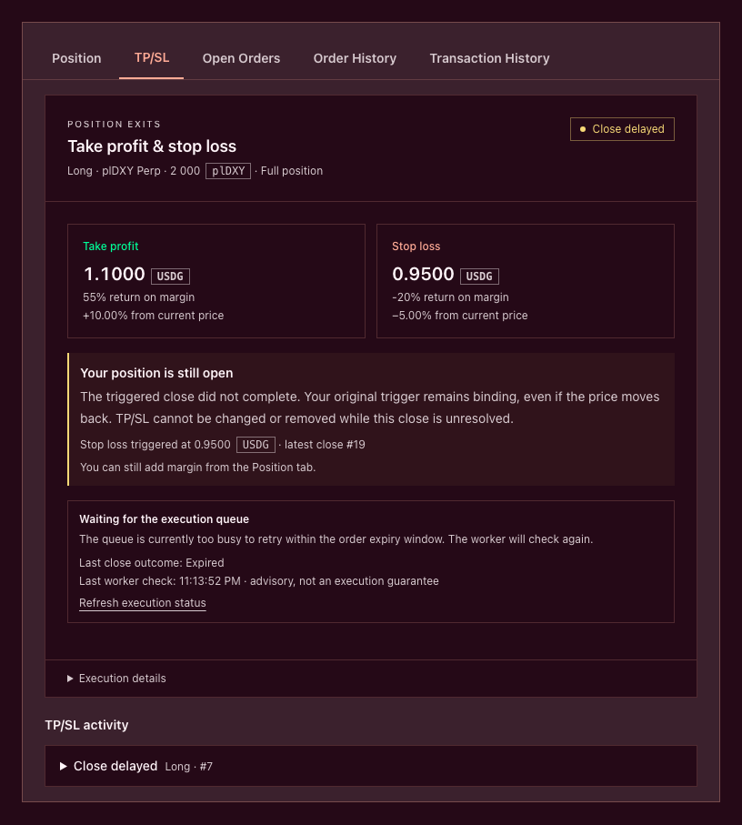
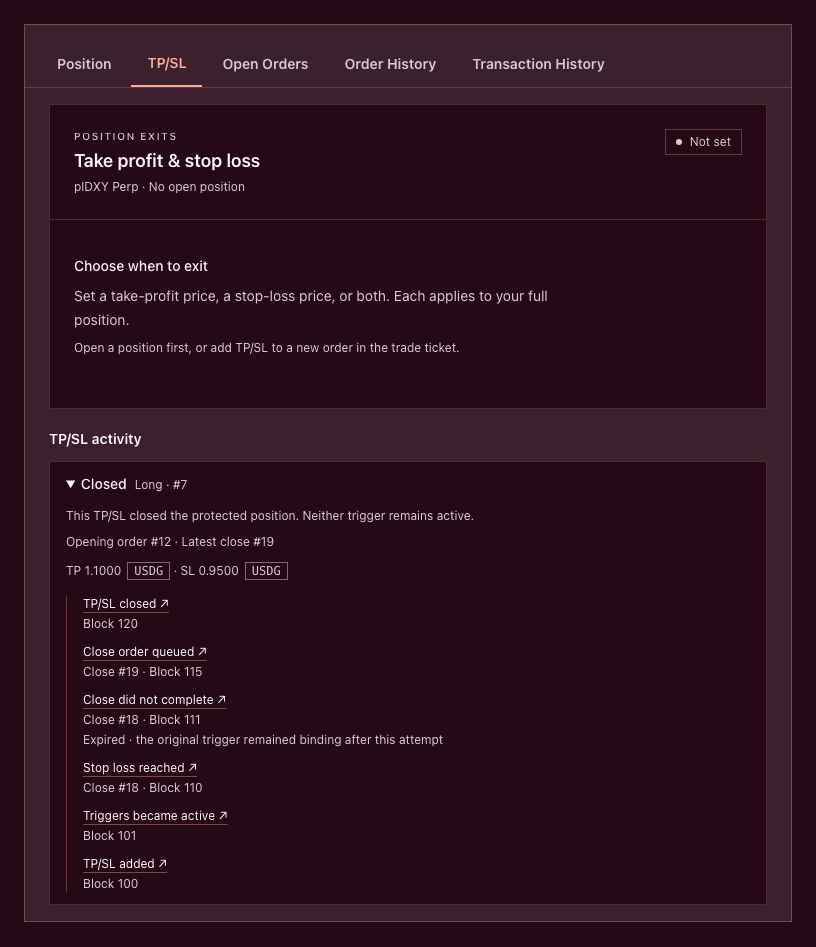

# Take profit and stop loss

Take profit (TP) and stop loss (SL) set onchain price triggers to automatically queue a **full-position close** for your plDXY Perp position. You can set either trigger or both (first accepted trigger queues the exit and cancels the other). Partial TP/SL exits are not supported.

> **Warning: Trigger prices are not guaranteed fills**
>
> * Reaching a trigger price submits a **delayed full-position close order** into the FIFO queue; your position stays exposed to price moves, carry and liquidation until that close executes.
> * **Uncapped close slippage in the web interface:** The current web interface sets all four onchain `CloseFinancialLimits` on triggered TP/SL closes to unlimited (`uint256.max`), prioritizing exit completion over a price cap—so a triggered close executes like a market close once queued.
> * **Paused during weekend/holiday freezes:** New TP/SL triggers cannot fire while `oracleFrozen` is active.

### Choose your trigger prices

Enter triggers using the displayed dollar-oriented **plDXY Perp price** (the app handles conversion to the raw basket automatically):

| Position | Take profit | Stop loss |
| --- | --- | --- |
| **Long plDXY Perp** | Above current price | Below current price |
| **Short plDXY Perp** | Below current price | Above current price |

Each trigger offers two synchronized inputs:

* **Price (`USDG`)** — absolute trigger price (up to 8 decimals).
* **Gain / Loss (`%`)** — gross price PnL from entry as a percentage of **position margin** (accounts for leverage, excludes fees, carry and VPI; up to 4 decimals). A negative Loss % locks in a gain; a negative Gain % targets a loss.

Stop losses at or beyond the estimated **liquidation price** are rejected. Saved triggers store fixed absolute prices—they do not trail the market or automatically shift if you add margin later.

### Attach TP/SL to a new position

1. Configure a new opening order in the trade ticket (available only when flat and `Reduce only` is unchecked).
2. Check **Take profit / stop loss** and enter one or both trigger levels.
3. Review the opening order, trigger prices, and the additional **trigger reserve** (`0.20 USDG` in Core v2.0.0).
4. Authorize the sponsored operation. Attached triggers show **Waiting for position** in the **TP/SL** tab until the opening order fills, then switch to **Active**.

If the opening order fails or expires, inspect both **Order History** and the **TP/SL** tab—no triggers activate without a filled position.

### Add, edit or remove TP/SL on an existing position

1. Open the **TP/SL** tab below the chart (your position must exist with **zero pending orders**).
2. Select **Add TP/SL**, enter one or both triggers, click **Review TP/SL**, verify **100% of the position** and the trigger reserve, and confirm in your wallet.

While status is **Waiting for position** or **Active**:

* **Edit TP/SL** replaces trigger prices while keeping the existing protection record and reserve (old triggers stay active until the edit confirms onchain).
* **Remove TP/SL** cancels protection and refunds any unpaid trigger reserve. It does **not** close your position or cancel a pending opening order.
* **Discretionary orders are blocked while TP/SL is active.** To manually increase, reduce, or close your position, remove untriggered TP/SL first and wait for confirmation. You can still use **Add Margin** from the Position tab at any time.

Once status reaches **Close queued** or **Close delayed**, TP/SL can no longer be edited or removed.

### Trigger reserve and sponsorship

Creating TP/SL reserves **`0.20 USDG`** (Core v2.0.0 `positionProtectionTriggerBountyAssets`) from **Available to Trade** (free USDG—adding position margin does not fund this reserve). That reserve pays the protection keeper that submits the trigger transaction. The resulting close order itself has **`0 USDG`** keeper execution reward.

Creating, editing, and removing TP/SL are **gas-sponsored** operations (and removing/cancelling TP/SL remains sponsored even if new protection sponsorship is paused).

### Understand every protection state

| Interface status | Contract status | Meaning |
| --- | --- | --- |
| **Not set** | `None` | No active TP/SL record on the account |
| **Waiting for position** | `PendingOpen` | Attached to a pending opening order; not active until the open fills |
| **Active** | `Armed` | Triggers are live; eligible oracle crossing queues a full close |
| **Close queued** | `Triggered` | Trigger accepted onchain and full close order queued in FIFO |
| **Close delayed** | `Latched` | Linked close attempt failed, but the triggered exit stays **permanently binding** |
| **Closed** | `Executed` | TP/SL close executed and closed the position |
| **Not completed** | `Failed` | Protection ended without a TP/SL close; check position & Order History |
| **Removed** | `Cancelled` | Protection removed by the trader (position untouched) |
| **Liquidated** | `Liquidated` | Position liquidated before TP/SL completed |

#### What "Close delayed" (`Latched`) means

If a triggered close order fails (for example, expires during queue congestion), the protection enters **Close delayed** (`Latched`). **The exit remains permanently binding even if the price reverses back across your trigger.** You cannot edit or remove a latched protection, though you can still add margin.

* **Expired close retries:** The protection worker automatically retries expired latched closes once account pending orders clear, oracle data is usable (including bounded frozen pricing if the market froze after latching), and FIFO queue capacity fits within the 60-second execution window.
* **Non-expiry failures:** Failures other than expiry display **`Operator review required`** and are **not** auto-retried; contact support with your protection reference, close order ID, and transaction hash.

### Automatic execution status & operational realities

The **Automatic execution status** panel displays the protection worker's latest advisory check (refreshed every 5 seconds; not an execution guarantee). Key operational behaviors to plan around:

* **Trigger rules:** Requires a fresh oracle observation with `publishTime > armedAt` and `blockNumber > armedBlock` (same-block triggers are rejected). Transient price wicks that revert before inclusion do not trigger.
* **Worker timing:** The reference protection worker indexes new records **12 blocks behind head**, polls every **5 seconds**, processes up to 50 candidates per pass, submits **1 transaction at a time**, and does not automatically fee-bump a dropped transaction.
* **Market freezes:** New armed triggers pause during `oracleFrozen` (the market can gap across your trigger or into liquidation when FX reopens). Already-latched expired closes can still retry under frozen-close rules (`0.50%` frozen-close spread).
* **Liquidation precedence:** TP/SL never suspends liquidation (including the 3.00% FAD margin jump before Friday close) and does not guarantee immediate cash settlement if pool liquidity triggers a [trader claim](check-and-settle-a-trader-claim.md).

### Inspecting TP/SL activity

Expand any record under **TP/SL activity** to inspect trigger prices, opening/close order references, and chronological onchain events (such as **TP/SL added**, **Triggers became active**, **Stop loss reached** / **Take profit reached**, **Close order queued**, **Close did not complete**, and **TP/SL closed**) with explorer links.

Closing the browser does not remove onchain TP/SL. If **TP/SL activity** shows a history loading error, select **Try again**—an indexer error never removes onchain protection.
