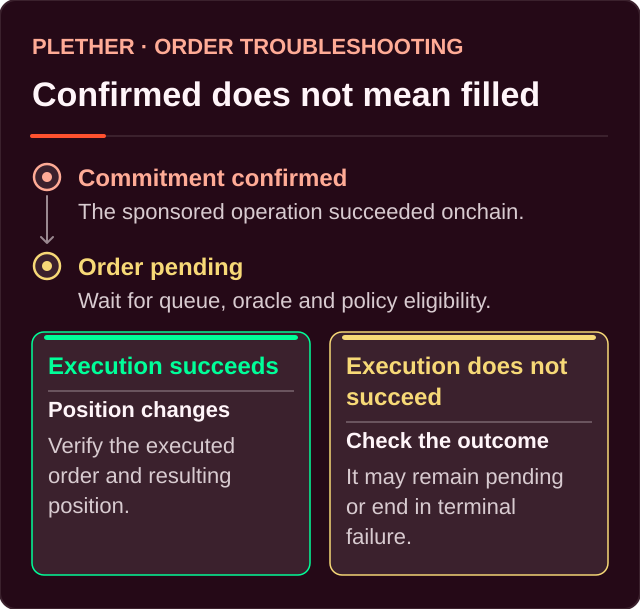
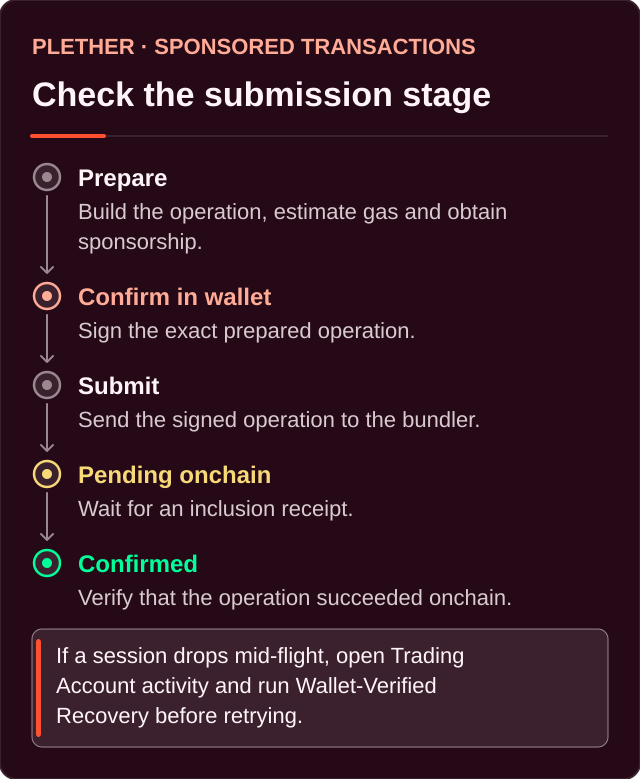

# Trader troubleshooting

Plether actions can pause or fail at different stages — account deployment, gas sponsorship, wallet signing, bundler inclusion, delayed keeper[^keeper] execution or settlement. Always verify the current operation and onchain state before retrying so you never create an unintended duplicate order.

## Check these first

1. Confirm your connected **owner wallet**, derived **Trading Account** and **Arbitrum Sepolia** network.
2. Open **Trading Account activity** (round button beside your wallet) to check:
   * Whether the **"Trading Account awaiting confirmation"** banner is active (first-time deployment waits for an Arbitrum Sepolia **`safe`** block — up to ~30 minutes).
   * The collapsible **Trading status** monitor (**Bundler executors**, **Trade keeper**, **Oracle updater**, **Liquidation worker**, **Protection worker** and **LP settlement**).
   * Any saved in-flight transaction needing **Wallet-Verified Recovery** (`1. Verify wallet to recover` via gasless `personal_sign` → `2. Check transaction outcome` / `Resume` / `Discard`).
3. Check the market state (**Open**, **FAD close-only**[^fad], **Oracle frozen**, **Degraded** or **Paused**) and oracle[^oracle] timestamp.
4. Check **Open Orders** (live onchain queue), **Order History** (indexed outcomes) and the **TP/SL** tab.

> Do not submit a replacement order while the original order still appears under **Open Orders**. A second commit creates another binding FIFO[^fifo] order.

## Quick diagnostic table

| What you see | Onchain state | Next step |
| --- | --- | --- |
| **Trading Account awaiting confirmation** | Trading Account deployed; waiting for `safe` block | Wait for `safe` finality (up to ~30 min on Arbitrum Sepolia); one-time only |
| **Wallet-signature rejected** | Nothing submitted | Review the request and sign again only if it matches your intent |
| **Sponsor unavailable / rate-limited** | Nothing submitted | Check **Trading status**, wait briefly, then request a fresh operation |
| **Bundler rejected / Dropped by bundler** | Usually nothing onchain | Check for a transaction hash or run **Wallet-Verified Recovery** before retrying |
| **Pending onchain** / **Inclusion timeout** | Inclusion uncertain | Check the UserOperation[^useroperation] hash and **Open Orders** before retrying |
| **Failed onchain (commit)** | Reverted; no order created | Read the contract error, adjust the ticket and submit a fresh commit |
| **Order in Open Orders** | Pending in global FIFO | Wait for post-commit Pyth tick and keeper execution (no manual finalize needed) |
| **Keeper execution attempt reverted** | Order usually stays Pending | Continue monitoring; keeper retries automatically until execution or `60s` expiry |
| **Expired** under **Open Orders** | Awaiting keeper cleanup | Wait for **Keeper cleanup in progress** to finish; do not duplicate yet |
| **Failed** in **Order History** | Terminal; will never execute | Review the failure reason, refresh balances and create a new order if needed |
| **Executed** | Position updated | Refresh account and position panels |

## Sponsored operation did not confirm

* **Sponsor unavailable or rate-limited:** No order was created. Because Plether's web app is sponsorship-only (to prevent acting on the wrong Margin Account), wait for service recovery or rate-limit reset rather than switching wallets. Existing positions, carry[^carry], pending orders and liquidation rules remain active during outages.
* **Bundler rejected, dropped or app refreshed mid-flight:** Open **Trading Account activity** and use **Wallet-Verified Recovery** to check the onchain receipt before requesting a new signature, nonce and paymaster approval.

## Cannot open or increase a position

Common blockers include:

* **Active TP/SL protection:** An active TP/SL record can block discretionary orders. Remove untriggered protection in the **TP/SL** tab and wait for confirmation first. Triggered or latched exits cannot be removed while unresolved (see [Take profit and stop loss](take-profit-and-stop-loss.md#understand-every-protection-state)).
* **Account or size checks:** Insufficient **Available to Trade** (must cover opening margin plus the `0.01–0.25 USDG` opening execution reward), order below the `1,000 USDG` minimum notional, leverage exceeding the initial-margin limit (`33x` normal UI cap / `294x` simulator cap), opposing position already open, or `5` pending orders already active.
* **Market or pool limits:** `40%` net-pool skew[^skew] cap reached, pool solvency capacity reached, **FAD close-only**, **Oracle frozen**, **Degraded** mode or paused risk commitments.

A reverted commit rolls back atomically with no order or reservation created.

## Cannot reduce or close a position

* **No unreserved size left:** You can only reduce an executed position (not a pending open) in its matching direction, up to the size not already reserved by earlier pending closes.
* **Dust residual:** A partial reduction cannot leave a remaining position below the `1,000 USDG` minimum notional — reduce less or submit a full close.
* **Underfunded partial close:** A partial reduction must fully pay its realized price loss (from same-account trader claim first, then position margin) and its action charges (execution fee, signed VPI[^vpi], unpaid carry and any `50 bps`[^bps] frozen-close spread) without waiver. Add margin, reduce a smaller amount or submit a **full close** (which waives uncollectible action charges and records genuine uncovered price loss as bad debt).

Reductions and full closes have **zero USDG execution reward** and remain available during FAD close-only, `oracleFrozen` (while the frozen basket is within its `3-day` staleness limit), degraded mode and paused risk commitments.

## Order stays Pending, expires or fails

See [Why is my order pending or failed?](why-is-my-order-pending-or-failed.md) for the full breakdown. Key points:

* **Why it stays Pending:** Earlier global FIFO orders, waiting for the first post-commit Pyth tick (`block > commitBlock`, `publishTime > commitTime`), transient Hermes/oracle validation errors (confidence above `0.10%` or timestamp spread above `5s`), an unexpected engine/receipt rollback (which **stays Pending** rather than automatically becoming terminal) or a close-only block on an opening order.
* **Terminal failures:** **Expiry** (`> 60s`), **Slippage exceeded**, **Engine rejected** or **Account liquidated**.
* **Execution rewards:** Opening orders pay their reserved `0.01–0.25 USDG` reward to the keeper on execution, terminal failure or expiry cleanup (or forfeit it to the protocol treasury on liquidation). Reductions and closes reserve and pay **zero** execution reward.
* **Confirmed operation, unchanged position:** Check *which* step confirmed — a confirmed commit only creates a Pending order; only `OrderExecuted` changes the position.

## Deposits, adding margin and withdrawals

* **Deposit failed or requested ETH:** Testnet **Get 100,000 USDG** credits your Margin Account directly with zero ETH needed. If you deposit USDG sitting in your owner wallet (for example, after a withdrawal), **Transfer & Deposit** first sends the exact shortfall from your owner wallet to your Trading Account (which requires Arbitrum Sepolia ETH for gas), then runs the gas-sponsored deposit batch. If the transfer succeeds but the sponsored deposit fails, your USDG is safe in the Trading Account — simply retry the deposit without repeating the transfer.
* **Deposit succeeded, but Available to Trade rose by less:** Depositing with an open position checkpoints carry (collecting from active position margin first, then eligible free USDG). Also note that **Deposit** adds to *free* Margin Account USDG; to add collateral directly to a position's price-loss buffer, use **Edit Position Margin** → **Add margin**.
* **Cannot add position margin:** Requires an open position and sufficient free Margin Account USDG *after* the pre-action carry checkpoint. Assigned position margin cannot be removed directly — reducing or closing the position releases it.
* **Withdrawable is zero or withdrawal failed:** Free USDG is reduced by position margin, pending-order commitments, reserved opening rewards and accrued carry. With an open position, withdrawals must preserve the higher of initial margin and active maintenance/FAD margin, require a fresh live mark and are blocked during **Degraded** mode. Trader withdrawals come from the Margin Clearinghouse and are independent of LP pool payout liquidity.

See [Your Margin Account](your-margin-account.md).

## Execution price, realized PnL, liquidation and pending closes

* **Execution price differs from preview:** Previews reflect current state; execution uses the later FIFO post-commit Pyth observation plus the `0.25×` adverse confidence shift during live/FAD (or the unshifted validated price plus the separate `50 bps` spread during `oracleFrozen`).
* **Realized result differs from Unrealized PnL:** Realized settlement also includes the `0.04%` execution fee, signed VPI, carry, execution-price confidence shift and any frozen-close spread. Compare against the **Close Preview** and close reconciliation details rather than Unrealized PnL[^pnl] alone (see [How PnL is calculated](../how-plether-works/how-pnl-is-calculated.md) and [Trading costs: fees, carry and VPI](../how-plether-works/trading-costs-fees-carry-and-vpi.md)).
* **Liquidation price or health changed:** Price health equals `position margin (after projected carry) + same-account trader claim + exact PnL` compared against maintenance margin (`0.10%` live, `2.00%` during FAD). **Free Margin Account USDG and committed opening margin do not raise price equity or move your price liquidation threshold.** Actual liquidation also uses the adverse confidence-adjusted price, so liquidation can trigger slightly before the central displayed mark reaches the estimate. **Not in range** means the threshold lies outside Plether's bounded `[0, 2.00]` range.
* **Close pending while health is falling:** A pending close does **not** reduce exposure or pause liquidation, and carry collected at commitment may have already lowered position margin. To strengthen price health immediately, use **Add margin** (not just Deposit, which only covers carry). If liquidation executes before the close, the position is closed, all pending orders fail, opening execution rewards are forfeited to the protocol treasury and committed opening margin is released (never backing price loss, though released free USDG can cover unpaid carry, VPI clawback or liquidation charges).

## TP/SL protection issues

Check the **TP/SL** tab and linked close order (see [Take profit and stop loss](take-profit-and-stop-loss.md#understand-every-protection-state)):

* **Active** means armed, not closed.
* **Close delayed** (latched) means a trigger fired and remains binding even if price reverses. You can still add margin; non-expiry retries require operator review.
* **History unavailable:** An API glitch in **TP/SL activity** never cancels onchain protection. Refresh and inspect the active onchain rule before submitting changes.

## Trader claims and indexer lag

* **Cannot settle a trader claim:** Settlement is all-or-nothing and requires `Recognized pool assets >= Total outstanding trader claims` across the entire protocol. Settled claims credit your **Margin Account** (position margin if a position is open, free USDG if flat), not your owner wallet. Same-account claims are also netted first against price losses on any losing partial close, full close or liquidation. See [Check and settle a trader claim](check-and-settle-a-trader-claim.md).
* **Open Orders and Order History disagree:** **Open Orders** reads live onchain state; **Order History** and **Transaction History** come from the indexer and can lag briefly. Verify `OrderExecuted` or `OrderFailed` in the transaction receipt before submitting anything new.

## Market states at a glance

| Market state | Trader effect |
| --- | --- |
| **Open** | Opens, increases, reductions and closes active under normal rules |
| **FAD close-only** | Opens blocked; closes use live post-commit pricing, `2.00%` FAD maintenance margin and no frozen spread |
| **Oracle frozen** | Opens blocked; voluntary closes use the validated frozen basket (up to `3-day` staleness), signed VPI and `50 bps` spread |
| **Degraded** | Opens and open-position withdrawals blocked; deposits, margin additions, closes, liquidations and flat-account withdrawals remain available |
| **Risk commitments paused** | New opens blocked; closes and existing queue execution remain available onchain |

Carry continues accruing through every market state, including weekend closures and stale periods.

## Information to include when contacting support

Share your **Owner-wallet address**, **Trading Account address**, **network**, **UserOperation hash**, **Order ID**, **commit and keeper transaction hashes**, **approximate UTC time**, **market state**, **exact error message** and screenshots of **Open Orders**, **Order History** and **Trading Account activity**. Never share a seed phrase, private key or wallet recovery code.

[^keeper]: A permissionless actor or bot that submits order-finalization or protocol-maintenance transactions.
[^fad]: Friday Afternoon Deleverage, Plether’s wider scheduled close-only window around the weekly FX closure.
[^oracle]: A service that supplies external market data to smart contracts; Plether uses Pyth price feeds.
[^fifo]: First in, first out; orders at the front of the queue are processed before later orders.
[^useroperation]: A signed smart-account instruction sent to a bundler for onchain inclusion.
[^carry]: The time-based cost charged on the portion of a position financed by LP capital.
[^skew]: The imbalance between aggregate LONG USD and SHORT USD exposure.
[^vpi]: Virtual Price Impact, a separate USDG charge or rebate based on how a trade changes pool directional imbalance.
[^bps]: Basis points; 100 bps equals 1%.
[^pnl]: Profit and loss, the financial result of market-price movement on a position.
