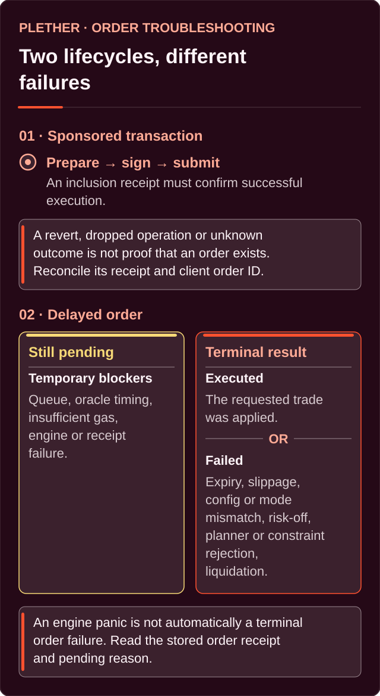

# Why is my order pending or failed?

An action can fail **before** an order exists (during sponsorship, signing or onchain commitment) or **after** a confirmed commitment (during delayed keeper execution). These are separate lifecycles and require different responses.

A sponsored commit is **Confirmed** once it lands onchain and creates an order ID in Plether's global FIFO[^fifo] queue. For **opens and increases**, committed margin and the opening execution reward (`0.01–0.25 USDG`) are reserved while the order is **Pending**. For **reductions and closes**, no execution reward or new margin is reserved, though the requested position quantity is reserved against overlapping closes.

Committed orders cannot be cancelled, resized or repriced. A **Failed** order is terminal and cannot execute later.

## First identify what happened

| What you see | Does an order exist? | Meaning |
| --- | --- | --- |
| **Wallet signature rejected** | No | Your owner wallet declined the authorization |
| **Sponsorship unavailable / rate-limited** | No | The paymaster did not approve gas funding for this attempt |
| **Bundler rejected** | No | The bundler[^bundler] refused the UserOperation[^useroperation] before submission |
| **Pending onchain** | Not yet known | Waiting for onchain inclusion; do not submit a duplicate |
| **Dropped by bundler** | Usually no | Bundler stopped tracking it; check for a transaction receipt before retrying |
| **Failed onchain** | No | The included commit call reverted; no order or reservation remains |
| Order listed under **Open Orders** | Yes | Commitment succeeded and the order is **Pending** in FIFO |
| **Keeper execution attempt failed** | Yes, usually still Pending | A keeper's execution attempt reverted; the keeper can retry |
| **Expired** under **Open Orders** | Yes, awaiting cleanup | The 30-second execution window passed; awaiting keeper[^keeper] cleanup |
| **Order failed** / **Expired / Cleaned up** in **Order History** | No longer active | An onchain `OrderFailed` event terminally closed the order |
| **Executed** | No longer active | The trade completed and updated your position |

### UserOperation hash vs transaction hash

A **UserOperation hash** identifies your signed smart-account request at the bundler (before or after inclusion). Once included, its receipt reveals the onchain **transaction hash**, which records EntryPoint and Plether contract events.

A confirmed bundler transaction alone does not prove your trade executed: a commit transaction only creates the pending order, and a later keeper transaction can confirm onchain while emitting `OrderFailed`. Always verify the final outcome in **Open Orders** and **Order History**.

## Quick troubleshooting sequence

1. Check **Trading Account activity** for the operation status, UserOperation hash and transaction hash (and check **Trading status** for bundler/keeper/oracle health).
2. If the transaction confirmed, locate the order ID under **Open Orders** and check its expiry countdown.
3. Check the market state (**Open**, **FAD close-only**[^fad] or **Oracle frozen**) and latest oracle[^oracle] timestamp.
4. Wait for automatic keeper execution or expiry cleanup — do not submit a replacement while the original order is still Pending, or you will create a second binding FIFO order.
5. Once **Order History** shows a terminal failure or **Expired / Cleaned up**, request a fresh preview and submit a new order if still needed.

## When the sponsored commit fails (no order created)

Pre-inclusion errors (rate limit, stale `submitBy` window, invalid nonce/signature, failed simulation, bundler rejection) and reverted onchain commits leave **zero** order ID and **zero** reservations. For eligible sponsored attempts that revert onchain, Plether still pays the network gas.

Common onchain commit reverts:

| Commit error | Typical cause |
| --- | --- |
| **Insufficient free USDG** | Available to Trade cannot cover the opening margin and opening execution reward |
| **Too many pending orders** | Account already has the maximum `5` active pending orders |
| **Position too small** | Opening size is below the `1,000 USDG` minimum notional (or partial close leaves a dust residual) |
| **Insufficient initial margin** | Requested size and margin exceed the initial leverage limit |
| **Opposing position** | Account already holds exposure in the opposite direction |
| **Skew or solvency limit** | Trade exceeds the `40%` net-pool skew cap or pool solvency capacity |
| **Close-only, frozen, degraded or paused** | New risk-increasing exposure is blocked in the current market state |
| **Invalid reduction** | No executed position exists, side mismatches, or earlier pending closes already reserve that size |

## Why a committed order stays Pending

* **Behind earlier global FIFO orders:** Plether processes every account through one global FIFO queue. Open Orders only shows your own orders; an earlier blocked or expired order from another account can briefly delay later orders (including closes) until the queue head executes or is cleaned up.
* **Waiting for the first post-commit Pyth tick:** Live and FAD-only execution requires `execution block > commit block` and `oracle publish time > commit time`, using the unique first eligible Pyth basket observation inside the order's settlement window. Keepers cannot skip ahead to a newer price.
* **Transient historical oracle or gas issues:** Hermes rate limiting, missing historical VAAs, wide oracle confidence (above `0.10%`), component timestamp divergence (above `5s`), Pyth fee changes or insufficient forwarded keeper gas all cause the keeper transaction to revert while leaving your order **Pending** for automatic retry.
* **Market entered close-only (`FAD` or `oracleFrozen`):** An open or increase committed right before close-only remains Pending because risk-increasing execution is blocked. Since the active `executionWindowSeconds` is `60` seconds and scheduled closures last much longer, the blocked open expires and is then cleaned up by a keeper. Reductions and closes remain executable in both FAD-only (live rules) and `oracleFrozen` (validated frozen price plus the `50 bps` spread).
* **Keeper or RPC[^rpc] delay:** The web app leaves execution and expired-order cleanup to Plether's keeper; your owner wallet is never prompted to finalize or clean up an order.

For pricing details behind oracle delays, see [Oracle & execution model](../how-plether-works/oracle-and-execution-model.md).

## What remains reserved while Pending

* **Open or increase:** Submitted order margin and the opening execution reward (`0.01–0.25 USDG`) leave **Available to Trade**. Committed opening margin creates no live exposure and does **not** back price losses on an existing position.
* **Reduce or close:** Reserves **zero** execution reward and no new margin, only the requested position quantity against further closes. Committing checkpoints accrued carry (from active position margin first, then eligible free USDG), which can reduce position margin while the position stays fully exposed until execution. **A pending close provides no liquidation protection.**

## Expired orders and keeper cleanup

An order becomes expired onchain once `block.timestamp > executionDeadline` (`commitTimestamp + 60s` on the current deployment). Until a keeper processes terminal cleanup, an expired order still holds its reservations (for an open) and counts toward the `5`-order cap.

**Open Orders** labels expired rows **Keeper cleanup in progress** / **Keeper processing**. Once FIFO reaches the order, cleanup emits `OrderFailed (Expired)`, removes it from the queue, releases committed opening margin to free USDG and — for **opens and increases only** — pays the reserved execution reward to the cleanup keeper. Expired reductions and closes pay **zero** execution reward.

## Terminal failure reasons in Order History

| Terminal status | Why it happened |
| --- | --- |
| **Failed: Slippage exceeded** | The eligible execution price (including the `0.25×` adverse confidence shift during live/FAD, or the unshifted validated price during `oracleFrozen`) crossed your acceptable-price bound (disabled only when set to **Infinity**). Terminal for that order. |
| **Failed: Engine rejected** | Execution-time state failed validation — for opens: opposing position still open, below `1,000 USDG` minimum, fees/VPI[^vpi]/carry drained usable margin, insufficient initial margin, skew/solvency cap or degraded mode; for closes: size exceeds remaining position, dust residual, or a partial close could not pay its losses and action charges without waiver. |
| **Failed: Account liquidated** | Liquidation occurred before the order executed. All of the account's pending orders are cleared and marked failed; opening-order execution rewards are forfeited to the protocol treasury while committed opening margin is released to free USDG (never backing price losses, though free USDG can cover separate non-price liquidation charges such as unpaid carry, VPI clawback or liquidation fees). |
| **Expired / Cleaned up** | Passed its `60`-second execution deadline without executing and was terminally removed by a keeper. |

> **Unexpected engine or receipt error (not automatically terminal):** If an execution attempt encounters an unexpected engine panic, malformed response or receipt error, the transaction rolls back and the order **stays Pending** for retry rather than silently failing. If this persists, save the Order ID, commit hash, block number and market state and contact support.

## Opening-order reservation outcomes

| Outcome | Committed opening margin | Opening execution reward (`0.01–0.25 USDG`) |
| --- | --- | --- |
| **Pending** | Reserved | Reserved |
| **Executed** | Becomes active position margin | Paid to executing keeper |
| **Slippage / engine failure** | Released to free Margin Account USDG | Paid to processing keeper |
| **Expired and cleaned** | Released to free Margin Account USDG | Paid to cleanup keeper |
| **Keeper transaction reverted** | Unchanged (still Pending) | Unchanged (still Pending) |
| **Account liquidated first** | Released when pending order clears (cannot absorb price loss; released free USDG can cover non-price charges if needed) | Forfeited to protocol treasury |

Reductions and full closes reserve and pay **zero** execution reward in every outcome. Carry already collected at commitment remains paid.

## Why a valid preview can fail — and why Available to Trade can lag

Previews snapshot current state, whereas execution happens later in FIFO after price moves, carry accrual, skew/solvency changes, earlier orders or market-state transitions.

If **Available to Trade** has not recovered right after a failure, check whether:

* The order is **Expired** and waiting for keeper cleanup.
* Other pending orders still reserve margin or opening rewards.
* Carry was checkpointed on an open position.
* **Order History** (indexed) has not yet caught up with **Open Orders** (read directly onchain).

## Before submitting a replacement

Confirm the original order is gone from **Open Orders**, check its terminal status in **Order History**, refresh your position and Margin Account balances, verify the current market state and request a fresh preview with deliberate slippage bounds.

[^fifo]: First in, first out; orders at the front of the queue are processed before later orders.
[^bundler]: A service that packages smart-account operations and submits them for onchain inclusion.
[^useroperation]: A signed smart-account instruction sent to a bundler for onchain inclusion.
[^keeper]: A permissionless actor or bot that submits order-finalization or protocol-maintenance transactions.
[^fad]: Friday Afternoon Deleverage, Plether’s wider scheduled close-only window around the weekly FX closure.
[^oracle]: A service that supplies external market data to smart contracts; Plether uses Pyth price feeds.
[^rpc]: Remote Procedure Call, an interface used to communicate with a blockchain node.
[^vpi]: Virtual Price Impact, a separate USDG charge or rebate based on how a trade changes pool directional imbalance.
