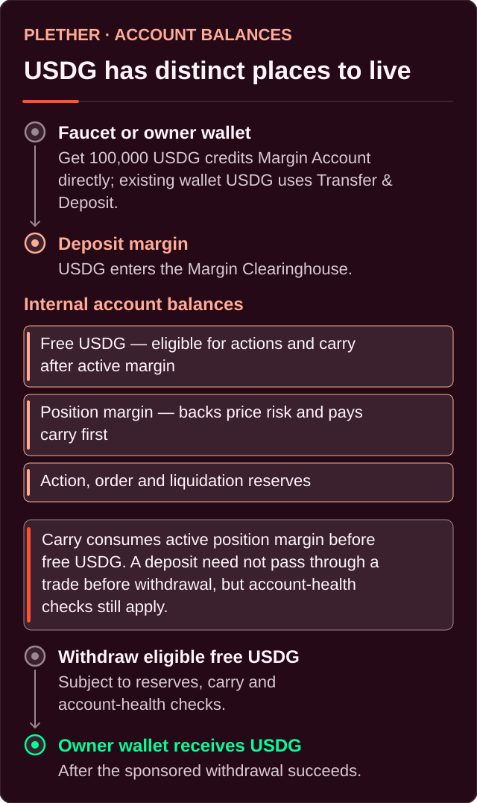
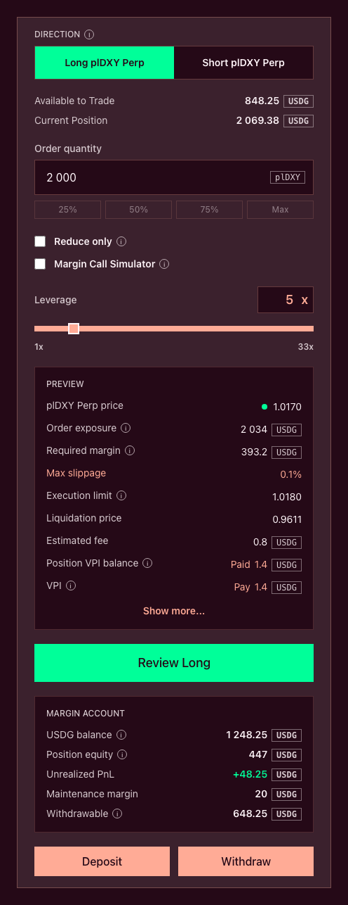
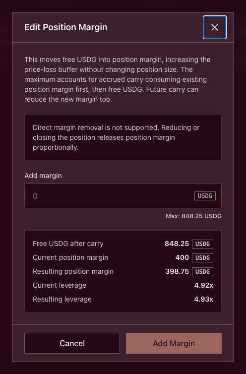
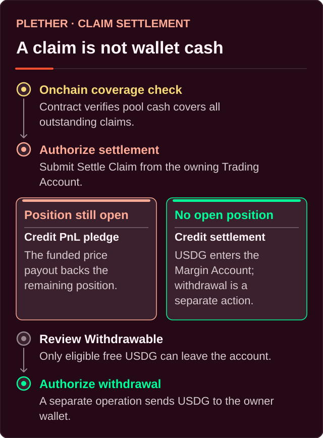

# Your Margin Account

Every Plether Perps trade settles through a USDG **Margin Account** owned by your **Plether Trading Account**. Your connected owner wallet authorizes actions, while positions, orders, margin buckets and trader claims live under the Trading Account address.



### Three places USDG can sit

| Balance | Where it lives | What it can do |
| --- | --- | --- |
| **Owner-wallet USDG** | Your connected wallet (or Privy embedded EOA) | Can fund LP Vaults directly, or fund Perps deposits via an owner-paid shortfall transfer (`Transfer & Deposit`) |
| **Trading Account USDG** | Your smart Trading Account address, outside Plether’s clearinghouse | Can fund a gas-sponsored Margin Account deposit; not trading collateral yet |
| **Margin Account USDG** | Inside Plether’s clearinghouse under your Trading Account | Trading collateral (`Available to Trade`, position margin, pending-order margin, and reserves) |

Never send USDG directly to a Plether contract address—always use the in-app **Deposit** or **Get USDG** flow.

### Inside your Margin Account

```text
USDG balance (total clearinghouse USDG)
= Available to Trade (free USDG)
+ Position margin (assigned to your open position)
+ Pending-order margin (reserved for pending opens/increases)
+ Dedicated reserves (opening execution rewards, TP/SL trigger reserve, VPI/liquidation reserves)
```

* **USDG balance** is all clearinghouse USDG; it excludes unrealized PnL and unsettled trader claims.
* **Position equity** (shown while a position is open) is `position margin after accrued carry + same-account trader claim + exact price PnL`. Free USDG, pending-order margin, and dedicated reserves do **not** increase Position equity.



### Depositing USDG

#### Testnet quick funding (no ETH needed)

Select **`Get USDG`** in the top banner, then **`Get 100,000 USDG`**. Plether pays all gas to mint and deposit **100,000 MockUSDG** directly into your **Margin Account** with zero wallet approvals (one allocation per Trading Account; use `Check funding` if delayed).

#### Depositing existing USDG

1. In the trade ticket's **Margin Account** card, click **`Deposit`**.
2. Enter an amount up to **`Available to deposit`** (combined Trading Account + Owner Wallet USDG).
3. **If your Trading Account holds the full amount:** click `Deposit` and sign the single gas-sponsored batch (`approve` + `depositMargin`).
4. **If the amount exceeds your Trading Account balance:** the button reads **`Transfer & Deposit`**. Step 1 sends the exact shortfall from your owner wallet to your Trading Account (requires Arbitrum Sepolia ETH for gas); Step 2 runs the gas-sponsored deposit. If Step 1 succeeds and Step 2 fails, the USDG stays safely in your Trading Account—retry without re-transferring.

> **Deposits and accrued carry:** Depositing while a position is open checkpoints carry (collecting from **active position margin first, then free USDG**). Deposits remain available during stale marks, `oracleFrozen`, and degraded mode.

### Reservations while orders are pending

* **Open or increase:** Reserves submitted order margin + opening execution reward (`1 bp`, `0.01–0.20 USDG`) from **Available to Trade**. On execution, committed margin enters position margin; on terminal failure or expiry cleanup, committed margin returns to free USDG while the opening reward pays the processing keeper.
* **Reduce or close (including TP/SL closes):** Reserves **zero** execution reward and no new margin; commitment still checkpoints carry from active position margin first, then free USDG.
* **Liquidation cleanup:** Clears pending orders, releases committed-order margin (it does not back price losses), and forfeits pending opening execution rewards to the protocol treasury.

### Position margin vs. free USDG

To raise your price-loss buffer and lower future carry on an open position, open **Edit Position Margin** (pencil icon beside **Leverage**) and click **Add Margin**. Carry is collected from existing active margin first (then free USDG), and the requested free USDG moves into **Position margin**. Direct removal of position margin is not supported—reduce or close the position to unlock it.



### Available to Trade and Withdrawable

```text
Withdrawable ≤ Available to Trade ≤ total USDG balance
```

* **Flat account:** All unreserved free USDG is generally withdrawable, even during stale marks or degraded mode.
* **Open position:** Withdrawal requires a non-degraded protocol, a sufficiently fresh mark for the active market state, carry realization, and post-withdrawal equity clearing the stricter of initial margin and active maintenance/FAD margin. If any check fails, **Withdrawable** drops to zero until conditions recover.

#### Withdrawing to your owner wallet

Click **`Withdraw`** in **Margin Account**, enter an amount within **Withdrawable**, confirm the verified owner recipient, and sign. One atomic gas-sponsored batch withdraws from the Margin Account to your Trading Account and transfers the exact amount to your connected owner wallet.

### Trader claims inside your account

When pool cash cannot immediately fund a complete fresh close payout, the full fresh payout is recorded as a **trader claim** (separate from released margin, which follows its normal path).

* Unsettled claims count toward **Position equity** and offset same-account price losses, but are **not** free USDG, cannot pay carry/fees, and cannot be withdrawn until settled.
* Once physical pool assets cover all aggregate claims, select **Settle Claim** in the **Position** tab: settling while a position is open adds the claim to **position margin**; settling while flat credits **free USDG** for withdrawal.



### Worked balance example

1. Flat account receives `5,000 USDG` → `USDG balance: 5,000`, `Available to Trade: 5,000`, `Withdrawable: 5,000`.
2. Commits a `1,200 USDG` contract-notional open at `1x` (`1 bp` execution reward = `0.12 USDG`) → while pending: `Available to Trade: 3,799.88`, `Pending margin: 1,200`, `Reserved reward: 0.12`.
3. Order executes → `1,200` moves into position margin (minus execution fee and signed VPI), `0.12` pays the keeper.
4. Trader adds `300 USDG` via **Add Margin** → `Position margin +300` (after any carry checkpoint), `Available to Trade −300`, exposure unchanged.

See [Check and settle a trader claim](check-and-settle-a-trader-claim.md) and [Gas-sponsored trading and your Plether trading account](gas-sponsored-trading-and-your-plether-trading-account.md) for next steps.
