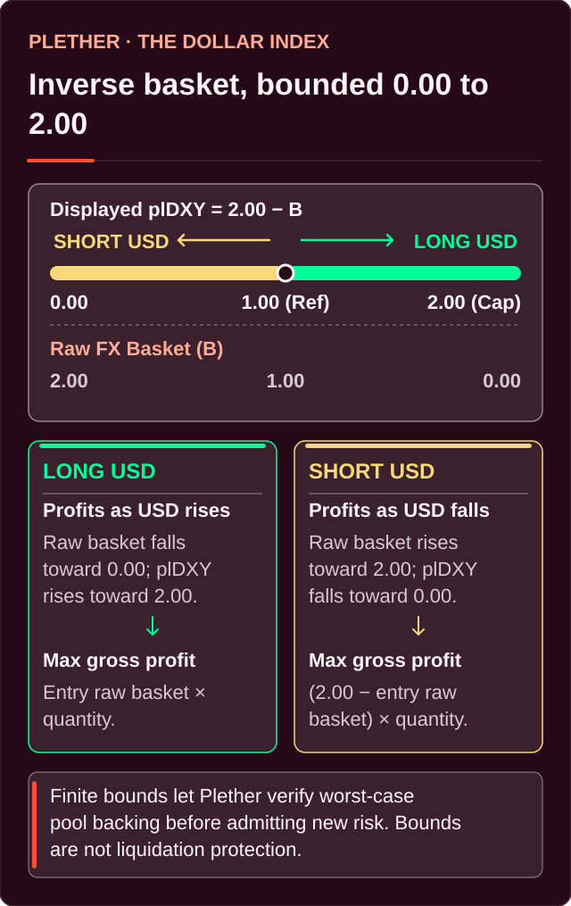

# How Plether works in 5 minutes

> **Traders take a view on the dollar. LPs underwrite it. Plether bounds the worst-case payout and accounts for everything in USDG.**

Plether is an oracle-priced perpetual market—not an order book and not an AMM. Traders open **LONG USD** or **SHORT USD** positions against Plether’s shared USDG liquidity pool.

### 1. One dollar index, bounded between 0.00 and 2.00

Plether combines six Pyth FX feeds—**EUR (57.6%), JPY (13.6%), GBP (11.9%), CAD (9.1%), SEK (4.2%), and CHF (3.6%)**—into a normalized basket centered at `1.00`.

* The displayed **plDXY Perp price** rises when USD strengthens (**LONG USD** profits) and falls when USD weakens (**SHORT USD** profits).
* Internally, contracts compute a raw foreign-currency basket `B` that moves opposite to USD, and the app displays `D = 2.00 − B`.
* Settlement prices are permanently clamped between **`0.00` and `2.00`**. That fixed ceiling makes every position’s maximum possible payout knowable before the trade is accepted.

For the full arithmetic formula and why effective weights drift over time, see [Understanding the Plether Dollar Index](understanding-the-plether-dollar-index.md).

### 2. Margin and your Trading Account

When you connect a wallet (or sign in with Email, Google, or a passkey), Plether derives a dedicated **Plether Trading Account** controlled by your wallet’s signatures. Eligible Perps actions are gas-sponsored—your wallet does not need Arbitrum Sepolia ETH to deposit test USDG or trade.

Each Trading Account holds **one live direction at a time**: you can open, increase, add margin, partially reduce, or fully close. To flip from LONG USD to SHORT USD, close the existing position first.

Position equity is your assigned position margin (after accrued carry) plus any same-account trader claim plus unrealized price PnL. Free USDG stays available for new orders, fees, and fallback carry—it does not raise your price-liquidation buffer until you assign it with **Add Margin**.

### 3. Orders commit first and price later

Plether never fills an order in the same block it is submitted:

1. You review the trade preview and sign the sponsored commitment.
2. The order joins a global **first-in, first-out (FIFO)** queue. Once confirmed onchain, it is **binding and cannot be cancelled**.
3. A permissionless keeper finalizes the order using the **first eligible Pyth observation published after commitment** (or bounded frozen-market rules during weekend FX closures).
4. If the price stays within your acceptable-price limit and passes risk checks, the trade executes; otherwise it fails cleanly or expires after 60 seconds.

This prevents queued orders from becoming free options and keeps keepers from cherry-picking favorable prices. See [Oracle & execution model](../how-plether-works/oracle-and-execution-model.md) and [How orders execute](../how-plether-works/how-orders-execute.md).

### 4. What drives a trade's result

| Component | What it does |
| --- | --- |
| **Directional PnL** | Linear gain or loss as the index moves (`quantity × price move`) |
| **Execution fee** | Protocol fee (`0.04%` of executed contract notional) on size changes |
| **Virtual Price Impact (VPI)** | Separate USDG charge when adding to pool skew, or a bounded rebate when reducing skew |
| **Carry** | Continuous time-based cost for LP-backed payout capacity—not trader-to-trader funding; both LONG and SHORT can pay carry at once, including over weekends |
| **Execution reward** | Small USDG bounty (`0.01–0.20 USDG`) reserved on **opens and increases** for the keeper; **reductions and closes have zero execution reward** |

If position equity reaches or falls below **maintenance margin** (or if carry or VPI reserves go uncovered), a keeper can execute a **full liquidation**. See [Trading costs: fees, carry and VPI](../how-plether-works/trading-costs-fees-carry-and-vpi.md) and [Margin, leverage and liquidation](../how-plether-works/margin-leverage-and-liquidation.md).

### 5. LPs supply the balance sheet in two tranches

Liquidity providers deposit USDG directly from their connected owner wallet (paying ordinary Arbitrum Sepolia ETH gas) into two ERC-4626 vaults backed by the same pool:

| Tranche | Return profile | Loss & withdrawal order |
| --- | --- | --- |
| **Senior (`psLP`)** | Targets a coupon funded from available Junior value | Takes losses only after Junior is exhausted; withdrawals funded before Junior |
| **Junior (`pjLP`)** | Receives residual pool trading revenue after Senior obligations | Absorbs losses first; withdrawals wait behind Senior and a Senior-share covenant |

**Liability is the product. Return is what LPs receive for underwriting it.** Senior is last-loss, not risk-free—its target coupon is not guaranteed, and Senior principal can be impaired if Junior is wiped out.

All LP deposits and withdrawals run through **hourly vault processing** (requests included within 5 minutes of the hour roll to the next hour) and carry a **one-hour withdrawal cooldown** from deposit activation. See [Choose Senior or Junior](../providing-liquidity/choose-senior-or-junior.md).

### 6. Solvency checks and trader claims

Before admitting risk-increasing trades, Plether checks that physically backed pool assets (after existing trader claims) cover the worst-case aggregate payout across LONG or SHORT positions plus a settlement buffer. If not, the trade is rejected.

Because there is **no counterparty auto-deleveraging**, winning positions are never forcibly trimmed. If a profitable close completes when free pool cash cannot fund the entire fresh payout immediately, your released position margin follows its normal path and the complete fresh payout is recorded as a **senior trader claim**. Claims rank ahead of LP withdrawals and settle in full once pool cash covers all outstanding claims. See [Settlement liquidity and trader claims](../how-plether-works/settlement-liquidity-and-trader-claims.md).

### 7. FX market hours matter

Global FX closes from Friday **17:00** to Sunday **17:00** New York time (including US DST):

| Market state | What is allowed |
| --- | --- |
| **Open** (Sun 17:15 – Fri 16:30 NY) | Normal opens, increases, closes, liquidations, and LP actions |
| **Close-only · live oracle** (Fri 16:30–17:00 & Sun 17:00–17:15 NY) | New risk blocked; maintenance margin rises to `3.00%`; closes and liquidations use live pricing |
| **Close-only · oracle frozen** (Fri 17:00 – Sun 17:00 NY) | New risk, new LP deposits, and new TP/SL triggers blocked; voluntary closes use bounded frozen pricing + `0.50%` LP-owned spread; carry continues |
| **Paused / Degraded** | New risk (and in degraded mode, new LP deposits and withdrawal funding) blocked while risk-reducing closes and liquidations stay available |

### Five things to remember

1. **LONG USD** profits when the displayed index rises; **SHORT USD** profits when it falls.
2. **Orders are delayed, binding and non-cancellable.**
3. **The liquidity pool—not another trader—is your counterparty.**
4. **Carry pays for LP-backed exposure; it is not trader-to-trader funding.**
5. **Bounded payouts make risk measurable—not risk-free.**

Next: read [Key risks at a glance](key-risks-at-a-glance.md) or jump into the [Trader quickstart](../trader-quickstart.md).
