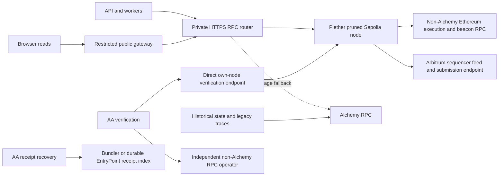

# Self-hosted Arbitrum RPC on AWS

Prepared 28 October 2026. Repository baseline: `c07f01ce`.

## Implementation status — 29 October 2026

The first implementation increment adds opt-in Sepolia node infrastructure,
verified snapshot bootstrap, a redundant private TLS gateway and bounded
administration. It leaves application routing and polling untouched while the
node qualifies. See the [pilot runbook](../../infra/rpc/README.md) for exact inputs,
qualification limits and the QuickNode/Chainstack upstream recommendation.
No AWS resources have been provisioned or reservations purchased. Parent-chain
credentials and a certificate for the private RPC hostname are still required.
The later application compatibility, AA verification, browser routing and faster
polling work remains part of the rollout.

## Selected approach

The user selected a **pruned Arbitrum Sepolia primary node** on 28 October 2026.
This supersedes the earlier archive-first sizing proposal.

- Run one Plether-operated Nitro full node in Singapore, chain `421614`.
- Start with `i4i.4xlarge`: 16 vCPU, 128 GiB RAM, 3.75 TB local NVMe.
- Accepted steady-state budget target: **about $1,000/month AWS before credits**,
  using a one-year No Upfront RI after qualification (modeled $874–1,069/month).
  Allow **$1,300–1,500/month at On-Demand rates during qualification**.
  These figures exclude contingency, external provider subscriptions, labor
  and tax; the target is not a hard invoice cap.
- Serve live reads, logs, receipts, simulation and signed transaction submission
  locally; retain Alchemy for outage fallback and historical state/backfills.
- Keep indexed application history in PostgreSQL. Replace V3 trace-derived
  oracle enrichment with validated event-derived fields.
- Include faster active-screen polling in the rollout: target 2 seconds for
  market/position reads, 5 seconds for history and 2 seconds for the perps
  indexer, subject to load qualification. Preserve canonical confirmation rules.
- Qualify Sepolia first. Arbitrum One remains the later, separately sized phase;
  no archive-node purchase is part of the selected approach.

The accepted tradeoff is that Alchemy may receive normal historical/recovery
traffic. Removing it from the primary live RPC path is the immediate objective;
complete historical-provider independence is outside this rollout.

## Clarification: historical traces do not require an archive primary

Historical tracing is not a requirement for executing trades and does not
justify an archive primary. The selected pruned primary retains managed
historical access for older state reads and legacy recovery.

The trace decoder reconstructs VPI, frozen-close spread and execution-oracle
price/publish-time evidence from internal calls. This supports legacy or
missing execution evidence and post-execution diagnostics. The indexer labels
trace-derived execution enrichment optional; failures remain pending and are
retried separately from canonical range ingestion. Native AA tracing used to
diagnose out-of-gas is advisory and happens after reconciliation.

Current V3 `OrderFinalized` logs already carry realized PnL, VPI, carry,
execution fees, frozen spread and account/position balances. The frontend
reads the VPI/spread from these stored receipt economics. Replaying internal
calls is unnecessary to obtain that canonical V3 breakdown. The legacy
enrichment query is not explicitly receipt-aware: if a release also supplies a
matching `OrderExecuted` event, missing oracle enrichment can still cause a
trace request. Make that optional routing/selection explicit during migration,
rather than assuming the current implementation never traces V3 transactions.

The V3 event also exposes `neutralMarkPrice` and `oraclePublishTime`. Validate
their semantics and index them directly, including reorg/replay handling and
evidence provenance, then exclude complete V3 receipts from legacy trace
enrichment. This supplies the post-trade oracle-confidence-spread display
without a normal trace request. Missing enrichment currently causes additional
polling and an unavailable display field; it does not block trade execution.

Evidence: [trace fields](../../apps/backend/src/Plether/Perps/ExecutionTrace.hs#L32),
[optional enrichment](../../apps/backend/src/Plether/Perps/HistoryIndexer.hs#L1504),
[V3 receipt economics](../../apps/backend/src/Plether/Perps/HistoryIndexer.hs#L1919),
[receipt persistence](../../apps/backend/src/Plether/Database/Schema.hs#L4680),
[legacy candidate selection](../../apps/backend/src/Plether/Database/Schema.hs#L4821),
[frontend receipt use](../../apps/frontend/src/hooks/usePerpsHistory.ts#L292),
[advisory failure diagnostics](../../apps/backend/src/Plether/AA/ExecutionDiagnostics.hs#L82).

Keep optional historical traces on a dedicated managed fallback and preserve
ordinary logs/receipts in PostgreSQL. Route old-state reads used by vault history,
competition baseline recovery and historical previews to Alchemy and qualify
their required coverage there. Alto's
pre-submission `debug_traceCall` is also a separate live simulation capability.
Split the current provider preflight so optional old-transaction tracing is
not treated as mandatory readiness for the primary live RPC node.

## Delivery scope

Deliver Sepolia first, then qualify a separate pruned Arbitrum One (`42161`)
service using the same automation and routing. The application currently uses
Sepolia; provisioning a One node does not migrate contracts or app traffic.

Plan for **15–25 engineering days for shared infrastructure/application work
and the Sepolia rollout**, then **5–8 additional days for One node deployment
and qualification**: approximately **20–33 days over 6–8 calendar weeks**,
including qualification and soaks. These remain planning estimates rather
than a measured implementation schedule. Alchemy historical routing reduces
the local capability scope; the work still includes V3 event enrichment,
provider routing, recovery compatibility and operational qualification.
A separate mainnet contract/application release is outside the node estimate.

This is technically feasible. The main work is provider routing, historical
data compatibility, account-abstraction recovery, and operating a large stateful
service. A replacement URL alone does not complete the migration.

Use non-Alchemy parent execution/beacon services so a node's L1 dependency does
not silently preserve the same primary dependency. Keep native AA verification
independent. Existing application Ethereum `RPC_URL` traffic is a separate
scope and must not be described as migrated by changing `PERPS_RPC_URL`.

## What the repository requires

The following findings come from checked-in code and configuration. Live AWS
resources, production secret values, Alchemy invoices and request volumes were
not inspected.

| Dependency | Current behavior | Required change |
| --- | --- | --- |
| Arbitrum RPC | `PERPS_RPC_URL` feeds API and perps workers | Route normal traffic to the own node, with authenticated Alchemy fallback |
| Ethereum RPC | `RPC_URL` serves the separate core/Ethereum path | Move to a non-Alchemy primary or scope this as a separate remaining dependency |
| Historical state | Vault performance and insights need old `eth_call`; some activity previews use execution block minus one | Keep a separate authenticated Alchemy history route; qualify oldest baseline/deployment there, and recent/safe state on the own node |
| Transaction traces | Legacy/missing execution evidence and advisory diagnostics use `debug_traceTransaction`; V3 economics are in finalization logs | Keep optional traces on a qualified route; do not require deep tracing on the live primary |
| Bundler receipts | Legacy AA recovery sends `eth_getUserOperationReceipt` to the Arbitrum chain endpoint | Separate bundler receipt lookup from execution RPC; Nitro does not replace the bundler |
| Provider failover | Most clients use one endpoint; the history indexer has an ordered fallback list | Introduce consistent health-aware routing, provider-specific authentication and retry limits |
| Native AA security | Dual-independent mode requires agreement at a common explicit `safe` block | Preserve independent verification; ordinary failover must not collapse both legs onto one operator |
| Browser reads | Frontend and insights have separate build-time RPC URLs; default is Arbitrum's public RPC | Migrate through a restricted public/same-origin gateway after server qualification |

Evidence:

- [API RPC construction](../../apps/backend/app/Main.hs#L54),
  [shared single-endpoint client](../../apps/backend/src/Plether/Ethereum/Client.hs#L73),
  [history fallback](../../apps/backend/src/Plether/Perps/HistoryIndexer.hs#L2628).
- [Historical/tracing preflight](../../apps/backend/app/ProviderPreflight.hs#L49),
  [trade traces](../../apps/backend/src/Plether/Perps/HistoryIndexer.hs#L1455),
  [historical execution state](../../apps/backend/src/Plether/Perps/HistoryIndexer.hs#L2029),
  [competition baseline requirements](../../specs/insights-operations-runbook.md#L96).
- [Alchemy receipt route](../../apps/backend/src/Plether/AA/Pimlico.hs#L435),
  [AA provider configuration](../../apps/backend/src/Plether/Config.hs#L1479),
  [accepted AA design](../../docs/adr/0002-self-hosted-account-abstraction.md#L21),
  [durable broadcast journal](../../apps/backend/src/Plether/Keeper/Broadcast.hs#L1).
- [Application browser transport](../../apps/frontend/src/config/wagmi.ts#L23),
  [insights browser transport](../../apps/insights/src/config/wagmi.ts#L14).

The file named `terraform.tfvars.mainnet.example` still specifies Arbitrum
Sepolia for perps. Environment names must never select chain identity implicitly.
Pin and verify chain ID, parent chain, deployment manifest and contract hashes.

## Target architecture

**Compute and runtime.** Use dedicated x86 EC2 with a pinned official Nitro
container managed by systemd, initially On-Demand. Keep existing application
services on Fargate. The existing ARM64 application task configuration is not a
node sizing template. Start qualification on `i4i.4xlarge` (16 vCPU, 128 GiB,
3.75 TB local NVMe). Verify capacity/quota in the selected AZ before launch.
Measure growth and upgrade only when disk/CPU/RPC evidence requires it.
Pin filesystem/mount identity and refuse service startup if the data mount is
absent; never silently initialize an empty database on the boot volume.
Arbitrum's current guidance recommends at least 128 GB RAM for robust service
and fast local NVMe. [Node prerequisites](https://docs.arbitrum.io/run-a-node/start-here)

**State and history.** Prefer PathDB with online pruning and a bounded recent
state window. Start qualification from a `full-path` snapshot. Explicitly test
block-pinned calls at the API/keeper/AA common `safe` block: retaining state on
disk does not by itself guarantee an RPC-readable history index. If those reads
need PathDB's history index, qualify enabling that index with an explicit finite
`state-history` window; do not accidentally retain the entire chain by using an
unbounded archive default. Choose the shortest tested window that supports safe
head delay, short outages and normal worker lag, and measure its disk cost.
Deep state and old traces remain on Alchemy. HashDB with scheduled pruning is
an alternative if the selected release cannot satisfy the bounded-state RPC
contract. PathDB does not support Nitro's optional block-validator role.
[Full-node configuration](https://docs.arbitrum.io/run-a-node/run-full-node),
[PathDB RPC indexing](https://docs.arbitrum.io/run-a-node/more-types/run-archive-node)

**Bootstrap.** Import a verified `full-path` snapshot with `--init.url` and
matching database scheme. `--init.latest` does not select PathDB snapshots.
Verify metadata, all part checksums, trusted origin, required recent/safe state,
and a known canonical checkpoint before admitting traffic. Provision separate
temporary EBS staging when download plus extraction would exhaust local disk.
[Snapshot procedure](https://docs.arbitrum.io/run-a-node/nitro/nitro-database-snapshots)

Snapshot metadata checked on 28 October 2026:

| Chain | Snapshot date | Uncompressed archive bytes | Decimal TB / TiB |
| --- | --- | --- | --- |
| Arbitrum Sepolia (`full-path`) | 20 October | 2,007,048,622,080 | 2.01 TB / 1.83 TiB |
| Arbitrum One (`full-path`) | 18 October | 2,737,448,744,960 | 2.74 TB / 2.49 TiB |

Sources: [Sepolia metadata](https://snapshot.arbitrum.foundation/sepolia-rollup/2026-10-20-dbd26a00/metadata.json),
[Arbitrum One metadata](https://snapshot.arbitrum.foundation/arb1/2026-10-18-3d8d5959/metadata.json).
These are snapshot-file sizes, not guarantees of live filesystem usage or growth.
Measure extraction, compaction and catch-up overhead. A 1.875 TB instance cannot
hold these snapshots. Use separate temporary staging on the 3.75 TB node because
download plus extraction can exceed its capacity. Forecast at least 90 days of
growth and target at least 30% free disk for Sepolia. One needs separate sizing;
its inspected snapshot already leaves less than that target on a 3.75 TB disk.

**Release management.** The official release page currently lists stable
`v3.12.2-5f02f3f`; pin its image digest after qualification. The inspected
snapshots name RC builds in metadata, with commit hashes matching subsequently
published stable builds. Verify snapshot/database compatibility explicitly;
metadata is not an instruction to run an RC image. Upgrade within the current
support window, rehearse on a replacement node, and retain a compatible
pre-upgrade data restore path. Image rollback alone may not reverse database
changes. [Stable release](https://github.com/OffchainLabs/nitro/releases/tag/v3.12.2),
[support policy](https://docs.arbitrum.io/run-a-node/nitro-support-policy)

**Parent chain.** Initially buy non-Alchemy Ethereum execution and beacon/blob
access; use Ethereum Sepolia for Arbitrum Sepolia and Ethereum mainnet for One.
Qualify historical blob availability and current subnet/retention requirements,
including recovery from an old snapshot. Configure and test provider failover
for both execution and beacon services. Using Alchemy as the sole L1 upstream
would preserve the dependency through the own node. Self-hosting execution plus
consensus clients is a later work package with separate compute, storage and
maintenance estimates. [Beacon providers](https://docs.arbitrum.io/run-a-node/l1-ethereum-beacon-chain-rpc-providers),
[historical blobs](https://docs.arbitrum.io/run-a-node/beacon-nodes-historical-blobs)

**Ingress and network.** Reuse Singapore VPC connectivity and supply private DNS
plus TLS on port 443. Alto/reconciler configuration and egress rules already
require HTTPS/443; directly replacing their URLs with `http://node:8547` fails
that contract. Bind Nitro RPC to private interfaces and restrict it by security
group. Use Session Manager, IMDSv2, encrypted boot/staging volumes and a narrowly
scoped instance role. No SSH ingress or public debug endpoint is needed.

The current VPC has public subnets only. The pilot can use its existing egress
topology with all inbound node ports closed except gateway-authorized traffic.
Price private subnets/NAT separately before adopting them: multi-terabyte
snapshot and feed traffic can create material NAT processing charges. Browser
access goes through an allowlisted, rate-limited gateway with limits on request
size, batch size, log ranges and concurrency. Keep trace/admin methods private.
Browser code receives no upstream credentials. Wallet extensions retain their
own RPC choices for wallet-managed transactions.

**High availability.** Start with one node plus tested Alchemy fallback. For
mainnet trading, recommend a second fully synced node in another AZ before
making own-node availability the normal service guarantee. A second Plether
node improves availability but does not create independent administrative
verification. Add a feed relay layer when running multiple nodes; avoid making
one relay a new shared failure point. Feed failure should be detected through
sustained lag, with L1 derivation providing catch-up.
[Feed relay guidance](https://docs.arbitrum.io/run-a-node/run-feed-relay)

## Application changes

1. **Define separate roles:** chain reads, raw transaction submission, heavy
   history/traces, bundler receipts and AA security verification. Use explicit
   provider identities, capabilities and per-provider authentication. Most app
   methods are portable JSON-RPC; no enhanced Alchemy asset API was found.

2. **Put ordinary failover in a reusable RPC routing service** behind stable
   internal HTTPS. This covers Haskell and JavaScript workers and Alto without
   duplicating policy in each process. Run the router redundantly, independently
   of the node host. Preserve upstream JSON-RPC responses, limit retries and
   isolate trace/backfill concurrency from live keeper and simulation traffic.
   An ALB alone does not validate JSON-RPC semantics or node freshness.

3. **Make health semantic:** expected chain ID, `eth_syncing`, latest head lag
   against an independent reference, agreed block hashes, parent derivation
   progress, and `safe`/`finalized` behavior. A responsive stale node must leave
   rotation. Retry transport/rate-limit/transient failures within a deadline;
   do not hide contract reverts, invalid parameters or chain disagreement by
   blindly trying another provider. Use a circuit breaker and recovery hysteresis.
   Multi-read operations must pin a block and verify canonicality across retry.

4. **Preserve transaction safety.** A timed-out send can have reached the network.
   Reconcile by transaction hash and receipt; any retry broadcasts the identical
   signed bytes. Preserve the existing journal and nonce ownership. Do not
   create another transaction or switch bundlers after an ambiguous submission.
   Nitro still forwards writes to the network sequencer; test this route and
   Alchemy backup without introducing a new signing/key service.

5. **Separate receipt recovery from execution RPC.** Native AA already has
   client-scoped, finalized-database receipt locators and canonical receipt
   reconstruction in `AA.RecoveryReceipt`; reuse and qualify it. Legacy Pimlico
   recovery still calls `eth_getUserOperationReceipt` on `PERPS_RPC_URL`.
   Give that legacy path a dedicated managed receipt route before switching the
   primary URL to Nitro. Do not broaden native locators into universal recovery
   without proving coverage and authorization. Split `plether-provider-preflight`
   into live execution, historical state, optional trace and bundler/recovery
   probes; only relevant capabilities gate the primary live endpoint.

6. **Keep AA verification independent.** Supply a direct own-node endpoint and
   an independently operated non-Alchemy endpoint for the two security legs.
   Decouple the AA primary configuration from the ordinary failover alias where
   necessary; add credential plumbing to AA clients that currently use
   unauthenticated `newClient`. Never route both verification legs through the
   ordinary router. Provider loss/disagreement remains fail-closed. If AA pair
   replacement is implemented, select an approved independent pair before a
   fresh attempt and recompute the common safe block; preserve all existing
   prepared/signed/submitted recovery constraints. Do not auto-enable the
   Sepolia single-provider exception. Keeping Alchemy as the permanent second
   verifier is an acceptable interim reduction in volume, but it does not meet
   the target of surviving an Alchemy outage.

   Preserve the existing reconciler cursor during migration. A fresh or disaster
   recovery bootstrap reads paymaster code at deployment block and block minus
   one on both verification legs. Qualify an approved independent archive pair
   for that explicit bootstrap procedure; do not silently make both legs use
   Alchemy. Normal AA profile checks must succeed at the agreed recent `safe`
   block on the pruned node. See [bootstrap reads](../../apps/backend/src/Plether/AA/Reconciler.hs#L477)
   and [native receipt fallback](../../apps/backend/src/Plether/AA/Gateway.hs#L1216).

7. **Qualify Alto separately.** Its main upstream must support reads, simulation,
   gas estimation and writes, including simulation deployment and utility-wallet
   refill. Test the pinned Alto custom `debug_traceCall` tracer and state
   overrides, plus a deliberately invalid operation. Self-hosting does not
   automatically authorize changing its current safe-mode exception or enabling
   native sponsorship on another chain.

8. **Migrate every consumer.** Update SSM URL/token references, API and worker
   task definitions, indexer fallback authentication, Alto's separate upstream,
   funding monitor, AA primary/secondary configuration and frontend/insights
   build URLs/CSP. Running ECS tasks must restart to load changed SSM secrets.
   Keep Alchemy credentials server-side, separately rotatable, and capable of
   handling outage load; reserve quota and test capacity before reducing plans.

9. **Replace routine V3 tracing with event ingestion.** Map and validate
   `neutralMarkPrice`, `oraclePublishTime`, execution mode and receipt economics
   from `OrderFinalized`. Persist canonical provenance, populate the fields
   used by trade confirmation, and mark only validated V3 evidence complete.
   Exclude those records from legacy trace enrichment. Verify live ingestion,
   duplicate ingestion, reorg replacement and bounded replay; preserve optional
   trace routing for legacy records and advisory failure diagnosis.

## Expected UX impact and how to measure it

The selected rollout combines the own node with faster polling. Expect the
largest visible improvement in market/position and history freshness, with
additional conditional gains in uncached read/simulation chains. There is no
own-node versus current-provider benchmark yet. The polling calculations below
are planning estimates, not measured improvements in complete trade time.

For an update arriving independently of a periodic poll, average detection
wait is approximately half the polling interval, before request processing.
Use the following active-screen targets during the pilot:

| Consumer | Current interval | Pilot target | Average polling wait, current → target |
| --- | --- | --- | --- |
| Market/position reads | 15 seconds | 2 seconds | 7.5 → 1 second; about 6.5 seconds saved |
| History UI | 30 seconds | 5 seconds | 15 → 2.5 seconds; about 12.5 seconds saved |
| Perps history indexer | 12 seconds (Terraform default) | 2 seconds | 6 → 1 second after data becomes eligible for indexing |

History has both an ingestion poll and a UI poll. Under a simple independent
polling model, their combined average wait falls from roughly 21 seconds to
3.5 seconds, plus RPC/database/network work and any required confirmation
delay. Actual phases and effective deployment settings must be measured.
This describes background freshness: existing post-trade paths already update
execution status and poll outcomes more aggressively, so do not attribute
these full savings to every trade confirmation.

Use fast intervals only for active, relevant screens; slow or pause hidden
screens, invalidate affected queries immediately after a trade and preserve
error backoff. Batch contract reads and share/cache common market reads so
each additional viewer does not duplicate all node work. A later push-based
path may reduce duplicate polling further.

Moving 15-second polls to 2 seconds creates 7.5 times as many polling cycles;
30 to 5 seconds creates 6 times as many. History UI queries primarily hit the
API/database, while indexer and direct contract reads exercise the node.
These ratios are not automatically RPC, CPU or cost multipliers. Qualify the
actual mixed load and revisit gateway/transfer cost assumptions. Owning the
node gives control over capacity and provider quotas; capacity remains finite.

| UX stage | Estimate / limitation |
| --- | --- |
| Cold order review | About seven dependent RPC waves for a normal unprotected open. If the new browser gateway saves 100–200 ms per critical wave, the model predicts 0.7–1.4 seconds saved. This is a conditional calculation, not a measured provider difference. |
| Warm order review | Often little visible change: preparation starts after 500 ms idle and matching work is reused for 10 seconds. Much of the RPC wait can already be hidden. |
| Backend AA preparation | A tentative planning range is 0–1 second saved, depending on actual RPC contribution. Independent remote verification can remain the critical path even when the primary is local. |
| Keeper execution | Fewer remote round trips may remove fractions of a second. Eligibility, Pyth availability, keeper cadence and sequencer inclusion remain separate. |
| Market/position/history freshness | Faster polling is part of this rollout, with the targets and modeled reductions above. Both ingestion and display cadence must improve for history to appear promptly. |
| Wallet approval, chain finality and edge/body stalls | No direct improvement from hosting the RPC node. These stages have different causes. |

The private backend URL does not move browser RPC requests. Frontend wagmi
uses its configured URL directly, so cold-review gains require a deliberate
browser-gateway cutover. Measure from actual user regions; a Singapore-only
endpoint can be slower for distant browsers than the existing provider.
Do not add the stage estimates together: background work overlaps and the
critical path varies by account, action and provider mode.

Historical September evidence: 809 preparation requests had median/p95
1.43/3.65 seconds; the fresh-sponsorship subset had 3.47/4.14 seconds, with
security verification around 1.05 seconds. These predate the current release
and are not an October baseline. A read-only check of current PostHog telemetry
on 28 October found 46 AA timing records from 20:23–21:19 Warsaw time (CET), mixing methods,
outcomes and reuse paths. The exported records lack the detailed stage/count
fields, so they cannot isolate fresh preparation or its RPC contribution.
No fresh-action percentiles or provider speedup are inferred from that mix.

Sources: [cold review path](../../apps/frontend/src/contracts/preparePerpsOrderV3.ts#L179),
[review prefetch policy](../../apps/frontend/docs/commit-preview-preparation.md#L3),
[browser transport](../../apps/frontend/src/config/wagmi.ts#L91),
[market polling](../../apps/frontend/src/hooks/usePerpsMarket.ts#L25),
[history polling](../../apps/frontend/src/hooks/usePerpsHistory.ts#L70),
[indexer default](../../infra/terraform/variables.tf#L1376),
[September measurements](../../docs/investigations/api-latency-reliability-2026-09-21.md#L5),
[unattributed intake stalls](../../docs/investigations/transaction-timeouts-2026-09-22.md#L7).

During the pilot, compare the same read-only calls at the same block against
both routes, from the Singapore API and representative browser regions. Keep
method mix, concurrency and cold/warm state comparable. Measure RPC p50/p95,
fresh review-ready latency, fresh AA preparation, keeper readiness-to-broadcast,
time to visible execution, error rate and head lag separately. Use existing
organic submissions for complete-trade timing and keep wallet time separate.
Report cold and completed/pending-reuse reviews separately. Decide whether to
route each consumer locally based on the measured result, before buying an RI.

## Delivery sequence and acceptance gates

| Stage | Effort estimate | Concrete deliverable and exit gate |
| --- | --- | --- |
| 1. Baseline and design | 2–3 days | Measure 7–14 days of requests by role/method, p95/p99 latency, bytes, archive age, trace load and Alchemy bill; confirm chain, required history, SLO and independent provider |
| 2. Dark AWS node | 3–5 days | Terraform node/network/IAM, digest-pinned service, verified snapshot bootstrap, private TLS, parent execution/beacon failover, metrics and a measured restore |
| 3. Routing and compatibility | 5–8 days | Redundant router, V3 event-derived oracle evidence, separate legacy receipt/history routes, AA configuration/authentication, split preflights, adaptive faster polling with batching/cache and deterministic transaction retry tests |
| 4. Shadow and canary | 3–5 days | Replay representative reads against both providers at identical blocks; run a read-only/shadow indexer and bounded transaction/AA canaries; measure visible freshness and load with the proposed faster polling enabled |
| 5. Cutover and operations | 2–4 days plus soak | Server consumers migrate in controlled groups, browser reads follow, seven-day stable operation and forced-failure/recovery evidence |
| 6. Arbitrum One rollout | 5–8 additional days plus soak | After Sepolia gates pass, size and qualify a separate pruned One service, mainnet execution/beacon services and historical route; decide node redundancy from measured production SLOs and repeat recent/safe-state, failure and load tests |

Stages 2 and 3 can overlap. Allow additional time if historical receipt
reconstruction or Alto tracing requires larger changes. Stage 6 reuses the
automation and routing developed for Sepolia, but repeats capacity, historical
coverage and failure testing on One. Before admitting One application traffic,
its separate mainnet release must provide real deployment addresses/blocks,
remove the applicable Sepolia-only application guards through review, and pass
the same contract-bound preflights and shadow/canary gates. Until then, the One
RPC service remains ready for integration without changing the existing app's
chain. Mainnet contract/application migration and self-hosted Ethereum clients
are separate estimates.

Before routing normal traffic, require:

- Live RPC methods, block-pinned recent/safe calls, logs, receipts, simulation
  and writes succeed on the own node. Qualify the pinned competition baseline,
  vault backfills and old previews on the separate historical route. Qualify
  optional old traces there; their availability does not gate the live primary.
- V3 normal trade confirmations, fees, VPI and oracle-confidence-spread fields
  remain correct with historical transaction tracing disabled. Preserve the
  canonical event/receipt data and keep legacy enrichment explicitly separate.
- Exact-block calls, receipts and log sets agree with the independent reference;
  no unexplained canonical-data mismatch is accepted. Compare trace semantics
  consumed by Plether, rather than provider-specific formatting.
- Sustained operation at **2× projected peak with faster polling enabled**
  without increasing head lag; include realistic concurrent viewers and tabs,
  cache behavior and API/database load. Validate the 2-second market/position,
  5-second history and 2-second indexer targets against measured visible
  freshness. Cap heavy trace work so keeper/AA latency meets existing SLOs.
- Proposed initial routing targets: ordinary traffic reaches a healthy backup
  within **30 seconds** of node failure; route away from latest-head lag above
  **5 seconds sustained for 15 seconds**. Tune these during shadowing. Keep
  chain-specific safe-head age limits separate; do not replace the existing AA
  finality policy with these latest-head thresholds.
- Failure injection covers node termination, stale-but-responsive node, wrong
  chain, divergent hashes, gateway loss, L1 execution loss, beacon/blob loss,
  Alchemy rate limiting, ambiguous transaction send and restart recovery.
- A **24-hour exercise with Alchemy removed from the ordinary live RPC route**
  demonstrates own-node reads, simulation, trade submission and current V3
  confirmation. The explicit historical/legacy receipt routes remain enabled.
  Check AA with its approved independent pair; do not claim complete Alchemy
  independence when a chosen verification or history route still requires it.
- Seven days of own-node primary traffic with no correctness regression,
  acceptable disk-growth forecast and **at least 95% of normal Arbitrum execution
  RPC traffic** served by Plether. Independent verification traffic is measured
  separately. Record historical and legacy recovery calls as expected distinct
  traffic, and investigate unexplained Alchemy requests from current V3 flow.

Roll out indexer/shadow reads first, then API reads, then transaction-producing
workers and Alto, then browser transports. Preserve single-active worker locks,
existing DB cursors and history. Switch routing for rollback, reconcile pending
transactions, and retain both provider configurations until the soak completes.

Implementation should use a dedicated node deployment/admin workflow with
GitHub OIDC and narrowly scoped EC2/SSM permissions; the existing application
deploy role is primarily ECR/ECS. Use `gh` for all deployment operations and the
`plether` AWS profile, following repository `AGENTS.md`. Normal backend deploys
use `bootstrap=false`; verify exact commit, duplicate runs, workflow success
and public endpoint smoke checks. Review a saved Terraform plan before apply.

## Operating responsibilities

Assign a primary operator and backup. Reserve **half to one engineer-day per
week initially**, then reassess after a month of measured operation. Work
includes Nitro/ArbOS and L1 compatibility upgrades, disk growth/capacity,
snapshot verification, recovery drills, TLS/token rotation and incident response.

Add short-window alerts for latest/safe-head lag, derivation progress, RPC
error rate and latency by method/provider, fallback share, parent RPC/blob
errors, CPU saturation, resident memory/OOM, disk free space/growth, disk
latency, restarts, trace backlog and stale worker cursors. Reuse CloudWatch,
operations SNS and existing application RPC metrics. Track total resident
memory as well as Go heap metrics.
[Nitro tuning and monitoring](https://docs.arbitrum.io/run-a-node/nitro/node-tuning-and-monitoring)

Treat local NVMe as disposable: instance stop/termination or disk failure can
destroy the database. Boot EBS snapshots do not back up instance storage.
Default to a tested verified-snapshot reseed procedure, with Alchemy covering
ordinary RPC traffic while the node rebuilds. Native AA pauses if its direct
own-node verification leg is unavailable, unless a prequalified independent
alternate pair is selected under the explicit AA policy. Ordinary RPC fallback
alone does not preserve AA availability. Keep at most one optional consistent database
copy in encrypted S3 if measured restore time justifies it. Stop
and flush the Nitro process/container, or use a supported consistent-copy
procedure before backing up the database; never stop the EC2 host for this copy,
because stopping the host discards instance-store data.
Do not archive live database files with an unchecked filesystem copy.
Restore/catch-up time must be measured; initially allow a full day or more,
with Alchemy serving ordinary RPC meanwhile. Blockchain state is recoverable;
PostgreSQL, signing material and application journals keep their separate
backup requirements. [Instance-store lifetime](https://docs.aws.amazon.com/AWSEC2/latest/UserGuide/instance-store-lifetime.html),
[EBS snapshots](https://docs.aws.amazon.com/ebs/latest/userguide/ebs-snapshots.html)

An EBS-backed database is an alternative if persistence is more important than
local NVMe performance. Benchmark sync and peak mixed RPC load before choosing
it; include provisioned IOPS/throughput and snapshots. It is not the default
recommendation, and an EBS volume in one AZ is not multi-AZ availability.

## Cost model and selected budget

Singapore Linux shared-tenancy On-Demand rates checked 28 October 2026,
730 hours/month, USD before tax. Published rates are separate from estimated
usage. The selected Sepolia configuration is a pruned `i4i.4xlarge`.
[AWS regional EC2/EBS price list](https://pricing.us-east-1.amazonaws.com/offers/v1.0/aws/AmazonEC2/current/ap-southeast-1/index.csv)

| Item | Usage assumption | Monthly USD |
| --- | --- | --- |
| EC2 `i4i.4xlarge` | 730 hours at $1.646/hour; 16 vCPU, 128 GiB, 3.75 TB local NVMe included | $1,201.58 |
| Boot EBS | 100 GB gp3 | $9.60 |
| Internal ALB | Base charge plus average 1 LCU | $24.24 |
| Two gateway tasks | ARM Fargate, each 0.5 vCPU and 1 GB | $35.98 |
| Logs, metrics and alarms | Initial usage allowance | $20–60 |
| Transfer/network charges | Modest-traffic allowance, without new NAT gateways | $0–100 |
| Optional S3 node backup | No private copy, or one copy up to about 2,200 billable GB | $0–55 |
| **Recurring subtotal before contingency** | | **$1,291–1,486** |

Target **$1,300–1,500/month AWS before contingency**. Temporary bootstrap EBS,
backup request charges, extra ALB capacity and public ingress costs use their
actual measured quantities. Local chain storage is included in EC2; no separate
full-size EBS data disk is added to this design. Alchemy capacity, parent-chain
execution/beacon services, an independent AA verifier, labor and tax are extra.

Underlying regional rates: [ALB](https://pricing.us-east-1.amazonaws.com/offers/v1.0/aws/AWSELB/current/ap-southeast-1/index.json),
[Fargate](https://pricing.us-east-1.amazonaws.com/offers/v1.0/aws/AmazonECS/current/ap-southeast-1/index.json),
[S3](https://pricing.us-east-1.amazonaws.com/offers/v1.0/aws/AmazonS3/current/ap-southeast-1/index.json).

A 1.875 TB `i4i.2xlarge` does not fit the inspected full-node snapshots on its
local disk. A lower-cost benchmark candidate is `r7i.2xlarge` (8 vCPU, 64 GiB,
$466.03/month) plus 4,096 GB gp3 ($393.22/month) and $24/month for 6,000 IOPS
and 250 MiB/s. Its node subtotal is $883.25, or roughly $1,000–1,200/month
with modest gateway, monitoring and network overhead. It remains an experiment;
local NVMe is the selected baseline and EBS must pass sync and RPC load tests
before replacing it.

Arbitrum One remains a later phase. One node on each chain could start around
$2,600–3,000/month AWS at the same instance class, but One needs its own storage
forecast, workload qualification and availability decision. Do not treat the
Sepolia pilot sizing or this arithmetic as a production mainnet capacity plan.
The previous $2,800–3,500 single-archive-node and $8,200–10,300 archive-fleet
budgets are superseded; they are not part of the selected rollout.

### Reserved Instance savings

For the selected Singapore Linux/shared-tenancy `i4i.4xlarge`, Standard RI
prices verified on 28 October 2026 are below. The public price list was published
27 October and these RI rates are effective 27 October. Monthly equivalents
use 730 hours and amortize upfront payment over 12 or 36 months; they are not
the monthly cash invoice when an upfront payment is involved.

| Standard RI term/payment | Upfront | Ongoing hourly | Effective EC2/month | Saving/month vs On-Demand | Compute discount |
| --- | --- | --- | --- | --- | --- |
| On-Demand reference | $0 | $1.646 | $1,201.58 | — | — |
| 1 year, no upfront | $0 | $1.074 | $784.02 | $417.56 | 34.75% |
| 1 year, partial upfront | $4,481 | $0.512 | $747.18 | $454.40 | 37.82% |
| 1 year, all upfront | $8,783 | $0 | $731.92 | $469.66 | 39.09% |
| 3 years, no upfront | $0 | $0.762 | $556.26 | $645.32 | 53.71% |
| 3 years, partial upfront | $9,272 | $0.353 | $515.25 | $686.33 | 57.12% |
| 3 years, all upfront | $17,431 | $0 | $484.19 | $717.39 | 59.70% |

Rates: [AWS Singapore EC2 price list](https://pricing.us-east-1.amazonaws.com/offers/v1.0/aws/AmazonEC2/current/ap-southeast-1/index.csv),
SKU `WCYU996HRG3WYENA`, no preinstalled software. Discount applies to the EC2
instance including its local NVMe. Boot EBS, ALB, gateway tasks, monitoring,
network, S3 and external providers are separate.

After qualification, the preferred starting commitment is **one year Standard,
no upfront**: save **$417.56/month or $5,010.72/year** at continuous use, taking
the existing AWS cost model to approximately **$874–1,069/month**. Paying the
full first year upfront saves only about $52/month more than no upfront, in
exchange for an $8,783 initial payment. Reassess before a three-year commitment.

A regional Linux/default-tenancy RI supports size flexibility within the same
family, so a later move from `i4i.4xlarge` to `i4i.8xlarge` can still use the
reserved portion. It does not automatically cover a switch to `i7i` or `r7i`.
Regional RIs provide a billing discount rather than guaranteed AZ capacity.
Commitment charges continue throughout the term even if the node stops.
[RI discount application](https://docs.aws.amazon.com/AWSEC2/latest/UserGuide/apply_ri.html),
[RI pricing terms](https://aws.amazon.com/ec2/pricing/reserved-instances/pricing/)

If switching instance family is likely, compare a Compute Savings Plan or
Convertible RI using a fresh exact quote. Convertible RI no-upfront compute
equivalents are $933.67/month for one year and $667.22/month for three years,
with less discount in exchange for exchange flexibility. No commitment has
been purchased as part of this planning work.

### Using existing AWS credits

The user confirmed unused AWS Activate/promotional credits. The specific
restrictions, balance, eligible products and expiry have not been inspected.
The accepted steady-state AWS budget is approximately $1,000/month before
credit offsets. Under the normal promotional/Activate credit terms,
upfront Reserved Instance and Savings Plan fees are excluded unless AWS
specifically authorizes an exception. The $8,783 all-upfront RI would therefore
normally require a cash/card payment rather than consuming promotional credits.
[AWS promotional credit terms](https://aws.amazon.com/awscredits/)

Eligible credits can cover recurring instance hourly charges, including the
selected $784.02/month one-year no-upfront RI. Check applicable products,
expiration and owning/billed account before choosing the commitment. A purchase
does not extend credit validity or bank expiring credits against future years;
charges after credit exhaustion/expiry remain payable.
[AWS Support credit guidance](https://repost.aws/knowledge-center/credits-ri),
[credit application rules](https://docs.aws.amazon.com/awsaccountbilling/latest/aboutv2/useconsolidatedbilling-credits.html)

Keep the pilot On-Demand while sizing it. After qualification, favor a one-year
no-upfront commitment if the workload remains useful for the full term and
the actual credits cover its recurring charges. If a large balance would expire
unused, compare the full cash-spend horizon before committing early; an upfront
payment is not automatically advantageous just because credits are available.

Use On-Demand through qualification. Measure total cost as:

`AWS + parent-chain services + independent verification + Alchemy usage + operator time`

The next implementation work is the dark Sepolia node plus the event-ingestion,
routing and preflight changes. Qualify recent/safe-state compatibility, force
node failure and recovery, then cut live traffic over in controlled groups and
complete the seven-day soak. Preserve PostgreSQL history and worker cursors.
